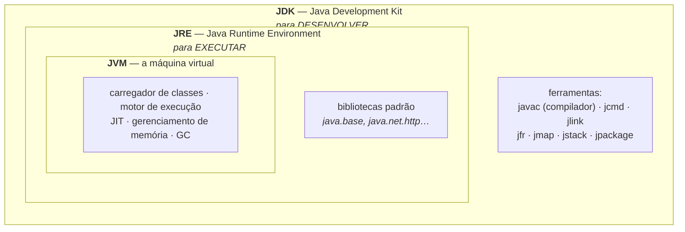
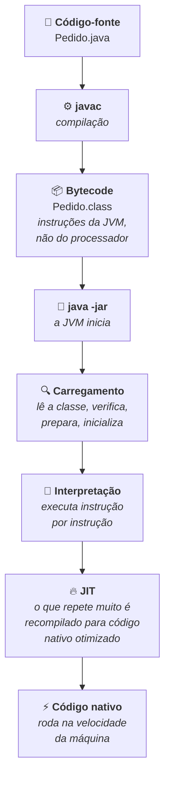
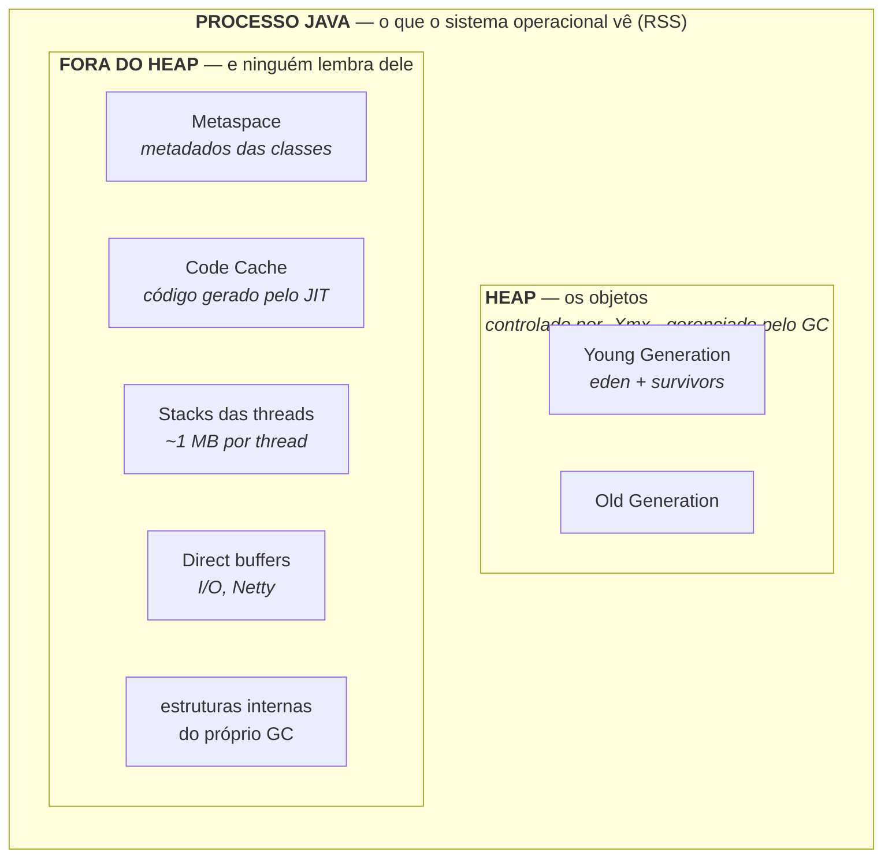
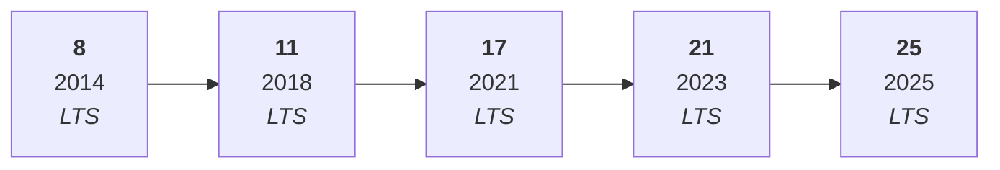

# JVM E PLATAFORMA JAVA

> **Capítulos:** [I - A JVM por dentro](i-a-jvm-por-dentro.md) · [II - Memória e Garbage Collector](ii-memoria-e-garbage-collector.md) · [III - Subir e operar em produção](iii-subir-e-operar-em-producao.md)

Esta matéria **não** é sobre a linguagem Java — não tem classe, `int` nem laço `for`. É sobre a **plataforma**: o que é a JVM, onde a memória de uma aplicação mora, quem a recolhe, o que de fato acontece entre `java -jar` e a primeira requisição atendida, e quais são as alavancas quando a aplicação está em produção consumindo mais do que devia.

É o degrau que fica **abaixo** de [SPRING E SPRING BOOT](../spring-e-spring-boot/README.md), [QUARKUS](../quarkus/README.md) e [DOCKER](../docker/README.md): os três falam de *boot*, memória e imagem de container supondo que a plataforma embaixo esteja entendida.

---

## 1. "Java" são três coisas diferentes

Quase toda confusão sobre a plataforma vem de usar uma palavra para três coisas:

| O que é | Nome correto | Exemplo do que pertence a isso |
|---|---|---|
| A **linguagem** | *Java Language Specification* | `class`, `record`, `sealed`, *pattern matching* |
| O **formato intermediário** e suas regras | *JVM Specification* + **bytecode** | o arquivo `.class`, as instruções da máquina virtual |
| A **plataforma de execução** | **JVM** + bibliotecas | memória, *garbage collector*, *threads*, JIT, carregamento de classes |

A separação entre linguagem e plataforma é o que permite que **Kotlin, Scala, Groovy e Clojure** rodem na JVM: eles geram o mesmo bytecode. E é o que permite que **a mesma aplicação** rode com coletores de lixo completamente diferentes sem recompilar — o assunto do [capítulo II](ii-memoria-e-garbage-collector.md).

> **Esta matéria trata da terceira linha.** As duas primeiras estão em [POO](../poo/README.md).

---

## 2. JDK × JRE × JVM

| Sigla | O que é | Quando você precisa |
|---|---|---|
| **JVM** | o **processo** que executa bytecode: carrega classes, compila, gerencia memória e threads | sempre — é o que roda |
| **JRE** | a JVM **mais** as bibliotecas padrão | para apenas executar uma aplicação |
| **JDK** | o JRE **mais** as ferramentas de desenvolvimento e diagnóstico | para compilar — e para **diagnosticar** em produção |

> **Detalhe que muda decisão de infraestrutura:** desde o **Java 11** o JRE **não é mais distribuído separadamente**. Hoje as opções são usar uma imagem `-jre` que a distribuição monta, ou gerar um *runtime* sob medida com **`jlink`**, contendo só os módulos que a sua aplicação usa. E há um argumento forte para levar o **JDK** para produção: sem `jcmd`, `jstack` e `jfr` dentro do container, diagnosticar um incidente fica muito mais difícil. → [III](iii-subir-e-operar-em-producao.md#4-empacotamento-e-imagem-de-container)

---

## 3. Do código-fonte ao processo em execução

| Etapa | Quem faz | Quando |
|---|---|---|
| Compilação | `javac` | **uma vez**, no build |
| Carregamento e verificação | a JVM (*class loader*) | a cada execução, **sob demanda** — classe só é carregada no primeiro uso |
| Interpretação | a JVM | nos primeiros milhares de execuções de cada método |
| Compilação JIT | a JVM (C1 e C2) | **em runtime**, nos trechos que se mostram quentes |

Dois pontos para fixar desde já, porque explicam muito do comportamento de uma aplicação Java:

- **O bytecode não é código de máquina.** Ele é portátil porque a JVM é quem traduz para a arquitetura real — o famoso *write once, run anywhere* mora aqui.
- **A JVM compila enquanto roda.** Ela começa lenta (interpretando), observa o próprio comportamento e vai otimizando com **dados reais de execução**. Por isso uma aplicação Java tem **aquecimento**: as primeiras requisições são mais lentas que as seguintes. → [I - JIT](i-a-jvm-por-dentro.md#4-o-motor-de-execução-interpretador--jit)

---

## 4. A anatomia de um processo Java

Esta é a figura que vale ter na cabeça — e a razão pela qual **`-Xmx` não é o consumo de memória da sua aplicação**:

| Área | Guarda | Quem a limita |
|---|---|---|
| **Heap** | todos os objetos que você cria | `-Xmx` — e **só ele** |
| **Metaspace** | metadados das classes carregadas | cresce conforme as classes; `-XX:MaxMetaspaceSize` |
| **Code Cache** | o código nativo produzido pelo JIT | `-XX:ReservedCodeCacheSize` |
| **Stacks** | a pilha de chamadas de **cada** thread | `-Xss` × número de threads |
| **Direct buffers** | memória fora do heap para I/O | `-XX:MaxDirectMemorySize` |

> 🔑 **A consequência operacional mais importante desta matéria:** o **RSS** — a memória que o sistema operacional (e a cota do pod) realmente cobra — é a **soma de tudo** acima, não só o heap. Um pod com limite de 512 MB e `-Xmx=512m` **vai** ser morto por OOM, porque o heap sozinho já ocupa o limite inteiro. → [II - RSS ≠ heap](ii-memoria-e-garbage-collector.md#2-por-que-rss--heap-e-por-que-isso-mata-pod)

---

## 5. Versões: o ciclo de seis meses e as LTS

Desde o **Java 9 (2017)**, o Java tem **uma versão nova a cada seis meses** — março e setembro. A maioria delas tem suporte curto; algumas são marcadas como **LTS** (*Long-Term Support*), com anos de correções.

As LTS são **8, 11, 17, 21 e 25**, e são elas que aparecem em produção. O que importa para infraestrutura em cada salto:

| Versão | O que ela trouxe de **plataforma** (não de linguagem) |
|---|---|
| **8** (2014) | fim do **PermGen**, que virou **Metaspace**; ainda é a versão mais comum em legado |
| **11** (2018) | fim do JRE separado; **JFR** e **JMC** abertos; *container awareness* consolidado; cliente HTTP nativo; ZGC experimental |
| **17** (2021) | **G1** maduro como padrão; ZGC pronto para produção; mudança de licença da Oracle; base mínima do Spring Boot 3 e do Quarkus 3 |
| **21** (2023) | 🔥 **threads virtuais** (a maior mudança de modelo de execução em 20 anos); **ZGC geracional**; melhorias de CDS |
| **25** (2025) | consolidação do **cache AOT** (Project Leyden) para cortar o tempo de inicialização; refinamentos nas threads virtuais |

> As versões intermediárias (22, 23, 24, 26…) existem e trazem recursos reais, mas poucas equipes as colocam em produção — o ciclo de suporte é curto. **Na prática, a escolha é entre LTS.** Consulte a documentação para o que entrou nas versões mais novas que a 25.

**O que de fato muda ao atualizar**, em ordem de impacto para infraestrutura: o **coletor de lixo** disponível (um salto de 8 para 17+ troca Parallel por G1 e abre ZGC), o **respeito aos limites do container** (antes do 10, a JVM ignorava o `cgroup` e tentava usar a memória da máquina inteira), o **tempo de inicialização** (CDS e cache AOT) e o **modelo de concorrência** (threads virtuais, no 21+).

---

## 6. Qual JDK baixar

Existe **uma** especificação e **várias** distribuições, todas construídas do mesmo código-fonte (OpenJDK):

| Distribuição | Quem mantém | Observação |
|---|---|---|
| **Eclipse Temurin** (Adoptium) | comunidade/Eclipse | a escolha neutra mais comum |
| **Amazon Corretto** | AWS | suporte longo, boa integração com AWS |
| **Azul Zulu** | Azul | tem builds com **CRaC**, para restauração rápida |
| **BellSoft Liberica** | BellSoft | imagens pequenas, também com CRaC |
| **Microsoft Build of OpenJDK** | Microsoft | foco em Azure |
| **Oracle JDK** | Oracle | **licença própria**, com janela de uso gratuito limitada — verifique antes de usar em produção |
| **GraalVM / Mandrel** | Oracle / Red Hat | o que compila **imagem nativa** → [QUARKUS](../quarkus/i-como-funciona.md#4-graalvm-mandrel-e-a-hipótese-do-mundo-fechado) |

Para a sua aplicação, **o comportamento é o mesmo**: o que varia é licença, suporte comercial, tamanho da imagem e recursos extras. A regra prática: use uma distribuição **gratuita do OpenJDK** (Temurin ou Corretto resolvem a maioria dos casos) e deixe o Oracle JDK para quando houver contrato.

---

## Capítulos

- [I - A JVM POR DENTRO](i-a-jvm-por-dentro.md) — a arquitetura em três subsistemas, carregamento de classes (os três carregadores e as três fases), bytecode como máquina de pilha, interpretador e **JIT** (C1, C2, *inlining*, desotimização), o **aquecimento**, **CDS** e o cache **AOT**, e as quatro formas de executar Java hoje
- [II - MEMÓRIA E GARBAGE COLLECTOR](ii-memoria-e-garbage-collector.md) — o mapa completo da memória, **por que RSS ≠ heap**, as gerações, como o GC decide o que é lixo (*GC roots* e alcançabilidade), os algoritmos, os **coletores** (Serial, Parallel, G1, ZGC, Shenandoah, Epsilon) com critério de escolha, *tuning* que importa, **JVM em container** e os tipos de `OutOfMemoryError`
- [III - SUBIR E OPERAR EM PRODUÇÃO](iii-subir-e-operar-em-producao.md) — o passo a passo de `java -jar`, *cold start* e as estratégias contra ele, **threads de plataforma × virtuais**, imagem de container, as flags mínimas de produção, observabilidade com **JFR** e `jcmd`, diagnóstico dos quatro incidentes clássicos, desligamento com SIGTERM e o checklist de Java no Kubernetes

---

## Perguntas para autoavaliação

1. Quais são as três coisas que a palavra "Java" nomeia? Por que a separação importa?
2. Como Kotlin e Scala rodam na JVM?
3. Diferencie JVM, JRE e JDK.
4. Por que não existe mais JRE separado desde o Java 11, e quais as duas alternativas?
5. Por que há um bom argumento para levar o JDK (e não só o JRE) para produção?
6. Descreva o caminho do código-fonte até o código nativo, dizendo quem faz cada etapa e quando.
7. Por que o bytecode é portátil?
8. Por que uma aplicação Java tem "aquecimento"?
9. Desenhe de memória: quais são as áreas de um processo Java, dentro e fora do heap?
10. O que `-Xmx` limita — e o que ele **não** limita?
11. Por que um pod com limite de 512 MB e `-Xmx=512m` é morto por OOM?
12. Qual é a cadência de versões do Java e quais são as LTS?
13. Cite, para cada LTS de 8 a 25, uma mudança de **plataforma** relevante.
14. Quais são as quatro mudanças de maior impacto para infraestrutura ao atualizar de Java 8 para 21?
15. Existe diferença de comportamento entre Temurin, Corretto e Oracle JDK? O que varia, então?

---

**Relacionados:** [SPRING E SPRING BOOT](../spring-e-spring-boot/README.md) · [QUARKUS](../quarkus/README.md) · [DOCKER](../docker/README.md) · [ARQUITETURA DISTRIBUÍDA](../arquitetura-distribuida/ii-latencia-e-performance.md) · [POO](../poo/README.md)
