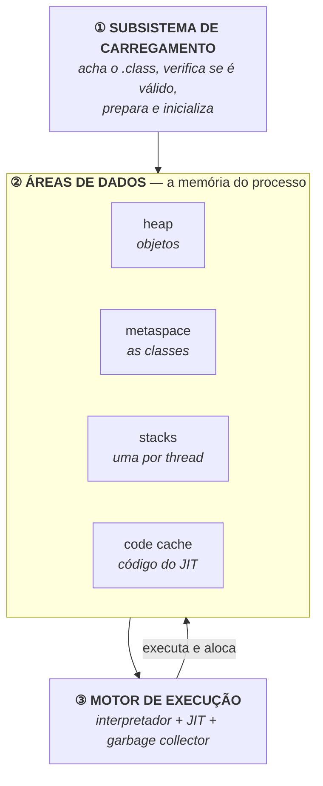
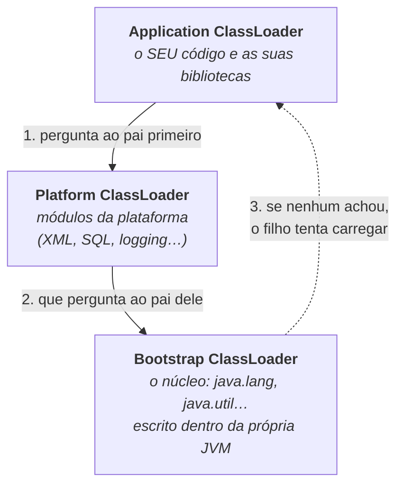
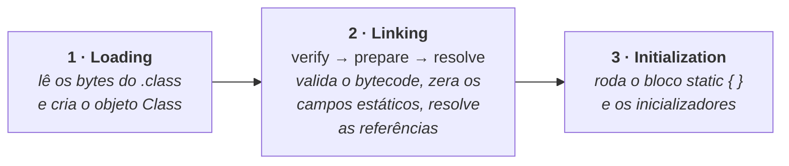
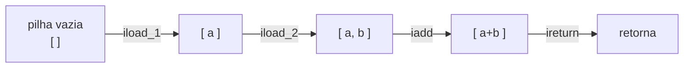
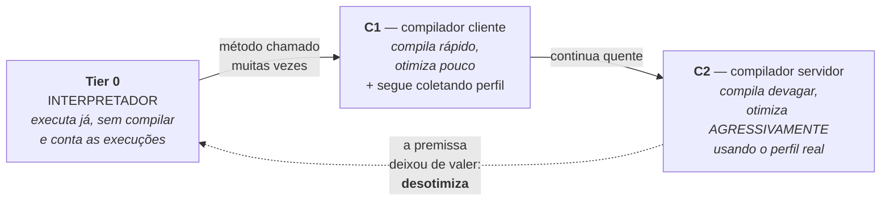
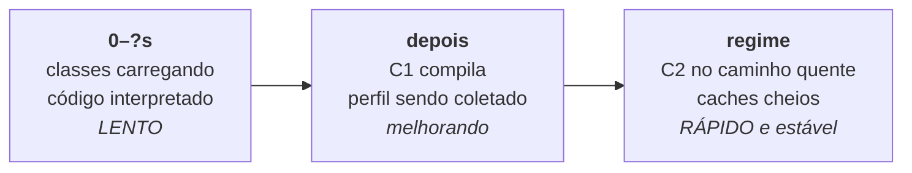

# I - A JVM POR DENTRO

> [← Voltar para JVM E PLATAFORMA JAVA](README.md) · Próximo: [II - MEMÓRIA E GARBAGE COLLECTOR](ii-memoria-e-garbage-collector.md)

## 1. A arquitetura em três subsistemas

A JVM é um programa comum, escrito em C++, que faz três coisas:



| Subsistema | Responsabilidade | Onde está detalhado |
|---|---|---|
| **Carregamento de classes** | transformar um arquivo `.class` em algo utilizável em memória | seção 2 |
| **Áreas de dados** | onde ficam objetos, metadados de classe, pilhas e código compilado | [capítulo II](ii-memoria-e-garbage-collector.md) |
| **Motor de execução** | executar o bytecode — interpretando, compilando e recolhendo o lixo | seções 3 a 5 |

---

## 2. Carregamento de classes

Uma classe só entra na memória **quando é usada pela primeira vez** — não no início da aplicação. Isso é *lazy loading* e é a razão pela qual uma aplicação grande continua carregando classes muito depois de ter subido.

### Os três carregadores



A regra é a **delegação ao pai primeiro**: antes de carregar qualquer coisa, o carregador pergunta ao seu pai. Isso existe por **segurança** — ninguém consegue substituir `java.lang.String` por uma versão própria colocando um JAR no classpath, porque o Bootstrap sempre responde primeiro.

| Erro | O que significa |
|---|---|
| `ClassNotFoundException` | pediram a classe **por nome em runtime** (reflexão) e nenhum carregador a achou |
| `NoClassDefFoundError` | a classe **existia na compilação** e não está no classpath agora — típico de dependência faltando no artefato |
| `NoSuchMethodError` | a classe está lá, mas com **outra versão**: assinatura mudou. É o sintoma clássico de conflito de versões de biblioteca |

> Essas três mensagens são a forma mais comum de "o inferno do classpath" aparecer. Todas apontam para o mesmo tipo de problema: **o que está no artefato não é o que a compilação viu**.

### As três fases



A fase de **verificação** é a que costuma surpreender: a JVM **não confia** no bytecode que recebe. Ela prova, antes de executar, que ele é estruturalmente seguro (não desempilha mais do que empilhou, não desvia para fora do método, respeita tipos). É por isso que não se corrompe a memória da JVM com um `.class` malformado — e é parte do custo de inicialização.

A fase de **inicialização** é onde o seu `static { }` roda: **uma única vez**, no primeiro uso real da classe. Fique com isso, porque é o mecanismo que o Quarkus explora para pré-computar estado no build. → [QUARKUS - static init](../quarkus/i-como-funciona.md#static-init--runtime-init-qual-é-o-critério)

---

## 3. Bytecode: uma máquina de pilha

A JVM não tem registradores como um processador: ela opera sobre uma **pilha de operandos**. Cada chamada de método cria um *frame* com sua própria pilha e suas variáveis locais.

Para este método:

```java
int soma(int a, int b) {
    return a + b;
}
```

O `javap -c` mostra o que o compilador gerou:

```
iload_1      // empilha a variável local 1 (o parâmetro 'a')
iload_2      // empilha a variável local 2 (o parâmetro 'b')
iadd         // retira dois inteiros, soma, empilha o resultado
ireturn      // retorna o inteiro do topo da pilha
```



Duas consequências práticas desse desenho:

- **O bytecode é simples e verificável** — daí ser possível provar sua segurança antes de executar, e daí qualquer linguagem conseguir gerá-lo.
- **Interpretar isso é lento.** Cada instrução dessas é um passo de um laço em C++ dentro da JVM. É exatamente o motivo de existir o JIT.

> `javap -c SuaClasse.class` é uma ferramenta de aprendizado excelente: mostra o que o compilador fez com o seu código. É assim que se descobre, por exemplo, que concatenar `String` em laço cria um objeto por iteração.

---

## 4. O motor de execução: interpretador + JIT

A JVM é **híbrida**. Ela começa interpretando (rápido para começar, lento para executar) e vai **compilando em runtime** o que se mostra quente (lento para começar, rápido para executar). Isso se chama **compilação em camadas** (*tiered compilation*).



| Camada | Característica |
|---|---|
| **Interpretador** | nenhuma espera; executa instrução por instrução; conta quantas vezes cada método roda |
| **C1** | compila em milissegundos, otimizações básicas. Bom para código que roda pouco |
| **C2** | compila devagar e gera o melhor código, guiado pelo **perfil de execução real** |
| **Desotimização** | se uma suposição se mostrar falsa, o código compilado é **descartado** e a execução volta para o interpretador |

**As otimizações que mais rendem** — e que explicam por que Java em regime é rápido:

| Otimização | O que faz |
|---|---|
| ***Inlining*** | substitui a chamada de um método pequeno pelo seu corpo. É a mais importante: elimina o custo da chamada e **abre caminho** para todas as outras |
| **Desvirtualização** | se, na prática, só uma implementação da interface aparece naquele ponto, o JIT chama direto — e pode fazer *inline*. É o que torna o custo do polimorfismo quase zero no caminho quente |
| ***Escape analysis*** | se um objeto nunca "escapa" do método, ele pode ser alocado na pilha ou dissolvido em variáveis — **sem passar pelo heap nem pelo GC** |
| **Eliminação de código morto e de verificações** | remove o que não tem efeito e verificações de limite que o JIT prova serem desnecessárias |
| **Desenrolar laços** e vetorização | menos saltos, uso de instruções SIMD do processador |

> **O ponto que pega quem vem de C:** o JIT usa **informação que um compilador estático não tem** — qual ramo do `if` acontece 99% das vezes, qual implementação realmente aparece, quais objetos nunca escapam. É por isso que Java em regime quente compete com linguagens compiladas, e por que [compilar AOT para nativo pode render menos throughput](../quarkus/i-como-funciona.md#5-jit--aot--por-que-o-nativo-pode-ser-mais-lento).

---

## 5. Aquecimento (*warmup*)

Junte as duas últimas seções e você tem o fenômeno mais característico de uma aplicação Java em produção:



<!--animacao: aquecimento-do-jit-->

| O que acontece durante o aquecimento | Efeito observável |
|---|---|
| Classes sendo carregadas e verificadas sob demanda | picos de latência em caminhos exercitados pela primeira vez |
| Código ainda interpretado | as primeiras requisições podem ser **ordens de grandeza** mais lentas |
| Pools de conexão e caches vazios | mais I/O por requisição |
| JIT recompilando e desotimizando | latência irregular até estabilizar |

**Como isso aparece — e morde — na prática:**

- **Deploy:** o pod novo entra no balanceador e recebe tráfego cheio ainda frio → picos de p99 em cada *rolling update*. A defesa é `readiness` honesto e *slow start* no balanceador. → [III](iii-subir-e-operar-em-producao.md#2-cold-start-e-warmup)
- **Autoescala:** a instância que subiu para atender o pico começa lenta exatamente quando é mais necessária.
- ***Benchmark* mal feito:** medir as primeiras iterações mede o aquecimento, não a aplicação. Por isso ferramentas de *microbenchmark* descartam as rodadas iniciais.
- **Função serverless:** o processo pode morrer antes de sequer aquecer — o cenário em que a JVM tradicional é mais penalizada. → [QUARKUS](../quarkus/README.md#6-onde-o-quarkus-é-usado)

---

## 6. CDS e o cache AOT: diminuir o custo de subir

Se parte do trabalho de inicialização é sempre igual, ele pode ser **gravado em disco** e reaproveitado. É a mesma ideia que o Quarkus aplica no build — aqui, feita pela própria JVM.

| Técnica | O que faz | Ganho típico |
|---|---|---|
| **CDS** (*Class Data Sharing*) | a JVM já vem com um arquivo pré-processado das classes do próprio JDK, mapeado direto na memória em vez de ser lido e verificado de novo | alguns pontos percentuais, **de graça** |
| **AppCDS** | o mesmo, **para as suas classes e bibliotecas**: você gera um arquivo em um treino da aplicação (`-XX:ArchiveClassesAtExit`) e passa a subir com ele (`-XX:SharedArchiveFile`) | redução perceptível do *startup*, na faixa de 10% a 30% |
| **Cache AOT** (Project Leyden, JDK 24+) | vai além: grava **classes já carregadas e ligadas** — e, nas evoluções do projeto, também perfis e código compilado | corta uma fatia maior da inicialização; a direção em que a plataforma está indo |
| **CRaC** | *Coordinated Restore at Checkpoint*: tira um **retrato do processo já aquecido** e o restaura em milissegundos. Exige JDK habilitado (Azul, Liberica) e suporte do framework | inicialização de dezenas de **milissegundos**, já aquecida |

```bash
# AppCDS em dois passos
java -XX:ArchiveClassesAtExit=app.jsa -jar app.jar     # 1. um treino, e saia
java -XX:SharedArchiveFile=app.jsa    -jar app.jar     # 2. produção usa o arquivo
```

> Repare no padrão: **CDS, cache AOT, CRaC e imagem nativa são quatro pontos da mesma régua** — "quanto do trabalho de inicialização eu consigo fazer antes de o processo subir?". O Quarkus respondeu "quase tudo, no build"; a plataforma Java está caminhando na mesma direção por outro caminho, sem abandonar o JIT.

---

## 7. Imagem nativa: o extremo oposto

Compilar **tudo** antes (AOT) e eliminar a JVM do artefato: é o que o GraalVM `native-image` faz. O resultado é um binário que sobe em dezenas de milissegundos e ocupa pouca memória, ao custo de perder o JIT, a reflexão livre e a portabilidade do bytecode.

O mecanismo, as restrições (hipótese do mundo fechado) e os *trade-offs* estão detalhados em [QUARKUS - GraalVM e o mundo fechado](../quarkus/i-como-funciona.md#4-graalvm-mandrel-e-a-hipótese-do-mundo-fechado) — vale ler de lá, porque é o mesmo assunto.

---

## 8. As quatro formas de executar Java hoje

| | **JVM padrão** | **JVM + CDS/AOT cache** | **CRaC** | **Imagem nativa** |
|---|---|---|---|---|
| Inicialização | segundos | segundos, porém menor | **milissegundos** | **milissegundos** |
| Já aquecido ao subir? | não | não | **sim** | não se aplica (não há JIT) |
| Throughput de pico | **o melhor** | o melhor | o melhor | menor |
| Memória | maior | maior | maior | **a menor** |
| Reflexão livre | **sim** | sim | sim | **não** — precisa registro |
| Custo de build | nenhum | um passo a mais | um passo a mais | **minutos e muita RAM** |
| Portabilidade do artefato | **qualquer SO/arquitetura** | idem | restrita | **um binário por plataforma** |
| Quando usar | serviço de vida longa | o mesmo, querendo deploy mais rápido | quando *cold start* importa e o nativo não é viável | serverless, CLI, jobs |

A leitura: **não existe "a forma certa"**. Existe a pergunta "este processo vive minutos ou semanas?" — e a resposta define a coluna.

---

## Perguntas para autoavaliação

1. Quais são os três subsistemas da JVM?
2. Quando uma classe é carregada? O que isso significa para uma aplicação grande?
3. Quais são os três carregadores e qual a regra de delegação? Por que ela existe?
4. Diferencie `ClassNotFoundException`, `NoClassDefFoundError` e `NoSuchMethodError`.
5. Quais são as três fases do carregamento?
6. Por que a JVM verifica o bytecode antes de executá-lo?
7. Quando o bloco `static { }` roda, e que framework explora isso?
8. Por que se diz que a JVM é uma máquina de pilha? Mostre a soma de dois inteiros em bytecode.
9. Por que interpretar bytecode é lento?
10. Explique a compilação em camadas: interpretador, C1 e C2.
11. O que é desotimização e por que ela é necessária?
12. Cite quatro otimizações do JIT e o que cada uma faz.
13. Por que *inlining* é considerada a mais importante?
14. O que é *escape analysis* e por que ela alivia o GC?
15. Que informação o JIT tem que um compilador estático não tem?
16. O que acontece durante o aquecimento, e como ele aparece em deploy, autoescala e benchmark?
17. O que são CDS e AppCDS? Como se gera um arquivo AppCDS?
18. O que o cache AOT do Project Leyden acrescenta ao CDS?
19. O que é CRaC e o que ele exige?
20. Por que CDS, cache AOT, CRaC e imagem nativa são "quatro pontos da mesma régua"?
21. Compare as quatro formas de executar Java em cinco critérios.

---

> [← Voltar para JVM E PLATAFORMA JAVA](README.md) · Próximo: [II - MEMÓRIA E GARBAGE COLLECTOR](ii-memoria-e-garbage-collector.md)
