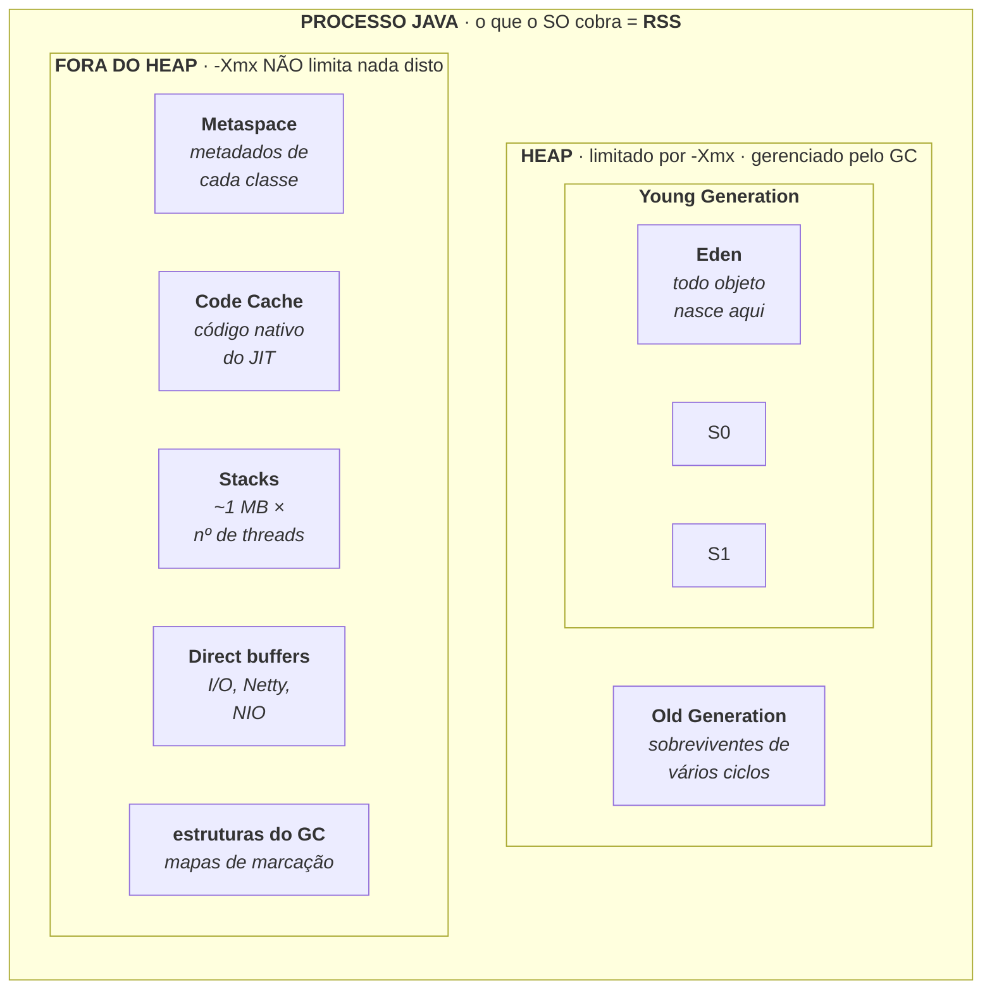
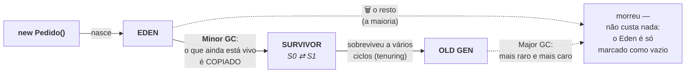
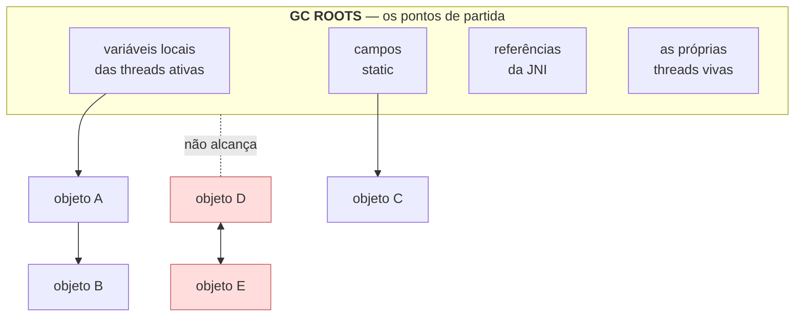
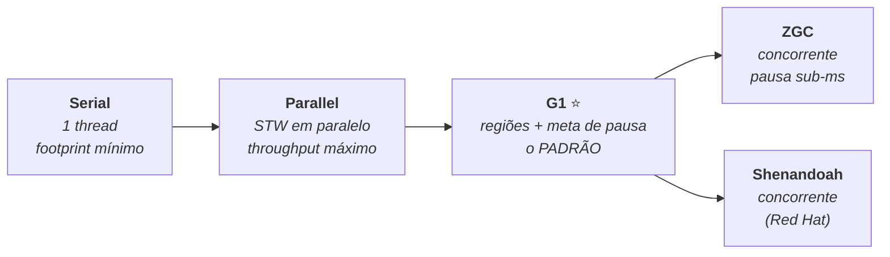
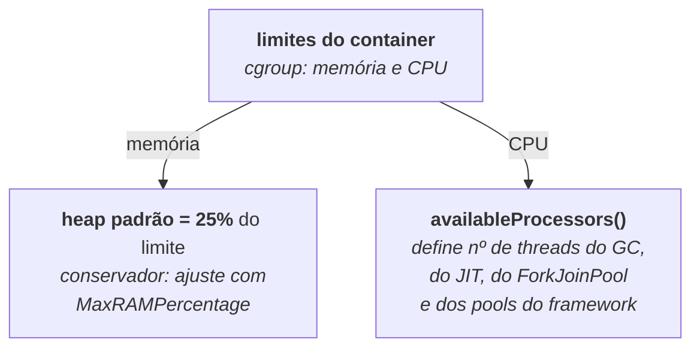

# II - MEMÓRIA E GARBAGE COLLECTOR

> [← Voltar para JVM E PLATAFORMA JAVA](README.md) · Anterior: [I - A JVM POR DENTRO](i-a-jvm-por-dentro.md) · Próximo: [III - SUBIR E OPERAR EM PRODUÇÃO](iii-subir-e-operar-em-producao.md)

## 1. O que é um garbage collector (e por que Java tem um)

Todo programa que cria coisas na memória precisa, em algum momento, **devolvê-la**. Memória é finita: se um programa aloca e nunca libera, ele cresce até morrer. A pergunta é **quem** faz essa devolução.

### Os dois modelos

Em linguagens como C e C++, **é você**: pede a memória (`malloc`) e a devolve (`free`). Explícito, previsível — e a origem de três das famílias de bug mais caras da história do software:

| Bug do modelo manual | O que é |
|---|---|
| ***Memory leak*** | você **esqueceu** de liberar. O programa cresce até ser morto |
| ***Double free*** | você liberou **duas vezes**. Corrompe as estruturas internas do alocador |
| ***Dangling pointer*** / *use-after-free* | você liberou e **continuou usando** o ponteiro. Lê lixo, escreve em cima de outra coisa, ou abre uma falha de segurança explorável |

Java faz a escolha oposta: **ninguém libera memória à mão.** Você cria objetos e simplesmente **para de usá-los**; um componente da JVM descobre quais não são mais alcançáveis e recupera o espaço. Esse componente é o **garbage collector**.

> 🔑 **O contrato do Java, em uma frase:** *você não libera memória — você para de referenciar. O resto é problema do GC.*

### O que se ganha e o que se paga

| ✅ Ganhos | ❌ Custos |
|---|---|
| as três famílias de bug acima **deixam de existir** | o GC consome **CPU** para descobrir o que é lixo |
| o código fica mais curto e mais simples | ele **pausa** a aplicação em certos momentos (as pausas *stop-the-world*) |
| segurança de memória por construção | precisa de **mais memória** do que o estritamente necessário para trabalhar bem |
| o programador pensa em domínio, não em ciclo de vida de ponteiro | o momento da coleta **não é determinístico**: você não controla *quando* acontece |

Esses três custos — CPU, pausa e memória extra — formam um triângulo em que **melhorar um piora outro**. É exatamente por isso que não existe "o" garbage collector do Java, e sim **vários**, cada um com um compromisso diferente entre eles. Escolher é o assunto da [seção 7](#7-os-coletores).

### Um mal-entendido que vale desfazer

| Afirmação comum | Correção |
|---|---|
| "O GC libera a memória do objeto quando ele sai de escopo" | não: ele libera **quando passar** e perceber que o objeto está inalcançável — pode ser muito depois, ou nunca, se o processo morrer antes |
| "Java não tem vazamento de memória" | tem, e é **mais sutil**: não é esquecer de liberar, é **manter alcançável** o que não se usa mais → [seção 5](#5-como-o-gc-decide-o-que-é-lixo) |
| "`System.gc()` força a coleta" | é apenas uma **sugestão**, que a JVM pode ignorar. Em produção, chamá-lo quase sempre piora as coisas |
| "Chamar o GC resolve consumo alto" | se a memória está alta porque os objetos estão **em uso**, não há nada a coletar |
| "Objeto `null` é coletado na hora" | atribuir `null` apenas remove **uma** referência. Se houver outra, o objeto continua vivo |

Com isso no lugar, o resto deste capítulo responde a quatro perguntas: **onde** essa memória está (seções 2 a 4), **como** o GC decide o que é lixo e com que algoritmos (seções 5 e 6), **quais** coletores existem e como escolher (seção 7) e **como** operar isso em produção (seções 8 a 11).

---

## 2. O mapa completo da memória



| Área | O que guarda | Como se limita | Quem a esvazia |
|---|---|---|---|
| **Heap** | todo objeto criado com `new` | `-Xmx` | o **garbage collector** |
| **Metaspace** | metadados das classes carregadas | `-XX:MaxMetaspaceSize` (padrão: ilimitado) | descarregamento de *class loader* |
| **Code Cache** | o código compilado pelo JIT | `-XX:ReservedCodeCacheSize` | o próprio JIT, ao desotimizar |
| **Stacks** | variáveis locais e a pilha de chamadas de cada thread | `-Xss` × nº de threads | a thread, ao terminar |
| **Direct buffers** | memória nativa para I/O | `-XX:MaxDirectMemorySize` | o GC, **indiretamente** |
| **Estruturas do GC** | o próprio contabilizador do coletor | implícito (proporcional ao heap) | — |

---

## 3. Por que RSS ≠ heap (e por que isso mata pod)

Esta é **a** seção prática da matéria. A conta que todo mundo erra:

```
RSS  =  heap  +  metaspace  +  code cache  +  (stacks × threads)
            +  direct buffers  +  estruturas do GC  +  a própria JVM
```

| Cenário | O que acontece |
|---|---|
| Pod com limite de **512 MB** e `-Xmx512m` | o heap sozinho pode chegar aos 512 MB; somando o resto, o processo passa do limite e o **kernel mata o container** |
| Pod com limite de **512 MB** e `-Xmx256m` | sobram ~256 MB para metaspace, code cache, stacks e JVM — margem razoável |

**A regra prática:** reserve ao **heap** algo entre **50% e 75%** do limite de memória do container, nunca 100%. E não confunda os dois modos de morrer:

| | `java.lang.OutOfMemoryError` | **OOMKilled** (código de saída **137**) |
|---|---|---|
| Quem mata | a **JVM**: "não consigo alocar no heap" | o **kernel/cgroup**: "o processo passou do limite do container" |
| Onde aparece | no log da aplicação, com *stack trace* | nos eventos do pod — **sem nada no log da aplicação** |
| Causa típica | heap pequeno para a carga, ou vazamento | `-Xmx` perto demais do limite, ou memória **fora** do heap crescendo |
| Como investigar | *heap dump* | somar as áreas: *native memory tracking*, nº de threads, *direct buffers* |

> **O sintoma mais confuso de produção:** o pod reinicia, e **não há nada** no log da aplicação. Isso praticamente sempre é OOMKilled — a aplicação não teve chance de registrar nada, porque foi o kernel que a encerrou. Se houver `OutOfMemoryError` no log, o problema é outro.

Para auditar a memória **fora** do heap:

```bash
java -XX:NativeMemoryTracking=summary -jar app.jar
jcmd <pid> VM.native_memory summary        # mostra cada área, somada
```

---

## 4. Dentro do heap: as gerações

O GC se apoia numa observação empírica, a **hipótese geracional**: *a maioria dos objetos morre jovem.* Um DTO de requisição vive milissegundos; um cache vive o processo inteiro. Varrer os dois com a mesma frequência é desperdício — então o heap é dividido.



| Conceito | O que é |
|---|---|
| **Eden** | onde todo objeto nasce. Alocar aqui é só avançar um ponteiro — **operação baríssima** |
| **Survivor (S0/S1)** | dois espaços que se alternam: a cada *minor GC*, os vivos são copiados de um para o outro |
| ***Minor GC*** | coleta **só** a young gen. Frequente e **curto** — custa proporcional ao que está **vivo**, não ao que morreu |
| **Promoção** (*tenuring*) | depois de sobreviver a N ciclos, o objeto é movido para a old gen |
| ***Major / Full GC*** | coleta a old gen (ou tudo). **Raro e caro** — é o que produz pausa perceptível |

**As duas consequências de projeto que mais importam:**

- **Objeto de vida curta é quase grátis.** Criar objetos pequenos e descartáveis dentro de um método não é problema de desempenho em Java moderno: eles morrem no Eden, e o custo do *minor GC* é proporcional aos **sobreviventes**. (Com [*escape analysis*](i-a-jvm-por-dentro.md#4-o-motor-de-execução-interpretador--jit), muitos nem chegam ao heap.)
- **Objeto de vida média é o pior caso.** O que sobrevive só o suficiente para ser promovido enche a old gen e provoca os ciclos caros. Cache mal dimensionado e sessão grande no servidor são os exemplos clássicos.

---

## 5. Como o GC decide o que é lixo

Não é contagem de referências (que vazaria em ciclos). É **alcançabilidade**: partindo de um conjunto de raízes, o GC marca tudo o que consegue alcançar. **O que não for alcançado é lixo** — não importa quantas referências aponte para ele.



No desenho, **D e E referenciam um ao outro** — e ainda assim são lixo, porque nenhuma raiz os alcança. Esse é o ganho da alcançabilidade sobre contagem de referências.

> **O que é um vazamento de memória em Java, então?** Não é "esquecer de liberar" — é **manter alcançável** algo que você não usa mais. Os suspeitos de sempre: coleção `static` que só cresce, cache sem política de expiração, *listener* registrado e nunca removido, `ThreadLocal` não limpo em pool de threads, e `ClassLoader` preso (o vazamento clássico de *redeploy* em servidor de aplicação).

---

## 6. Os algoritmos

Todo coletor combina três ou quatro operações básicas:

| Operação | O que faz | Custo |
|---|---|---|
| ***Mark*** | percorre o grafo a partir das raízes e marca os vivos | proporcional ao que está **vivo** |
| ***Sweep*** | libera o espaço dos não marcados | deixa **fragmentação** |
| ***Compact*** | move os vivos para juntos, eliminando buracos | caro, mas devolve alocação rápida |
| ***Copy*** | copia os vivos para outro espaço e declara o original vazio de uma vez | muito eficiente **quando pouca coisa sobrevive** → é o que a young gen usa |

E há o conceito que define a experiência do usuário:

> ***Stop-the-world* (STW):** o momento em que **todas** as threads da aplicação são paradas para o GC trabalhar em segurança. Toda pausa percebida é isto. A evolução dos coletores modernos é, em uma frase, **fazer cada vez mais trabalho concorrentemente** — com a aplicação rodando — e deixar as paradas cada vez mais curtas.

---

## 7. Os coletores



| Coletor | Flag | Como funciona | Use quando |
|---|---|---|---|
| **Serial** | `-XX:+UseSerialGC` | uma única thread, STW | container **pequeno** (1 CPU, pouca memória); é o que a JVM escolhe sozinha nesse caso |
| **Parallel** | `-XX:+UseParallelGC` | várias threads, mas **tudo em STW** | **lote/batch**: quando o que importa é terminar rápido e a pausa não incomoda |
| **G1** | `-XX:+UseG1GC` | divide o heap em **regiões**; marca concorrentemente e compacta aos poucos, tentando respeitar uma **meta de pausa** (`-XX:MaxGCPauseMillis`, padrão 200 ms) | **o padrão desde o Java 9** e a resposta certa para quase toda aplicação de servidor |
| **ZGC** | `-XX:+UseZGC` | quase tudo concorrente, com ponteiros marcados e barreiras de leitura. Pausas **abaixo de 1 ms, independentes do tamanho do heap** | latência é requisito duro, ou heap muito grande (dezenas de GB a TB) |
| **Shenandoah** | `-XX:+UseShenandoahGC` | compactação concorrente | mesmo caso do ZGC; disponível em distribuições que o incluem |
| **Epsilon** | `-XX:+UseEpsilonGC` | **não coleta nada** — quando o heap acaba, a aplicação morre | testes e medição de alocação. **Nunca** em produção |

**O critério de escolha, em três perguntas:**

| Pergunta | Resposta |
|---|---|
| É uma aplicação de servidor comum? | **G1** — não mexa |
| A pausa de GC viola o seu SLO de latência (p99)? | **ZGC** |
| É um *job* em lote, em que só o tempo total conta? | **Parallel** |

> ⚠️ **Antes de trocar de coletor, confirme que o problema é o GC.** Habilite o log, olhe a soma das pausas e a frequência dos ciclos. Na maioria dos incidentes atribuídos ao GC, a causa real é heap subdimensionado, vazamento, ou uma consulta que carrega 200 mil objetos de uma vez → [N+1](../spring-data-jpa/ii-consultas-e-performance.md#6-o-problema-n1--o-mais-importante-da-matéria). Trocar o coletor nesses casos só muda o formato do sintoma.

---

## 8. *Tuning*: as flags que importam

**A lista curta, que resolve 90% dos casos:**

```bash
java -XX:MaxRAMPercentage=70.0 \        # heap = 70% da memória DO CONTAINER
     -XX:+HeapDumpOnOutOfMemoryError \  # material para investigar
     -XX:HeapDumpPath=/dumps \
     -XX:+ExitOnOutOfMemoryError \      # morra para o orquestrador reiniciar
     -Xlog:gc*:file=/logs/gc.log:time,uptime:filecount=5,filesize=10M \
     -jar app.jar
```

| Flag | Para que serve |
|---|---|
| `-Xmx` / `-Xms` | máximo e inicial do heap. **Em container, iguale os dois**: evita o custo de o heap crescer aos poucos |
| `-XX:MaxRAMPercentage` | melhor que `-Xmx` em container: é **relativo** ao limite do pod, então sobrevive a mudanças de cota |
| `-XX:+HeapDumpOnOutOfMemoryError` | grava o *heap dump* no momento do erro. **Sem isso, a investigação morre** |
| `-XX:+ExitOnOutOfMemoryError` | encerra em vez de seguir agonizando — deixa o Kubernetes reiniciar o pod |
| `-Xlog:gc*` | o log de GC (unificado desde o Java 9). Ligue **em produção**: o custo é desprezível |
| `-XX:MaxGCPauseMillis` | a meta de pausa do G1. É uma **meta**, não uma garantia |
| `-Xss` | tamanho da pilha por thread. Só mexa com recursão profunda ou **muitas** threads |

**E o que não fazer:** copiar listas de flags de artigos antigos. Boa parte do "tuning de JVM" que circula na internet é de 2012, para coletores que **não existem mais** (CMS foi removido) e para uma JVM que não entendia container. Comece sem flag nenhuma além das acima, **meça**, e só depois ajuste uma coisa por vez.

---

## 9. JVM em container

Antes do **Java 10**, a JVM olhava a memória e a CPU **da máquina hospedeira** e ignorava o limite do container: num nó de 64 GB, ela dimensionava o heap como se tivesse 64 GB — e o pod morria. Hoje `-XX:+UseContainerSupport` é **padrão** e a JVM lê os limites do `cgroup`.



| Armadilha | O que acontece | Como evitar |
|---|---|---|
| **Heap padrão de 25%** | num pod de 1 GB, o heap fica com ~256 MB e a aplicação sofre GC sem parar, com 700 MB "sobrando" | `-XX:MaxRAMPercentage=70` |
| **`-Xmx` = limite do pod** | OOMKilled, porque o que está fora do heap não cabe | heap em 50–75% do limite |
| **Limite de CPU fracionário** (0.5) | a JVM vê **1** processador: GC serial, JIT lento, *pools* com uma thread. Pior: durante o GC, o container é **estrangulado** (*throttling*) e a pausa explode | dê **1 CPU ou mais** de limite; ou ajuste `-XX:ActiveProcessorCount` |
| **`request` muito menor que `limit`** | a aplicação aquece com CPU que depois não tem | aproxime os dois para aplicações sensíveis a latência |

> O princípio geral: **a JVM se autoconfigura a partir do que ela acha que tem.** Se você mentir para ela — dando meia CPU, ou um limite de memória que não cabe — ela toma decisões ruins com convicção. → [DOCKER](../docker/capitulo-v-orquestracao-de-containeres.md#5-boas-práticas-de-container-em-produção)

---

## 10. Os `OutOfMemoryError` e como ler cada um

A mensagem **depois** do `OutOfMemoryError:` é o diagnóstico — cada uma aponta para um lugar diferente:

| Mensagem | Significa | Primeira coisa a investigar |
|---|---|---|
| `Java heap space` | o heap encheu | é carga legítima (aumentar `-Xmx`) ou **vazamento**? Peça o *heap dump* |
| `GC overhead limit exceeded` | a JVM passou a maior parte do tempo coletando e recuperou quase nada | praticamente sempre **vazamento** ou heap muito pequeno |
| `Metaspace` | classes demais carregadas | geração dinâmica de classes, *redeploy* sem descarregar *class loader*, muitos proxies |
| `Direct buffer memory` | memória nativa de I/O esgotada | *buffers* de Netty/NIO não liberados; ajuste `-XX:MaxDirectMemorySize` |
| `unable to create native thread` | o SO recusou criar mais threads | **vazamento de threads** (pool criado em laço) ou limite do SO |
| `Requested array size exceeds VM limit` | alguém tentou alocar um array gigantesco | quase sempre um *bug* de cálculo de tamanho |

E o *dump* para investigar:

```bash
jcmd <pid> GC.heap_info                       # situação atual do heap
jcmd <pid> GC.class_histogram                 # o que mais ocupa, por classe
jcmd <pid> GC.heap_dump /dumps/heap.hprof     # dump para abrir no MAT/VisualVM
```

No *heap dump*, a pergunta não é "o que é grande" — é **"quem está segurando isto vivo?"**. As ferramentas chamam isso de *dominator tree* / caminho até as raízes, e é ela que aponta o `static Map` esquecido.

---

## 11. O log de GC e o que observar

```bash
-Xlog:gc*:file=/logs/gc.log:time,uptime,level,tags:filecount=5,filesize=10M
```

| O que olhar | Sinal de saúde | Sinal de problema |
|---|---|---|
| **Frequência dos ciclos** | *minor GC* de tempo em tempo | *minor GC* a cada poucos segundos → heap pequeno ou alocação excessiva |
| **Duração das pausas** | dezenas de ms no G1 | pausas de segundos → heap grande demais para o coletor, ou *swap* |
| **Heap após cada *full GC*** | volta a um patamar **estável** | sobe degrau por degrau, sempre → 🚩 **vazamento** |
| **Proporção de tempo em GC** | abaixo de ~5% | acima de 10% → investigue antes que vire `GC overhead limit` |
| **Promoções** | poucas | muita promoção → objetos de vida média; revise caches |

O padrão mais importante dessa tabela é o terceiro: **"o heap depois do full GC sobe e nunca volta"** é a assinatura de vazamento de memória, e ela aparece no log muito antes de o `OutOfMemoryError` acontecer.

---

## Checklist de memória para produção

- [ ] Heap em **50–75%** do limite de memória do container, via `MaxRAMPercentage`
- [ ] `-Xms` igual a `-Xmx` (em container)
- [ ] Limite de **CPU ≥ 1** para a JVM não cair no modo "máquina pequena"
- [ ] `HeapDumpOnOutOfMemoryError` ligado, com volume onde gravar
- [ ] `ExitOnOutOfMemoryError` ligado, para o orquestrador reiniciar
- [ ] Log de GC habilitado e **rotacionado**
- [ ] Métricas de heap, GC e threads no painel → [OBSERVABILIDADE](../arquitetura-distribuida/v-observabilidade.md#4-métricas)
- [ ] Alerta sobre **heap após full GC** crescente, não só sobre uso instantâneo
- [ ] Coletor **padrão (G1)**, até que uma medição justifique a troca

---

## Perguntas para autoavaliação

1. Por que todo programa precisa devolver memória em algum momento?
2. Quais são os dois modelos de gerenciamento de memória, e qual o Java escolheu?
3. Cite as três famílias de bug do modelo manual e explique cada uma.
4. Enuncie o contrato de memória do Java em uma frase.
5. Quais são os três custos de ter um garbage collector, e por que eles formam um triângulo?
6. Por que existe mais de um coletor no Java, e não apenas "o" GC?
7. Corrija: "o GC libera o objeto quando ele sai de escopo", "Java não tem vazamento de memória" e "`System.gc()` força a coleta".
8. Atribuir `null` a uma variável faz o objeto ser coletado? Por quê?
9. Desenhe o mapa de memória de um processo Java. O que está dentro e fora do heap?
10. Escreva a fórmula do RSS. Por que `-Xmx` não é o consumo da aplicação?
11. Por que um pod de 512 MB com `-Xmx512m` morre?
12. Diferencie `OutOfMemoryError` e OOMKilled: quem mata, onde aparece, como investigar.
13. O pod reinicia sem nada no log da aplicação. Qual a hipótese mais provável?
14. Como auditar a memória fora do heap?
15. Enuncie a hipótese geracional e diga como ela justifica a divisão do heap.
16. Explique Eden, Survivor, promoção, minor GC e full GC.
17. Por que objeto de vida curta é quase grátis e objeto de vida média é o pior caso?
18. Como o GC decide o que é lixo? Por que alcançabilidade é melhor que contagem de referências?
19. O que são GC roots? Cite quatro.
20. Dois objetos que se referenciam mutuamente são coletados? Por quê?
21. O que é um vazamento de memória em Java? Cite cinco causas clássicas.
22. Explique mark, sweep, compact e copy — e o custo de cada um.
23. O que é uma pausa stop-the-world e qual a direção da evolução dos coletores?
24. Compare Serial, Parallel, G1 e ZGC: como funcionam e quando usar.
25. Para que serve o Epsilon?
26. Quais as três perguntas que resolvem a escolha do coletor?
27. Por que "trocar o coletor" raramente é a correção certa?
28. Cite cinco flags que valem a pena e o que cada uma faz.
29. Por que `MaxRAMPercentage` é melhor que `-Xmx` em container?
30. O que mudou no Java 10 em relação a container, e o que acontecia antes?
31. Por que o heap padrão de 25% é um problema, e por que meia CPU é pior ainda?
32. Dê o diagnóstico inicial para cada uma das seis mensagens de `OutOfMemoryError`.
33. No heap dump, qual é a pergunta certa a fazer?
34. Quais cinco coisas observar no log de GC, e qual delas denuncia vazamento?
---

> [← Voltar para JVM E PLATAFORMA JAVA](README.md) · Anterior: [I - A JVM POR DENTRO](i-a-jvm-por-dentro.md) · Próximo: [III - SUBIR E OPERAR EM PRODUÇÃO](iii-subir-e-operar-em-producao.md)
