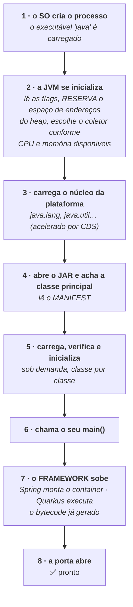
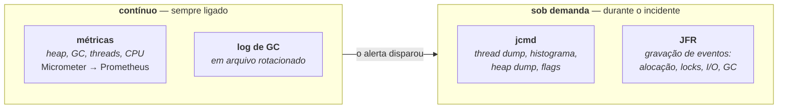
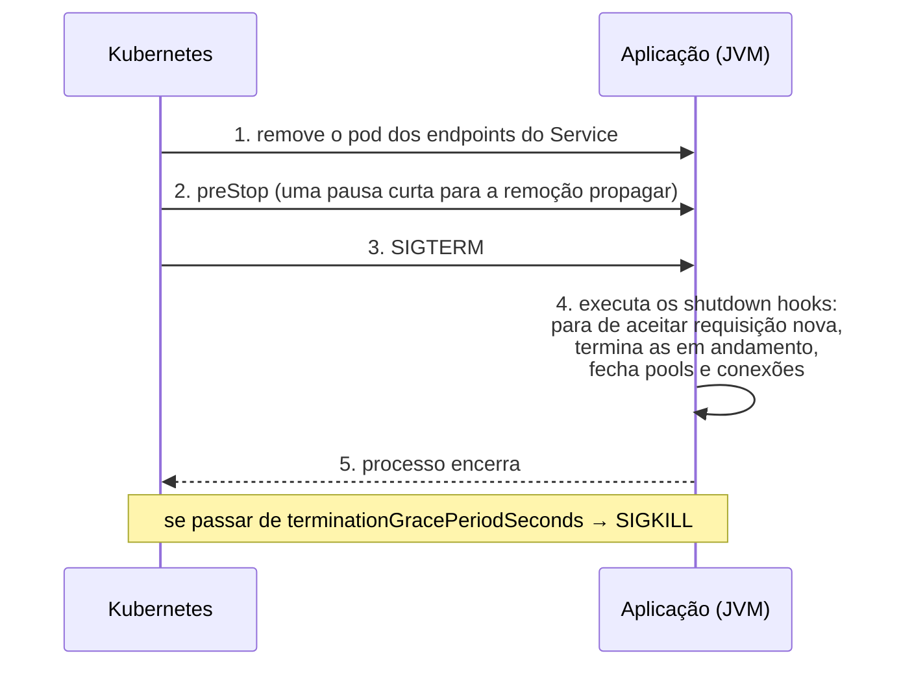

# III - SUBIR E OPERAR EM PRODUÇÃO

> [← Voltar para JVM E PLATAFORMA JAVA](README.md) · Anterior: [II - MEMÓRIA E GARBAGE COLLECTOR](ii-memoria-e-garbage-collector.md)

## 1. O que acontece em `java -jar app.jar`



| Etapa | Quem paga a conta | Dá para reduzir? |
|---|---|---|
| **2. Inicialização da JVM** | dezenas de ms | pouco — é o custo de existir |
| **3. Núcleo da plataforma** | ms | **sim**: o CDS do JDK já faz isso por padrão |
| **5. Suas classes** | de centenas de ms a segundos, conforme o tamanho | **sim**: AppCDS, cache AOT → [I](i-a-jvm-por-dentro.md#6-cds-e-o-cache-aot-diminuir-o-custo-de-subir) |
| **7. O framework** | **normalmente a maior fatia** | **sim**: é aqui que [Spring](../spring-e-spring-boot/README.md#6-como-uma-aplicação-spring-boot-sobe) e [Quarkus](../quarkus/README.md#3-a-ideia-central-build-time-augmentation) divergem |
| **Aquecimento** (depois do passo 8) | as primeiras requisições | **sim**: CRaC, nativo, ou aquecer antes de liberar tráfego |

Um detalhe do passo 2 que confunde muita gente: a JVM **reserva** o espaço de endereços do heap no início (é o que `-Xmx` diz), mas só **compromete** a memória conforme precisa. Por isso o RSS cresce depois de subir, mesmo sem mudança de carga.

---

## 2. *Cold start* e *warmup*

São dois problemas diferentes, e a confusão entre eles leva a soluções erradas:

| | ***Cold start*** | ***Warmup*** |
|---|---|---|
| O que é | o tempo até a aplicação **aceitar** a primeira requisição | o tempo até ela ficar **rápida** |
| Causa | inicialização da JVM + carregamento + montagem do framework | código ainda interpretado, caches e pools vazios |
| Remédios | CDS/AppCDS, cache AOT, CRaC, imagem nativa, menos classes | aquecer antes de receber tráfego; CRaC (restaura **já aquecido**); nativo (não tem JIT) |

**As estratégias, da mais simples à mais invasiva:**

| Estratégia | Como |
|---|---|
| **`startupProbe` no Kubernetes** | a resposta certa para boot lento: dá ao pod um prazo generoso para subir **sem** que o `livenessProbe` o mate no meio do caminho |
| ***Readiness* honesto** | só reporte pronto quando de fato puder atender. Metade dos picos de p99 em deploy vem de pod recebendo tráfego antes da hora → [Actuator](../spring-e-spring-boot/iii-spring-boot.md#6-actuator) |
| ***Slow start* no balanceador** | aumentar o peso do pod novo gradualmente, em vez de jogar 1/N do tráfego de uma vez |
| **Aquecer antes de liberar** | disparar algumas chamadas internas aos caminhos críticos durante o *startup* |
| **AppCDS / cache AOT** | reaproveitar o trabalho de carregamento entre execuções |
| **CRaC ou imagem nativa** | mudar de categoria: inicialização em milissegundos → [as quatro formas](i-a-jvm-por-dentro.md#8-as-quatro-formas-de-executar-java-hoje) |

> **Quando o processo vive minutos**, nada disso importa muito: use o modo padrão. **Quando ele vive segundos** (função serverless, job, CLI), o *cold start* é o custo dominante — e é a razão de existir do [Quarkus](../quarkus/README.md) e da imagem nativa.

---

## 3. Threads: plataforma × virtuais

A mudança mais importante da plataforma na última década, e ela é de **infraestrutura**, não de linguagem.

```mermaid
flowchart TB
    subgraph PL["<b>THREAD DE PLATAFORMA</b> — o modelo clássico"]
        direction TB
        T1["cada thread Java = <b>1 thread do SO</b>"]
        T2["~1 MB de pilha reservado"]
        T3["troca de contexto feita pelo <b>kernel</b>"]
        T4["limite prático:<br/><b>alguns milhares</b>"]
        T5["bloquear em I/O = <b>desperdiçar</b><br/>um recurso caro"]
    end
    subgraph VT["<b>THREAD VIRTUAL</b> — Java 21+"]
        direction TB
        V1["milhares de threads virtuais<br/>montadas sobre <b>poucas</b> do SO"]
        V2["pilha no heap, cresce sob demanda"]
        V3["troca de contexto feita pela <b>JVM</b>"]
        V4["limite prático:<br/><b>milhões</b>"]
        V5["ao bloquear em I/O, ela <b>desmonta</b><br/>e libera a thread do SO"]
    end
```



O problema que elas resolvem: no modelo clássico, uma aplicação web usa **uma thread por requisição**, e a thread passa a maior parte do tempo **parada** esperando banco ou outra API. Como thread do SO é caro, o pool é pequeno — e sob carga as requisições esperam por *thread*, não por recurso. A saída era programação reativa, que resolve o problema **ao custo de reescrever o código** em estilo assíncrono. → [modelo reativo](../quarkus/iii-quarkus-x-spring.md#5-modelo-de-execução-e-programação-reativa)

A thread virtual resolve o mesmo problema **mantendo o código imperativo**: você escreve bloqueante, e quando o código bloqueia, a JVM desmonta a thread virtual da thread do SO e aproveita essa para outra requisição.

| Ponto de atenção | Detalhe |
|---|---|
| **Não faça pool** | thread virtual é descartável: crie uma por tarefa. *Pool* de threads virtuais é um antipadrão |
| **Só ajuda em I/O** | para trabalho de **CPU**, não há ganho: a conta continua sendo o número de núcleos |
| ***Pinning*** | bloquear dentro de um bloco `synchronized` prendia a thread do SO (resolvido em versões recentes, a partir do JDK 24). Em versões anteriores, prefira `ReentrantLock` em trechos que bloqueiam |
| **O gargalo se desloca** | com 10 mil requisições simultâneas de verdade, o limite passa a ser o **pool de conexões do banco**. Threads virtuais não criam capacidade no banco — elas só param de esconder a fila |
| **`ThreadLocal`** | continua funcionando, mas com milhões de threads o custo de memória pesa |

```java
// uma thread virtual por tarefa — o executor fecha esperando todas
try (var executor = Executors.newVirtualThreadPerTaskExecutor()) {
    for (var pedido : pedidos) {
        executor.submit(() -> processar(pedido));   // bloquear aqui é BARATO
    }
}
```

Nos frameworks: `spring.threads.virtual.enabled=true` no [Spring Boot 3.2+](../spring-e-spring-boot/iii-spring-boot.md#9-o-que-mudou-no-spring-boot-3), e `@RunOnVirtualThread` no [Quarkus](../quarkus/i-como-funciona.md#7-o-modelo-de-threads-vertx-event-loop-e-mutiny).

---

## 4. Empacotamento e imagem de container

```dockerfile
# multi-stage: compila com JDK completo, roda com runtime enxuto
FROM eclipse-temurin:21-jdk AS build
WORKDIR /src
COPY . .
RUN ./mvnw -B package -DskipTests

FROM eclipse-temurin:21-jre
WORKDIR /app
COPY --from=build /src/target/app.jar app.jar
RUN useradd -r -u 1001 app && mkdir /dumps && chown -R app /app /dumps
USER 1001
ENV JAVA_TOOL_OPTIONS="-XX:MaxRAMPercentage=70 -XX:+HeapDumpOnOutOfMemoryError -XX:HeapDumpPath=/dumps"
ENTRYPOINT ["java", "-jar", "app.jar"]
```

| Decisão | Recomendação |
|---|---|
| **Imagem base** | uma imagem `-jre` da distribuição escolhida, ou *distroless*. Em **Alpine**, atenção: a `libc` é outra (musl) e há casos de incompatibilidade — só use se tiver testado |
| **JDK ou JRE em produção?** | JRE é menor; **JDK dá `jcmd`, `jstack` e `jfr` dentro do container**. Sem eles, diagnosticar incidente fica muito mais difícil. Um bom meio: JRE + ferramentas via *debug container* efêmero |
| **`jlink`** | gera um *runtime* sob medida, só com os módulos usados — imagem bem menor |
| **Camadas** | separe dependências do código da aplicação para aproveitar cache → [layered jar](../spring-e-spring-boot/iii-spring-boot.md#8-empacotamento) · [imagem em camadas](../docker/capitulo-i-introducao-ao-docker.md#4-imagem-em-camadas-e-copy-on-write) |
| **Usuário** | nunca `root` → [segurança de imagem](../docker/capitulo-ii-gerenciamento-de-containers.md#segurança-de-imagem) |
| **`JAVA_TOOL_OPTIONS`** | a JVM lê essa variável automaticamente: dá para injetar flags **sem** alterar o `ENTRYPOINT` |

---

## 5. As flags mínimas de produção

```bash
-XX:MaxRAMPercentage=70.0          # heap relativo ao limite do container
-XX:+HeapDumpOnOutOfMemoryError    # material para a investigação
-XX:HeapDumpPath=/dumps
-XX:+ExitOnOutOfMemoryError        # morra e deixe reiniciar
-Xlog:gc*:file=/logs/gc.log:time,uptime:filecount=5,filesize=10M
```

É isso. O detalhamento de cada uma e o que **não** copiar da internet estão em [II - tuning](ii-memoria-e-garbage-collector.md#7-tuning-as-flags-que-importam). Para auditar o que a JVM realmente decidiu:

```bash
java -XX:+PrintFlagsFinal -version | grep -iE 'heapsize|useg1|usez|processor'
jcmd <pid> VM.flags            # as flags em vigor no processo
jcmd <pid> VM.version          # qual JVM está rodando de fato
```

---

## 6. Observabilidade da JVM



| Ferramenta | Para que serve |
|---|---|
| **Micrometer / Actuator** | expõe `jvm.memory.used`, `jvm.gc.pause`, `jvm.threads.live`, `process.cpu.usage` → [OBSERVABILIDADE](../arquitetura-distribuida/v-observabilidade.md#4-métricas) |
| **`jcmd`** | o guarda-chuva moderno: `Thread.print`, `GC.heap_info`, `GC.class_histogram`, `GC.heap_dump`, `VM.native_memory`, `JFR.*` |
| **JFR** (*Java Flight Recorder*) | gravador de eventos **embutido no JDK**, com custo baixíssimo. Registra alocação, contenção de *lock*, I/O, pausas de GC e amostras de CPU |
| **JMC** (*Mission Control*) | abre e analisa o arquivo `.jfr` |
| **`kill -3 <pid>`** | imprime um *thread dump* na saída padrão **sem matar o processo** — o truque mais rápido para uma aplicação travada |

```bash
# JFR: gravar 60s do processo em execução
jcmd <pid> JFR.start name=diag settings=profile duration=60s filename=/dumps/diag.jfr

# ou desde o start, para pegar o problema que só acontece no início
java -XX:StartFlightRecording=duration=120s,filename=/dumps/boot.jfr,settings=profile -jar app.jar
```

> O JFR é a ferramenta mais subaproveitada do ecossistema: ele vem **de graça** no JDK, pode ficar ligado em produção e responde perguntas que métrica nenhuma responde ("qual linha de código alocou esses 3 GB?", "qual *lock* está serializando as requisições?").

---

## 7. Diagnóstico: os quatro incidentes clássicos

### a) CPU em 100%

```bash
top -H -p <pid>                       # qual THREAD está consumindo (não só o processo)
printf '%x\n' <tid>                   # converte o id da thread para hexadecimal
jcmd <pid> Thread.print > threads.txt # procure por nid=0x<hex> no dump
```

| Causa provável | Pista |
|---|---|
| Laço infinito ou regex catastrófico | a mesma pilha de aplicação em todos os *dumps* consecutivos |
| **GC em trabalho forçado** | as threads de CPU alta são as do GC → o problema é **memória**, não CPU |
| Serialização/criptografia em volume | aparece claramente no perfil do JFR |

### b) Latência alta ou irregular

Ordem de investigação: **log de GC** (as pausas explicam?) → **JFR** (contenção de *lock*? alocação excessiva?) → **pool de conexões** (as threads estão esperando conexão?) → **a dependência externa** (é latência de rede?). → [LATÊNCIA](../arquitetura-distribuida/ii-latencia-e-performance.md)

### c) Memória crescendo

Vá direto ao padrão de assinatura: **o heap após *full GC* sobe e nunca volta**. Confirme no log de GC, tire o *heap dump*, abra no MAT e procure **quem segura** os objetos vivos. → [II - vazamento](ii-memoria-e-garbage-collector.md#4-como-o-gc-decide-o-que-é-lixo)

### d) Aplicação travada (não responde)

```bash
jcmd <pid> Thread.print | grep -A5 -E 'BLOCKED|deadlock|WAITING'
```

| O que o *thread dump* mostra | Significa |
|---|---|
| `Found one Java-level deadlock` | duas threads esperando *locks* uma da outra. O *dump* nomeia as duas |
| Muitas threads `WAITING` em `getConnection` | **pool de conexões esgotado** — a causa mais comum de "a aplicação travou" |
| Threads `BLOCKED` no mesmo monitor | contenção: uma seção sincronizada virou gargalo |
| Threads de HTTP todas ocupadas | o pool de requisições acabou: alguma dependência está lenta e segurando todas |

> **Tire sempre três *thread dumps*, com ~10 segundos entre eles.** Um só mostra uma foto; três mostram **se a pilha mudou** — e é isso que diferencia "travado" de "lento".

---

## 8. Desligamento ordenado



| Item | O que fazer |
|---|---|
| **SIGTERM** | é o sinal que o Kubernetes manda. A JVM executa os *shutdown hooks*; `SIGKILL` **não** executa nada |
| **`server.shutdown=graceful`** | no Spring Boot, para de aceitar novas requisições e espera as em andamento → [III](../spring-e-spring-boot/iii-spring-boot.md#8-empacotamento) |
| **`terminationGracePeriodSeconds`** | precisa ser **maior** que o tempo da requisição mais longa (o padrão é 30 s) |
| **`preStop`** | uma pausa curta antes do SIGTERM evita o caso clássico: o pod recebe requisição **depois** de começar a desligar, porque a remoção do balanceador ainda não propagou |
| **PID 1** | o processo Java precisa **receber** o sinal. Se o `ENTRYPOINT` é um script de *shell* que não repassa, o SIGTERM se perde → [forma exec × shell](../docker/capitulo-ii-gerenciamento-de-containers.md#forma-exec--forma-shell--e-o-pid-1) |

---

## 9. Checklist de Java no Kubernetes

- [ ] `-XX:MaxRAMPercentage` entre **50 e 75**, nunca heap igual ao limite do pod
- [ ] Limite de **CPU ≥ 1** (meia CPU degrada GC e JIT, e provoca *throttling* na pausa)
- [ ] `requests` próximo de `limits` para serviço sensível a latência
- [ ] **`startupProbe`** para o boot lento, `readinessProbe` honesto, `livenessProbe` **barato** (não consultando banco)
- [ ] `terminationGracePeriodSeconds` maior que a requisição mais longa, com `preStop`
- [ ] Desligamento ordenado ligado na aplicação, e o Java como **PID 1** recebendo o sinal
- [ ] Heap dump habilitado, gravando em volume que **sobrevive** ao reinício do pod
- [ ] Log de GC ligado e rotacionado
- [ ] Métricas de JVM no painel, com alerta no **heap após full GC**
- [ ] Ferramentas de diagnóstico acessíveis (JDK na imagem ou *debug container*)
- [ ] Imagem com usuário não-root, em camadas, de uma distribuição mantida
- [ ] Versão do Java em uma **LTS** com suporte ativo

---

## Perguntas para autoavaliação

1. Descreva os oito passos de `java -jar app.jar`. Qual etapa costuma ser a maior?
2. Por que o RSS continua crescendo depois de a aplicação subir?
3. Diferencie *cold start* e *warmup*: causa e remédio de cada um.
4. Cite seis estratégias contra inicialização lenta, da mais simples à mais invasiva.
5. Para que serve o `startupProbe`, e que problema ele evita?
6. Compare thread de plataforma e thread virtual em cinco critérios.
7. Qual problema as threads virtuais resolvem, e qual era a solução anterior?
8. Por que não se faz *pool* de threads virtuais?
9. Por que elas não ajudam em trabalho de CPU?
10. O que é *pinning* e como contorná-lo nas versões anteriores ao JDK 24?
11. Com threads virtuais, para onde o gargalo se desloca?
12. JDK ou JRE na imagem de produção? Qual é o *trade-off*?
13. O que é `jlink` e que problema resolve?
14. Para que serve `JAVA_TOOL_OPTIONS`?
15. Quais são as cinco flags mínimas de produção?
16. Como auditar quais flags e qual coletor a JVM realmente escolheu?
17. Qual a diferença entre o que fica ligado sempre e o que se usa durante o incidente?
18. O que o JFR registra e por que ele é subaproveitado?
19. O que `kill -3` faz?
20. CPU em 100%: descreva o procedimento e as três causas possíveis.
21. Se as threads que consomem CPU são do GC, qual é o problema real?
22. Qual a ordem de investigação para latência irregular?
23. Qual a assinatura de um vazamento de memória?
24. Cite quatro coisas que um *thread dump* revela numa aplicação travada.
25. Por que tirar três *thread dumps* e não um?
26. Descreva a sequência de desligamento de um pod, do endpoint ao SIGKILL.
27. Por que o `ENTRYPOINT` em forma de shell pode impedir o desligamento ordenado?
28. Por que `livenessProbe` não deve consultar o banco?

---

> [← Voltar para JVM E PLATAFORMA JAVA](README.md) · Anterior: [II - MEMÓRIA E GARBAGE COLLECTOR](ii-memoria-e-garbage-collector.md)
