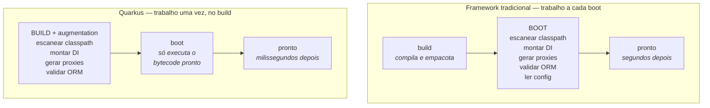
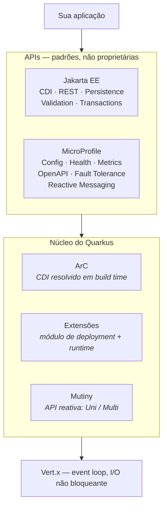

# QUARKUS

> **Capítulos:** [I - Como funciona](i-como-funciona.md) · [II - Quarkus na prática](ii-quarkus-na-pratica.md) · [III - Quarkus × Spring](iii-quarkus-x-spring.md)

**Quarkus** é um framework Java criado pela **Red Hat** (primeira versão em 2019) que se apresenta como *"a Kubernetes-native Java stack"* — uma pilha Java desenhada **para rodar em container**, não em servidor de aplicação.

A frase de marketing é *"Supersonic Subatomic Java"*, mas a ideia técnica por trás é uma só e vale memorizar:

> **Tudo o que um framework tradicional faz quando a aplicação sobe, o Quarkus faz quando a aplicação é compilada.**

Essa única decisão explica praticamente todo o resto: a inicialização em milissegundos, o consumo baixo de memória, a compatibilidade com imagem nativa, o modelo de extensões — e também as limitações dele.

---

## 1. O problema que o Quarkus resolve

A JVM foi projetada para um mundo em que a aplicação subia **uma vez**, numa máquina grande, e ficava no ar por meses. Nesse mundo, gastar 40 segundos no boot e 2 GB de heap era irrelevante: o JIT tinha tempo de aquecer e o throughput compensava tudo.

Container, Kubernetes e serverless mudaram a conta:

| O mundo para o qual a JVM foi feita | O mundo de container e Kubernetes |
|---|---|
| Um processo grande, de vida longa | **Muitos** processos pequenos, de vida curta |
| Sobe uma vez por release | Sobe a cada deploy, *scale-out*, *rollout*, *reschedule* do nó |
| Memória é do servidor | Memória é **cota do pod** — e o preço é por GB |
| Boot de 1 minuto não incomoda | Boot de 1 minuto **impede** autoescala reativa e *scale-to-zero* |
| Otimizar throughput de pico | Otimizar **densidade** (quantas instâncias cabem por nó) e **custo** |
| Reflexão e classpath dinâmico são grátis | Reflexão custa memória e **impede compilação nativa** |

O custo do modelo antigo está concentrado no **boot**: ler o classpath, escanear anotações, montar o grafo de dependências, construir proxies, validar o mapeamento ORM, processar configuração. Esse trabalho é **sempre o mesmo** a cada inicialização — e é exatamente ele que o Quarkus tira do caminho.

---

## 2. A ideia central: *build-time augmentation*

O Quarkus move o trabalho de inicialização para a **fase de compilação** (chamada de **augmentation**). O resultado do build não é só o seu código: é o seu código **mais o bytecode já gerado** com o grafo de injeção resolvido, os proxies criados e os metadados prontos.

Três consequências diretas:

1. **Sobe rápido mesmo na JVM comum.** O ganho de inicialização não depende de imagem nativa — vem de não repetir no boot um trabalho que já foi feito.
2. **Gasta menos memória.** Não há metadados de escaneamento, `BeanDefinition` nem cache de reflexão vivos no heap: o que sobreviveu virou bytecode.
3. **Fica compatível com compilação nativa.** O GraalVM exige saber **tudo em tempo de build** (*closed world*). Um framework que resolve tudo no build já atende a essa exigência por construção — daí o Quarkus ser nativo-*friendly* e o modelo tradicional não.

> **A pegadinha nº 1 da matéria:** o Quarkus **não** é rápido *porque* é nativo. Ele é rápido porque antecipa o trabalho para o build; a imagem nativa é um **segundo** ganho, opcional, empilhado sobre o primeiro. → [I - Como funciona](i-como-funciona.md)

O preço aparece no [capítulo I](i-como-funciona.md#8-o-preço-do-modelo): se as decisões são tomadas no build, **mudar de decisão exige rebuild**. Parte da configuração do Quarkus é *build-time* e não se altera por variável de ambiente.

---

## 3. Os dois modos de execução

O mesmo código-fonte produz dois artefatos diferentes, e essa escolha é de **deploy**, não de programação:

| | **Modo JVM** (`package`) | **Modo nativo** (`-Dnative`) |
|---|---|---|
| Artefato | JAR + JVM (HotSpot) | **executável** do sistema operacional |
| Como nasce | `./mvnw package` | `./mvnw package -Dnative` (GraalVM/Mandrel) |
| Inicialização | dezenas a centenas de ms | **poucos ms a algumas dezenas de ms** |
| Memória (RSS) | baixa | **a mais baixa das três opções** |
| Tempo de build | segundos | **minutos**, e exige muita RAM na máquina de build |
| JIT em runtime | **sim** — otimiza com o tempo | **não** — tudo foi compilado AOT |
| Throughput sustentado | **tende a ganhar** em carga longa | pode perder, por não ter JIT |
| Reflexão dinâmica | livre | precisa ser **registrada** no build |
| Imagem de container | precisa de JRE na imagem | binário em imagem mínima |

**A regra de escolha:** processo de **vida curta** ou que escala agressivamente (função serverless, job, CLI, pod que nasce e morre) → **nativo**. Serviço de **vida longa** sob carga constante → **modo JVM**, onde o JIT trabalha a seu favor.

> Os números divulgados pelo projeto (ordem de grandeza: **dezenas de MB** de RSS e **dezenas de ms** de boot no nativo, contra **centenas de MB** e **segundos** numa pilha tradicional) vêm de *benchmarks* do próprio fornecedor, em aplicações REST+CRUD simples. A ordem de grandeza se sustenta na prática; o número exato depende da sua aplicação — meça a sua. → [III - Quarkus × Spring](iii-quarkus-x-spring.md#3-inicialização-e-memória-os-números-e-o-que-eles-não-dizem)

---

## 4. O que ele é por dentro

O Quarkus não inventou um conjunto novo de APIs: ele **implementa padrões** já existentes do ecossistema Java corporativo, sobre um núcleo reativo.

| Peça | Papel |
|---|---|
| **Jakarta EE** | as anotações que você escreve: `@Inject`, `@Path`, `@Entity`, `@Transactional`, `@Valid` |
| **MicroProfile** | os padrões de microsserviço: configuração, *health check*, métricas, OpenAPI, tolerância a falhas |
| **SmallRye** | as implementações da Red Hat dessas especificações MicroProfile usadas pelo Quarkus |
| **ArC** | o container de injeção de dependência — CDI **resolvido no build**, sem escaneamento em runtime |
| **Extensões** | a unidade de integração: cada tecnologia (Hibernate, Kafka, Redis…) entra como extensão, com uma parte que roda no **build** e outra em **runtime** |
| **Vert.x** | o motor de I/O não bloqueante sob tudo — é o *event loop* que atende as requisições |
| **Mutiny** | a API reativa exposta ao desenvolvedor: `Uni` (0 ou 1 resultado) e `Multi` (vários) |

Isso tem um efeito prático importante: **o que você aprende em Quarkus é em boa parte padrão Jakarta/MicroProfile**, não API de um framework só. → [I - Como funciona](i-como-funciona.md)

---

## 5. Onde o Quarkus é usado

O denominador comum dos casos de uso é sempre o mesmo: **quando inicialização e memória viram custo ou requisito**.

| Cenário | Por que o Quarkus se encaixa |
|---|---|
| **Serverless / FaaS** (AWS Lambda, Azure Functions, Knative) | *cold start* é a métrica que manda; o nativo sobe em dezenas de ms. Permite *scale-to-zero* de verdade |
| **Microsserviços em Kubernetes** | mais pods por nó com a mesma cota de memória → **densidade** e custo menor de cluster |
| **Autoescala reativa** | um pod que sobe em 50 ms consegue responder ao pico; um que sobe em 40 s não |
| **Jobs, CronJobs e CLIs** | processo de vida curta: o boot era uma fração enorme do tempo total de execução |
| **Consumidores de mensageria** | Reactive Messaging (Kafka, AMQP, MQTT) sobre o núcleo reativo → [MENSAGERIA](../mensageria/README.md) |
| **Edge e IoT** | binário nativo pequeno, sem JVM, em hardware restrito |
| **Modernização de legado Java EE** | o código já usa CDI, JPA e JAX-RS; a migração é mais curta do que reescrever em Spring |
| **Ambiente Red Hat / OpenShift** | é o stack Java suportado comercialmente pela Red Hat, com integração pronta |

**Onde ele faz menos sentido:** monólito corporativo de vida longa que já roda bem; time inteiramente formado em Spring, sem demanda de custo ou *cold start*; projeto que depende de bibliotecas que só existem no ecossistema Spring (Spring Cloud, Spring Batch, Spring Integration); e qualquer caso em que **custo de inicialização simplesmente não é um problema** — aí o ganho não paga a curva de aprendizado.

> Entre os casos publicados pelo próprio projeto há empresas de telecomunicações, aviação e serviços financeiros relatando redução de consumo de memória e de custo de infraestrutura. Trate esses relatos como o que são: **estudos de caso do fornecedor** — úteis como indício, não como prova.

---

## 6. O que o Quarkus **NÃO** é

| Afirmação comum | Por que está errada |
|---|---|
| "É um Spring Boot mais rápido" | Não é uma reimplementação do Spring. As APIs são Jakarta EE + MicroProfile; o modelo de DI é CDI resolvido em build time |
| "Só vale a pena com imagem nativa" | O maior ganho é do *build-time augmentation*, que acontece também no modo JVM |
| "É rápido porque é nativo" | Invertido: é compatível com nativo **porque** resolve tudo no build |
| "É só para aplicação reativa" | O modelo imperativo é cidadão de primeira classe; o núcleo reativo fica embaixo, opcional para você |
| "As extensões `spring-*` rodam Spring dentro do Quarkus" | Elas traduzem um **subconjunto** de anotações Spring para o modelo do Quarkus. São ponte de migração, não runtime do Spring → [III](iii-quarkus-x-spring.md#7-as-extensões-de-compatibilidade-com-spring) |
| "Substitui o Spring no mercado" | O ecossistema, a comunidade e o mercado de trabalho do Spring são ordens de grandeza maiores |

---

## Capítulos

- [I - COMO FUNCIONA](i-como-funciona.md) — *build-time augmentation* em detalhe, ArC e CDI no build, anatomia de uma extensão, GraalVM e o mundo fechado, JIT × AOT, dev mode e live reload, modelo de threads (Vert.x e Mutiny) e o preço do modelo
- [II - QUARKUS NA PRÁTICA](ii-quarkus-na-pratica.md) — estrutura do projeto, Jakarta REST, CDI, configuração e perfis, Hibernate com Panache, transações, validação, mensageria, testes com `@QuarkusTest` e Dev Services, observabilidade e empacotamento para container
- [III - QUARKUS × SPRING](iii-quarkus-x-spring.md) — o comparativo ponto a ponto: injeção de dependência, tabela de-para das anotações, números de boot e memória, modelo reativo, testes, ecossistema e maturidade, extensões de compatibilidade, critério de escolha e roteiro de migração

---

## Perguntas para autoavaliação

1. Qual é a ideia central do Quarkus, em uma frase?
2. O que mudou no mundo de container e Kubernetes que tornou o custo de boot e de memória relevante?
3. Que trabalho um framework tradicional faz a cada inicialização, e onde o Quarkus o faz?
4. Por que o Quarkus sobe rápido **mesmo sem** imagem nativa?
5. Qual a relação entre *build-time augmentation* e a possibilidade de compilar nativo?
6. Compare modo JVM e modo nativo em cinco critérios.
7. Em que situação o modo JVM **ganha** do nativo? Por quê?
8. Que padrões o Quarkus implementa em vez de criar APIs próprias? Dê exemplos de cada.
9. O que são ArC, Mutiny e Vert.x no desenho do framework?
10. Cite quatro cenários em que o Quarkus se encaixa bem e dois em que não vale a pena.
11. Por que "é rápido porque é nativo" está invertido?
12. As extensões `quarkus-spring-*` rodam Spring dentro do Quarkus? O que elas fazem de fato?
13. Qual é o preço de tomar decisões em tempo de build?

---

**Relacionados:** [Spring MVC - APIs RESTful](../spring-mvc-apis-restful/README.md) · [SPRING DATA JPA](../spring-data-jpa/README.md) · [DOCKER](../docker/README.md) · [ARQUITETURA DISTRIBUÍDA](../arquitetura-distribuida/i-estilos-arquiteturais.md) · [MENSAGERIA](../mensageria/README.md)
