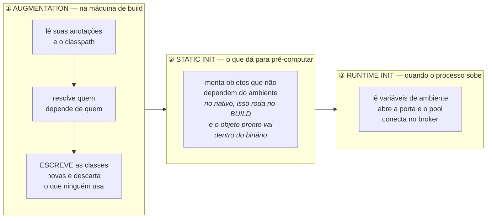
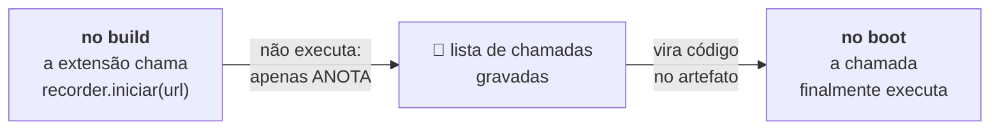
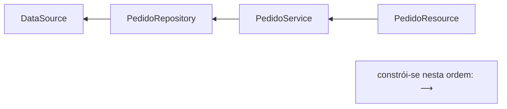
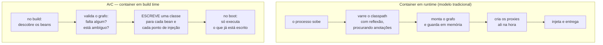
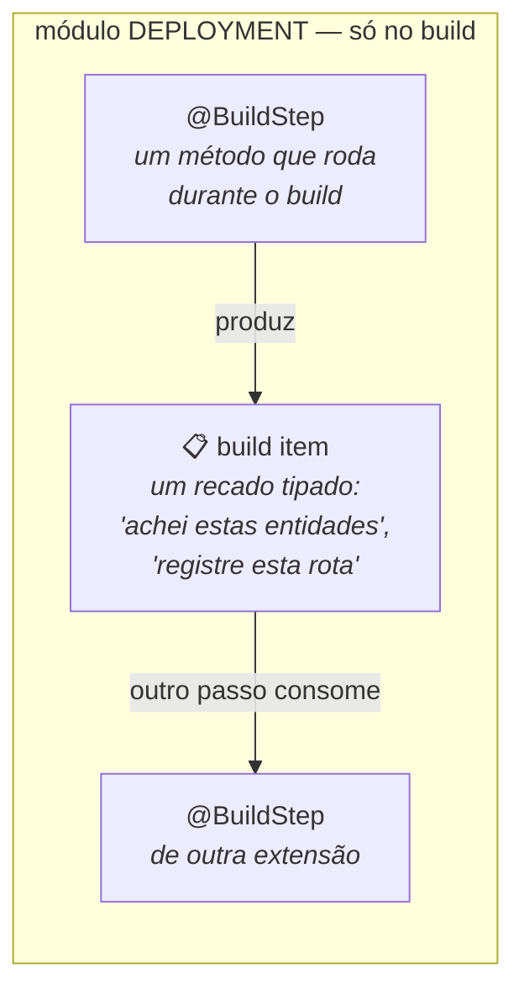
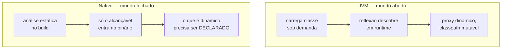
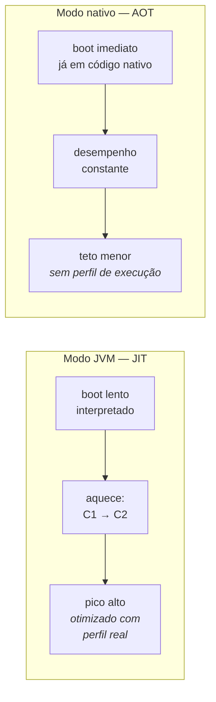
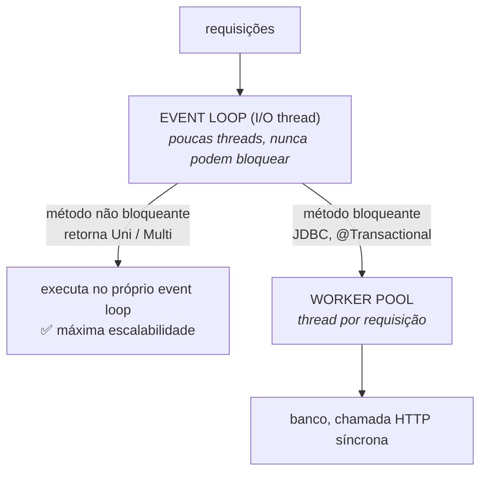

# I - COMO FUNCIONA

> [← Voltar para QUARKUS](README.md) · Próximo: [II - QUARKUS NA PRÁTICA](ii-quarkus-na-pratica.md)

## 1. As três fases: build, static init e runtime init

A palavra que o Quarkus usa para o que ele faz no build é ***augmentation*** — literalmente **aumentar**: ele pega o seu código compilado e o **acrescenta** de tudo aquilo que o framework normalmente montaria durante o boot. O resultado do build não é só o seu código: é o seu código **mais classes novas**, escritas pelo próprio Quarkus.

Antes das três fases, vale abrir a expressão que vai reaparecer o tempo todo.

### O que significa "gerar bytecode"

Você escreve `.java`; o compilador traduz para **bytecode** (`.class`), que é o que a JVM executa. → [fundamentos](README.md#o-vocabulário-mínimo)

"Gerar bytecode" significa que, durante o build, **o Quarkus escreve classes `.class` novas** — classes que ninguém digitou, montadas instrução por instrução por uma biblioteca de geração de código (no caso dele, a Gizmo). Para a JVM, elas são indistinguíveis de classes que você tivesse escrito à mão.

Um exemplo do que isso quer dizer na prática. Você escreve:

```java
@ApplicationScoped
public class PedidoService {
    @Inject PedidoRepository repository;      // "alguém me entregue um PedidoRepository"
}
```

Um framework tradicional resolve esse `@Inject` **no boot**: descobre por reflexão que o campo existe, procura quem sabe fabricar um `PedidoRepository`, e preenche o campo. Toda vez que a aplicação sobe.

O Quarkus resolve **no build** e escreve o equivalente a isto no artefato (nomes ilustrativos):

```java
// classe GERADA no build — você nunca vê esse arquivo
public class PedidoService_Bean {
    public PedidoService create() {
        PedidoService instancia = new PedidoService();
        instancia.repository = PedidoRepository_Bean.get();   // já sabe quem é, sem procurar
        return instancia;
    }
}
```

Não há mais nada a descobrir no boot: existe uma classe pronta que **chama o construtor e preenche o campo**. A busca, a reflexão e a dúvida foram resolvidas uma vez, na sua máquina de build. É isso — repetido para cada bean, cada rota, cada entidade — que o Quarkus faz de diferente.

O mesmo vale para a palavra **proxy**: é uma classe "embrulho", gerada automaticamente, que fica **no lugar** da sua e executa algo em volta do seu método (abrir e fechar transação, verificar permissão, consultar cache) antes de delegar para o seu código. → [padrão Proxy](../design-patterns-em-oo/ii-padroes-estruturais.md#7-proxy) O framework tradicional cria esse embrulho no boot; o Quarkus o escreve no build.

### As três fases

Com isso claro: o Quarkus divide em **três momentos** o que um framework tradicional faz em um só (o boot).



| Fase | Quando roda | O que pertence a ela |
|---|---|---|
| **Augmentation** | no **build**, na sua máquina ou no servidor de CI | ler o classpath e as anotações, resolver a injeção de dependência, escrever as classes geradas e os proxies, validar o mapeamento das entidades |
| **Static init** | na **inicialização das classes geradas**; no modo nativo, isso acontece durante o **build** | objetos que dão sempre o mesmo resultado: o metamodelo do Hibernate, a tabela de rotas REST, os conversores de JSON |
| **Runtime init** | a **cada** vez que o processo sobe | tudo o que só existe no ambiente: variáveis de ambiente, segredos, abrir porta TCP, criar o pool de conexões, conectar no Kafka |

### Static init × runtime init: qual é o critério

A separação entre as duas últimas fases responde a uma pergunta só: **isto dá o mesmo resultado em qualquer máquina, ou depende de onde a aplicação está rodando?**

| | **Static init** | **Runtime init** |
|---|---|---|
| Critério | o resultado não depende do ambiente | **depende** do ambiente |
| Exemplos | "quais são as rotas da API", "como esta entidade mapeia para a tabela" | "qual é a senha do banco", "qual porta escutar", "abrir a conexão" |
| No modo JVM | roda no **boot**, muito rápido (só executa o bytecode) | roda no **boot** |
| No modo nativo | roda no **build** — e o objeto já montado é **gravado dentro do binário** | roda no **boot** |

Dois termos dessa tabela merecem tradução:

- ***Static init*** vem do Java: toda classe pode ter um bloco `static { ... }` que roda **uma única vez**, quando a classe é usada pela primeira vez. O Quarkus põe nesse bloco o código gerado que monta a aplicação.
- **"Gravado dentro do binário"**: no modo nativo, o objeto é construído na máquina de build e seu estado é **serializado para dentro do executável**. Quando o binário sobe, o objeto não é criado — ele já **está lá**, pronto, como um dado do arquivo. É o limite do modelo: trabalho zero no boot.

### O *bytecode recorder* — a ponte entre as duas pontas

Falta um problema a resolver: a extensão roda no **build**, mas precisa que certas coisas aconteçam no **boot**. Como é que um código que já terminou de executar manda outro executar depois?

A resposta é o **bytecode recorder**, e a analogia é a de **gravar uma macro**. Durante o build, as chamadas que a extensão faz a um objeto marcado como `@Recorder` **não são executadas**: elas são **anotadas numa lista** ("chame `iniciar("jdbc://...")`"). No fim do build, essa lista é convertida em bytecode — e é esse bytecode que executa no static ou no runtime init.



É assim que uma decisão tomada no build "vira código" no artefato final — o mecanismo que permite ao Quarkus decidir cedo sem perder a capacidade de agir tarde.

> **Por que isso importa para você:** se o Hibernate valida o mapeamento das entidades durante o build, uma `@Column` escrita errado **quebra a compilação** — e não a inicialização em produção, às três da manhã. Boa parte do que no Spring é erro de boot, no Quarkus é erro de build.

---

## 2. ArC — o container de injeção resolvido no build

Três palavras antes de qualquer coisa, porque elas se repetem em toda a documentação do Quarkus:

| Termo | O que é |
|---|---|
| **Bean** | qualquer objeto cuja criação **não é sua**: você não dá `new`, o framework cria, guarda e entrega quando alguém pede. Um `PedidoService` anotado é um bean |
| **Container de injeção de dependência** | o componente que **fabrica** esses objetos e os **entrega** a quem declarou precisar deles. É quem responde ao `@Inject` |
| **CDI** | *Contexts and Dependency Injection*: a **especificação padrão** do Jakarta EE para isso. O Spring tem o seu container próprio; o Quarkus implementa o padrão CDI |

**ArC** é o nome do container do Quarkus: uma implementação de CDI que faz **no build** o que os outros fazem no boot.

### O que é "o grafo de dependências"

A tarefa do container é resolver uma cadeia. Se `PedidoResource` precisa de `PedidoService`, que precisa de `PedidoRepository`, que precisa de `DataSource`, então existe uma **ordem obrigatória de construção**: o `DataSource` primeiro, o `PedidoResource` por último. Esse mapa de "quem precisa de quem" é o **grafo de dependências**, e montá-lo é o trabalho central do container.



A diferença entre os dois modelos é **quando** esse grafo é montado:



| | CDI/Spring em runtime | ArC em build time |
|---|---|---|
| Descoberta dos beans | varrendo o classpath no boot | **no build** |
| Dependência faltando ou ambígua | o erro aparece no **start** da aplicação | o erro aparece na **compilação** |
| Reflexão | é o mecanismo central | quase eliminada |
| Metadados na memória | o catálogo de beans e os caches de reflexão ficam vivos no *heap* | **nada** — virou classe gerada |
| Bean declarado e nunca injetado | é construído e fica ocupando lugar no container | é **removido do artefato** |

A última linha é uma pegadinha prática. Esse descarte se chama *dead code elimination* — "eliminação de código morto": se o Quarkus não vê **ninguém** pedindo aquele bean, ele conclui que é peso morto e o deixa fora. O problema é quando o bean **é** usado, mas de um jeito que a análise não vê (por nome, por reflexão, por uma biblioteca externa) — nesse caso ele desaparece e a aplicação falha. É para isso que existe a anotação `@Unremovable`: "não tire este, mesmo que pareça inútil".

### Declarando um bean

O vocabulário é o do CDI, não o do Spring:

```java
@ApplicationScoped                      // ~ @Service/@Component singleton do Spring
public class CobrancaService {

    @Inject                             // ~ @Autowired
    ClienteRepository repository;        // injeção em campo package-private é idiomática aqui

    private final Gateway gateway;

    @Inject                             // injeção por construtor: a forma preferida
    public CobrancaService(Gateway gateway) {
        this.gateway = gateway;
    }
}
```

A anotação de **escopo** (`@ApplicationScoped` acima) é o que responde a duas perguntas: **quantas instâncias** desse objeto existem e **por quanto tempo** cada uma vive.

| Escopo CDI | Quantas instâncias | Observação |
|---|---|---|
| `@ApplicationScoped` | **uma** para toda a aplicação | criada **sob demanda** — no primeiro uso, não no boot. Para isso, o que é injetado é um **proxy** que só constrói o objeto real quando alguém o chama (*lazy*). É o escopo padrão do dia a dia |
| `@Singleton` | **uma** para toda a aplicação | **sem proxy**: um pouco mais rápido, mas criada de imediato e sem o comportamento *lazy* |
| `@RequestScoped` | **uma por requisição** HTTP | morre quando a requisição termina. Para guardar dados do usuário da chamada atual |
| `@Dependent` | **uma por lugar que pede** | cada ponto de injeção recebe a sua. É o escopo assumido quando você não anota nada |

> **Ponto de injeção** é só o nome do lugar onde um objeto é pedido: um campo com `@Inject`, um parâmetro de construtor. Dez classes que injetam `CobrancaService` são dez pontos de injeção para um mesmo bean.

---

## 3. Anatomia de uma extensão

**Extensão** é a unidade de integração do Quarkus: a forma como cada tecnologia (banco, fila, cache, cliente HTTP) entra na aplicação — `quarkus-hibernate-orm`, `quarkus-rest`, `quarkus-messaging-kafka`, `quarkus-redis-client`.

Uma extensão não é uma biblioteca comum: ela são **dois módulos** — dois JARs separados — e essa divisão é a materialização de tudo o que foi dito até aqui.

| Módulo | Roda | Contém | Vai para o artefato final? |
|---|---|---|---|
| **deployment** | só no **build** | o código que lê as suas anotações, decide o que ligar e **escreve as classes geradas** | **não** — cumpriu o papel no build e fica para trás |
| **runtime** | no **processo**, de verdade | as classes que realmente executam quando a aplicação está no ar | **sim** |

Essa é a razão pela qual as extensões do Quarkus são leves em produção: **metade do código da extensão nunca é embarcada**. O trabalho de decidir fica na máquina de build; só o resultado viaja.

### As duas peças do módulo de deployment



- **`@BuildStep`** é um **método que roda durante o build**. Nada mais: um método comum, executado pelo Quarkus na augmentation em vez de em runtime.
- **Build item** é a forma como esses métodos **conversam entre si**: um recado tipado que um passo produz e outro consome ("estas são as classes com `@Entity`", "registre esta rota", "esta classe precisa de reflexão no nativo"). O Quarkus lê quem produz e quem consome o quê e **descobre sozinho a ordem** de executar os passos.

```java
// módulo deployment — este código NÃO vai para o artefato final
public class MinhaExtensaoProcessor {

    @BuildStep                                   // roda durante o build
    FeatureBuildItem feature() {
        return new FeatureBuildItem("minha-extensao");   // recado: "esta extensão está ativa"
    }

    @BuildStep
    @Record(ExecutionTime.RUNTIME_INIT)          // o que este método "chamar" vira código do boot
    void configurar(MinhaExtensaoRecorder recorder, MinhaConfig config) {
        recorder.iniciar(config.url());          // NÃO executa agora — é gravado (ver seção 1)
    }
}
```

Lendo a segunda linha com o vocabulário já montado: o método roda no build; a chamada `recorder.iniciar(...)` é **gravada** em vez de executada; e o `@Record(RUNTIME_INIT)` diz em que momento essa chamada gravada deve rodar — quando o processo subir.

É por isso que **"existe extensão para isso?" é a pergunta decisiva** ao avaliar o Quarkus num projeto. Uma biblioteca Java qualquer continua funcionando no modo JVM — ela é só um JAR no classpath. Mas sem extensão ela fica **fora do modelo**: não participa da augmentation, não tem configuração integrada, não aparece no *dev mode* e, no modo nativo, provavelmente vai exigir registro manual de reflexão. → [seção 4](#4-graalvm-mandrel-e-a-hipótese-do-mundo-fechado)

---

## 4. GraalVM, Mandrel e a hipótese do mundo fechado

A compilação nativa usa o **`native-image`** do GraalVM — na prática, quase sempre pela distribuição **Mandrel**, a versão da Red Hat do GraalVM voltada a `native-image` para Quarkus.

O `native-image` faz uma **análise estática de alcançabilidade** a partir dos pontos de entrada: tudo que é alcançável vai para o binário, o resto é descartado. Daí a regra que domina o modo nativo:

> **Hipótese do mundo fechado (*closed world*): tudo o que a aplicação vai usar precisa ser conhecido em tempo de build. O que o analisador não consegue ver, não existe em runtime.**



O que quebra no nativo, e como se resolve:

| Recurso dinâmico | Por que quebra | Solução |
|---|---|---|
| **Reflexão** (`Class.forName`, ler campos por nome) | o analisador não vê o uso | `@RegisterForReflection` ou arquivo de configuração de reflexão |
| **Proxy dinâmico** (JDK `Proxy`) | a classe é criada em runtime | registro explícito no build |
| **Recursos** (arquivos em `resources`) | não são código, não são alcançáveis | registrar o padrão de inclusão |
| **Serialização / bibliotecas que geram bytecode** | geração em runtime não existe | extensão que faça o equivalente no build |
| **Agente Java, JMX, instrumentação em runtime** | dependem de um mundo aberto | não há equivalente direto |

**A boa notícia:** para tudo que entra por **extensão**, esse registro já foi feito pela própria extensão. O problema aparece quando você usa uma biblioteca de terceiros sem extensão — e aí o erro típico só aparece **no binário nativo**, não no modo JVM, o que exige rodar os testes de integração também contra o artefato nativo. → [II - Testes](ii-quarkus-na-pratica.md#8-testes)

---

## 5. JIT × AOT — por que o nativo pode ser mais lento

Essa é a parte que mais gera erro de interpretação. A JVM compila **em runtime** (JIT): ela observa a execução, descobre quais caminhos são quentes e recompila esse código com otimizações agressivas, usando o perfil **real** da sua carga. O `native-image` compila **antes** (AOT), sem nunca ter visto a execução.



| Critério | JIT (modo JVM) | AOT (nativo) |
|---|---|---|
| Primeira requisição | lenta (interpretada) | **rápida** |
| Depois do aquecimento | **throughput maior** | constante, geralmente menor |
| Memória | maior (JIT, metaspace, perfis) | **menor** |
| Otimização por perfil de execução | nativa e automática | só com PGO, disponível em parte das distribuições |
| Coletor de lixo | HotSpot completo (G1, ZGC…) | coletor mais simples por padrão |

**A síntese:** nativo troca **throughput de pico** por **tempo de início e footprint**. Se o processo vive minutos, o nativo ganha fácil. Se vive semanas sob carga alta, a JVM provavelmente ganha. É uma decisão de perfil de carga — não de modernidade.

---

## 6. Dev mode — o que mais impressiona na prática

```bash
./mvnw quarkus:dev
```

Quatro coisas acontecem a partir desse comando:

| Recurso | O que faz |
|---|---|
| **Live reload** | ao salvar um arquivo, a aplicação é **reconstruída e recarregada no próximo request** — sem reiniciar o processo e sem comando nenhum. Vale para classes, templates e configuração |
| **Dev Services** | se falta configuração de banco, Kafka, Redis ou Keycloak em `dev`/`test`, o Quarkus **sobe um container** com o serviço e injeta a conexão. Requer Docker ou Podman |
| **Dev UI** | um console em `/q/dev-ui` que lista beans, rotas, configuração, extensões, cache, entidades — e permite agir sobre eles |
| **Teste contínuo** | tecle `r` e a suíte passa a rodar sozinha a cada alteração, mostrando só o que o seu último salvamento quebrou |

O **Dev Services** é a peça que mais muda o dia a dia: um `git clone` seguido de `quarkus:dev` levanta a aplicação **com banco** sem nenhum `docker-compose` e sem nenhuma propriedade preenchida. Em `test`, o mesmo mecanismo garante que a suíte rode contra um banco real e descartável — o papel que, no mundo Spring, o Testcontainers cumpre manualmente. → [DOCKER](../docker/README.md) · [TESTES](../testes-em-software/iii-testes-no-spring.md)

---

## 7. O modelo de threads: Vert.x, event loop e Mutiny

Sob todo o Quarkus roda o **Vert.x**: um pequeno número de **event loops** (tipicamente 2 × núcleos) que atendem o I/O sem bloquear, mais um **worker pool** para código bloqueante.



A decisão de **onde** o seu método roda é tomada no build, pela assinatura e pelas anotações:

| O seu método | Onde roda |
|---|---|
| retorna `Uni` / `Multi` / `CompletionStage` | **event loop** (não bloqueante) |
| retorna um tipo comum (`String`, DTO, `List`) | **worker thread** (bloqueante) |
| é anotado com `@Transactional` | worker thread — JDBC bloqueia |
| `@Blocking` | força worker thread |
| `@NonBlocking` | força event loop |
| `@RunOnVirtualThread` | thread virtual (Java 21+) |

> **A regra de ouro do modelo reativo:** *nunca bloqueie o event loop.* Um `Thread.sleep`, um JDBC ou um `.get()` numa thread de I/O trava **todas** as requisições que aquela thread atende. O Quarkus tem um detector que registra no log quando uma thread de event loop fica bloqueada — quando esse aviso aparece, há um `@Blocking` faltando.

**Mutiny** é a API reativa exposta: `Uni<T>` para zero-ou-um resultado, `Multi<T>` para um fluxo. Ela é **preguiçosa** — nada acontece até alguém assinar — e tem API guiada por navegação explícita:

```java
@GET @Path("/{id}")
public Uni<Cliente> buscar(Long id) {
    return repository.findById(id)                                  // Uni<Cliente>
        .onItem().ifNull().failWith(() -> new NotFoundException())
        .onFailure().retry().atMost(2);
}
```

O ponto central: **o modelo imperativo continua sendo cidadão de primeira classe**. Escrever código bloqueante comum no Quarkus é normal e suportado; o núcleo reativo está embaixo e você só desce até ele quando precisa.

---

## 8. O preço do modelo

Nada disso é de graça. Os custos, na ordem em que você vai encontrá-los:

| Custo | Detalhe |
|---|---|
| **Configuração fixa em build time** | parte das propriedades (tipo de banco, extensões ativas, estratégia de ORM) é resolvida no build e **não** muda por variável de ambiente. Mudar exige **rebuild** — a pegadinha mais comum do dia a dia |
| **Build nativo lento e caro** | minutos de compilação e vários GB de RAM na máquina de build; o pipeline de CI sente |
| **Dois artefatos para testar** | o que passa no modo JVM pode falhar no nativo (reflexão). Exige teste de integração contra o binário |
| **Dependência de extensão** | biblioteca sem extensão funciona, mas fora do modelo: sem config integrada, sem *dev mode*, com risco no nativo |
| **Ecossistema menor** | menos respostas prontas, menos exemplos, menos bibliotecas de terceiros do que no Spring → [III](iii-quarkus-x-spring.md#8-ecossistema-maturidade-e-mercado) |
| **Curva do CDI e do Mutiny** | para quem vem do Spring, é um vocabulário novo (`@ApplicationScoped`, `@Produces`, `Uni`) e um modelo de threads que precisa ser entendido |
| **Menos dinamismo** | padrões que dependem de decidir em runtime (bean condicional por propriedade, carga dinâmica de classe) têm menos espaço, por construção |

---

## Perguntas para autoavaliação

1. O que a palavra *augmentation* quer dizer, literalmente?
2. O que significa "gerar bytecode"? Quem escreve essas classes e quando?
3. O que é um proxy e para que serve? Quando ele é criado no Spring e quando no Quarkus?
4. O que é um bean? E um container de injeção de dependência? E o CDI?
5. O que é o grafo de dependências e por que montá-lo impõe uma ordem de construção?
6. O que é um ponto de injeção?
7. O que é *dead code elimination* no ArC e em que caso ela te prejudica?
8. O que um escopo decide? Diferencie os quatro.
9. O que é um `@BuildStep` e o que é um *build item*?
10. Por que metade do código de uma extensão nunca chega ao artefato final?
11. Quais são as três fases do Quarkus e o que pertence a cada uma?
12. O que é um *bytecode recorder* e qual problema ele resolve?
13. Por que no Quarkus um erro de mapeamento JPA tende a aparecer na compilação e não no boot?
14. O que o ArC faz no build que um container de DI tradicional faz em runtime?
15. Por que o ArC remove beans não utilizados, e qual anotação impede isso?
16. Diferencie `@ApplicationScoped`, `@Singleton`, `@RequestScoped` e `@Dependent`.
17. Por que uma extensão tem dois módulos? O que roda em cada um?
18. Por que "existe extensão para isso?" é a pergunta decisiva ao adotar o Quarkus?
19. Enuncie a hipótese do mundo fechado e dê três recursos que ela quebra.
20. Por que a reflexão precisa ser registrada no modo nativo?
21. Em que cenário o modo JVM supera o nativo em desempenho? Por quê?
22. Compare JIT e AOT em quatro critérios.
23. O que são Dev Services e que papel eles cumprem em `dev` e em `test`?
24. Como o Quarkus decide se o seu método roda no event loop ou numa worker thread?
25. Qual é a regra de ouro do event loop e o que acontece quando ela é violada?
26. O que significa dizer que o `Uni` do Mutiny é preguiçoso?
27. Cite quatro custos do modelo de build-time augmentation.
28. Por que uma propriedade de build time é uma pegadinha operacional?
---

> [← Voltar para QUARKUS](README.md) · Próximo: [II - QUARKUS NA PRÁTICA](ii-quarkus-na-pratica.md)
