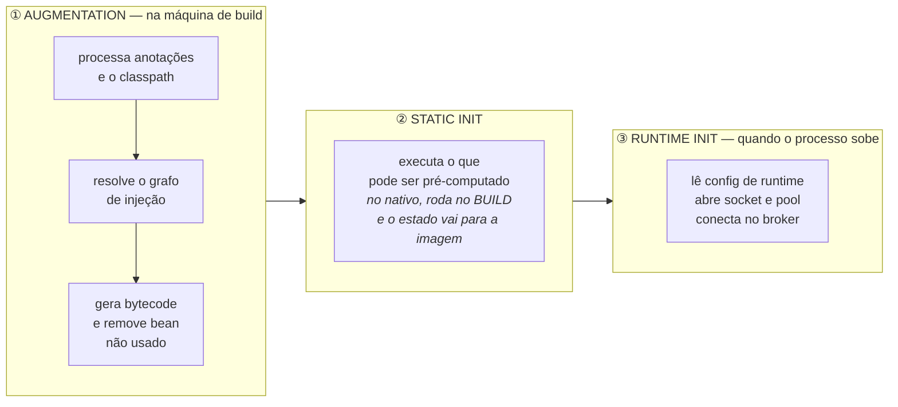
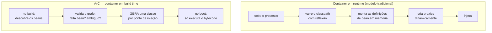
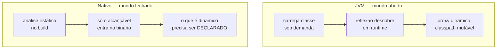
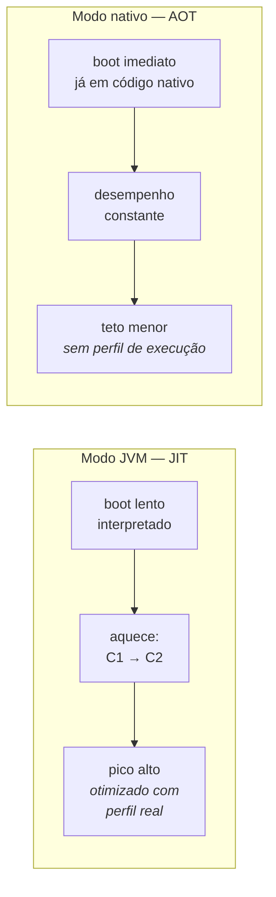
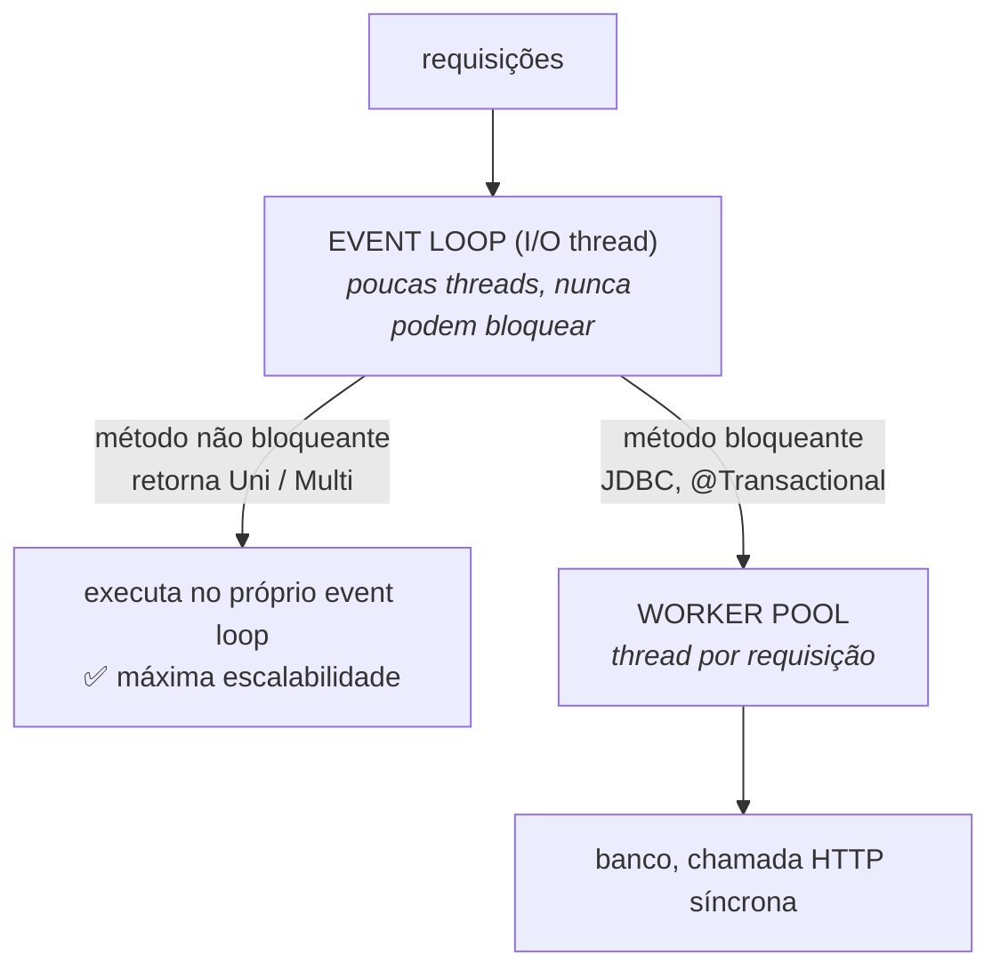

# I - COMO FUNCIONA

> [← Voltar para QUARKUS](README.md) · Próximo: [II - QUARKUS NA PRÁTICA](ii-quarkus-na-pratica.md)

## 1. As três fases: build, static init e runtime init

O Quarkus divide em **três momentos** o que um framework tradicional faz em um só (o boot). Entender esses três momentos é entender o framework.



| Fase | Quando roda | O que pertence a ela |
|---|---|---|
| **Augmentation** | no `build`, na máquina de CI | leitura do classpath, processamento de anotações, resolução de CDI, geração de proxies, validação do mapeamento ORM, geração de bytecode |
| **Static init** | na inicialização da classe gerada — **no nativo, durante o build**, e o resultado é serializado dentro da imagem | objetos que não dependem do ambiente: metamodelo do Hibernate, rotas REST registradas, *mappers* do Jackson |
| **Runtime init** | a cada inicialização do processo | o que **só** existe no ambiente: variáveis de ambiente, segredos, abrir porta TCP, criar pool de conexão, conectar no Kafka |

O mecanismo que liga build e runtime é o **bytecode recorder**: durante a augmentation, as chamadas que a extensão faz a uma classe `@Recorder` não são executadas — são **gravadas** e transformadas em bytecode, que depois roda no static ou no runtime init. É assim que uma decisão tomada no build "vira código" no artefato final.

> **Por que isso importa para você:** se o Hibernate valida o mapeamento no build, um `@Column` errado **quebra a compilação**, não a inicialização em produção. Boa parte do que no Spring é erro de boot, no Quarkus é erro de build.

---

## 2. ArC — CDI resolvido em tempo de build

**ArC** é o container de injeção de dependência do Quarkus: uma implementação de **Jakarta CDI** que faz no build o que o CDI tradicional faz em runtime.



O que muda, na prática:

| | CDI/Spring em runtime | ArC em build time |
|---|---|---|
| Descoberta de bean | escaneando o classpath no boot | **no build** |
| Erro de dependência faltando | explode no **boot** | explode na **compilação** |
| Reflexão | central ao funcionamento | quase eliminada |
| Metadados em memória | `BeanDefinition` e caches vivos no heap | **nada** — virou bytecode |
| Bean declarado e não usado | é construído e fica no container | é **removido** do artefato (*dead code elimination*) |

Essa última linha é uma pegadinha prática: o ArC **remove beans que ninguém injeta**. Se um bean só é usado de forma indireta (por nome, por reflexão, por um framework externo), ele desaparece — e é para isso que existe a anotação `@Unremovable`.

O vocabulário é o do CDI, não o do Spring:

```java
@ApplicationScoped                      // ~ @Service/@Component singleton do Spring
public class CobrancaService {

    @Inject                             // ~ @Autowired
    ClienteRepository repository;        // injeção em campo package-private é idiomática aqui

    private final Gateway gateway;

    @Inject                             // injeção por construtor: a forma preferida
    public CobrancaService(Gateway gateway) {
        this.gateway = gateway;
    }
}
```

| Escopo CDI | Significado |
|---|---|
| `@ApplicationScoped` | uma instância por aplicação, **criada sob demanda** (proxy *lazy*) — o padrão |
| `@Singleton` | uma instância por aplicação, **sem proxy** (um pouco mais rápido, sem *lazy*) |
| `@RequestScoped` | uma instância por requisição |
| `@Dependent` | uma instância por ponto de injeção (o escopo padrão do CDI quando nada é dito) |

---

## 3. Anatomia de uma extensão

**Extensão** é a unidade de integração do Quarkus. Toda tecnologia entra por ela: `quarkus-hibernate-orm`, `quarkus-rest`, `quarkus-messaging-kafka`, `quarkus-redis-client`. Cada extensão tem **dois módulos**, e essa separação é a materialização do modelo:

| Módulo | Roda | Contém |
|---|---|---|
| **deployment** | só no **build** | os `@BuildStep` que leem anotações, geram classes e produzem os *build items*. Nada disso vai para o artefato final |
| **runtime** | no **processo** | as classes que de fato executam, e os `@Recorder` cujas chamadas foram gravadas no build |

```java
// módulo deployment — este código NÃO vai para o artefato final
public class MinhaExtensaoProcessor {

    @BuildStep                                   // roda durante a augmentation
    FeatureBuildItem feature() {
        return new FeatureBuildItem("minha-extensao");
    }

    @BuildStep
    @Record(ExecutionTime.RUNTIME_INIT)          // grava a chamada para o boot
    void configurar(MinhaExtensaoRecorder recorder, MinhaConfig config) {
        recorder.iniciar(config.url());          // não executa agora: vira bytecode
    }
}
```

É por isso que **"existe extensão?" é a pergunta decisiva** ao avaliar o Quarkus para um projeto. Uma biblioteca Java qualquer funciona no modo JVM, mas sem extensão ela não participa da augmentation — não tem configuração integrada, não entra no *dev mode* e, no modo nativo, provavelmente precisará de registro manual de reflexão.

---

## 4. GraalVM, Mandrel e a hipótese do mundo fechado

A compilação nativa usa o **`native-image`** do GraalVM — na prática, quase sempre pela distribuição **Mandrel**, a versão da Red Hat do GraalVM voltada a `native-image` para Quarkus.

O `native-image` faz uma **análise estática de alcançabilidade** a partir dos pontos de entrada: tudo que é alcançável vai para o binário, o resto é descartado. Daí a regra que domina o modo nativo:

> **Hipótese do mundo fechado (*closed world*): tudo o que a aplicação vai usar precisa ser conhecido em tempo de build. O que o analisador não consegue ver, não existe em runtime.**



O que quebra no nativo, e como se resolve:

| Recurso dinâmico | Por que quebra | Solução |
|---|---|---|
| **Reflexão** (`Class.forName`, ler campos por nome) | o analisador não vê o uso | `@RegisterForReflection` ou arquivo de configuração de reflexão |
| **Proxy dinâmico** (JDK `Proxy`) | a classe é criada em runtime | registro explícito no build |
| **Recursos** (arquivos em `resources`) | não são código, não são alcançáveis | registrar o padrão de inclusão |
| **Serialização / bibliotecas que geram bytecode** | geração em runtime não existe | extensão que faça o equivalente no build |
| **Agente Java, JMX, instrumentação em runtime** | dependem de um mundo aberto | não há equivalente direto |

**A boa notícia:** para tudo que entra por **extensão**, esse registro já foi feito pela própria extensão. O problema aparece quando você usa uma biblioteca de terceiros sem extensão — e aí o erro típico só aparece **no binário nativo**, não no modo JVM, o que exige rodar os testes de integração também contra o artefato nativo. → [II - Testes](ii-quarkus-na-pratica.md#8-testes)

---

## 5. JIT × AOT — por que o nativo pode ser mais lento

Essa é a parte que mais gera erro de interpretação. A JVM compila **em runtime** (JIT): ela observa a execução, descobre quais caminhos são quentes e recompila esse código com otimizações agressivas, usando o perfil **real** da sua carga. O `native-image` compila **antes** (AOT), sem nunca ter visto a execução.



| Critério | JIT (modo JVM) | AOT (nativo) |
|---|---|---|
| Primeira requisição | lenta (interpretada) | **rápida** |
| Depois do aquecimento | **throughput maior** | constante, geralmente menor |
| Memória | maior (JIT, metaspace, perfis) | **menor** |
| Otimização por perfil de execução | nativa e automática | só com PGO, disponível em parte das distribuições |
| Coletor de lixo | HotSpot completo (G1, ZGC…) | coletor mais simples por padrão |

**A síntese:** nativo troca **throughput de pico** por **tempo de início e footprint**. Se o processo vive minutos, o nativo ganha fácil. Se vive semanas sob carga alta, a JVM provavelmente ganha. É uma decisão de perfil de carga — não de modernidade.

---

## 6. Dev mode — o que mais impressiona na prática

```bash
./mvnw quarkus:dev
```

Quatro coisas acontecem a partir desse comando:

| Recurso | O que faz |
|---|---|
| **Live reload** | ao salvar um arquivo, a aplicação é **reconstruída e recarregada no próximo request** — sem reiniciar o processo e sem comando nenhum. Vale para classes, templates e configuração |
| **Dev Services** | se falta configuração de banco, Kafka, Redis ou Keycloak em `dev`/`test`, o Quarkus **sobe um container** com o serviço e injeta a conexão. Requer Docker ou Podman |
| **Dev UI** | um console em `/q/dev-ui` que lista beans, rotas, configuração, extensões, cache, entidades — e permite agir sobre eles |
| **Teste contínuo** | tecle `r` e a suíte passa a rodar sozinha a cada alteração, mostrando só o que o seu último salvamento quebrou |

O **Dev Services** é a peça que mais muda o dia a dia: um `git clone` seguido de `quarkus:dev` levanta a aplicação **com banco** sem nenhum `docker-compose` e sem nenhuma propriedade preenchida. Em `test`, o mesmo mecanismo garante que a suíte rode contra um banco real e descartável — o papel que, no mundo Spring, o Testcontainers cumpre manualmente. → [DOCKER](../docker/README.md) · [TESTES](../testes-em-software/iii-testes-no-spring.md)

---

## 7. O modelo de threads: Vert.x, event loop e Mutiny

Sob todo o Quarkus roda o **Vert.x**: um pequeno número de **event loops** (tipicamente 2 × núcleos) que atendem o I/O sem bloquear, mais um **worker pool** para código bloqueante.



A decisão de **onde** o seu método roda é tomada no build, pela assinatura e pelas anotações:

| O seu método | Onde roda |
|---|---|
| retorna `Uni` / `Multi` / `CompletionStage` | **event loop** (não bloqueante) |
| retorna um tipo comum (`String`, DTO, `List`) | **worker thread** (bloqueante) |
| é anotado com `@Transactional` | worker thread — JDBC bloqueia |
| `@Blocking` | força worker thread |
| `@NonBlocking` | força event loop |
| `@RunOnVirtualThread` | thread virtual (Java 21+) |

> **A regra de ouro do modelo reativo:** *nunca bloqueie o event loop.* Um `Thread.sleep`, um JDBC ou um `.get()` numa thread de I/O trava **todas** as requisições que aquela thread atende. O Quarkus tem um detector que registra no log quando uma thread de event loop fica bloqueada — quando esse aviso aparece, há um `@Blocking` faltando.

**Mutiny** é a API reativa exposta: `Uni<T>` para zero-ou-um resultado, `Multi<T>` para um fluxo. Ela é **preguiçosa** — nada acontece até alguém assinar — e tem API guiada por navegação explícita:

```java
@GET @Path("/{id}")
public Uni<Cliente> buscar(Long id) {
    return repository.findById(id)                                  // Uni<Cliente>
        .onItem().ifNull().failWith(() -> new NotFoundException())
        .onFailure().retry().atMost(2);
}
```

O ponto central: **o modelo imperativo continua sendo cidadão de primeira classe**. Escrever código bloqueante comum no Quarkus é normal e suportado; o núcleo reativo está embaixo e você só desce até ele quando precisa.

---

## 8. O preço do modelo

Nada disso é de graça. Os custos, na ordem em que você vai encontrá-los:

| Custo | Detalhe |
|---|---|
| **Configuração fixa em build time** | parte das propriedades (tipo de banco, extensões ativas, estratégia de ORM) é resolvida no build e **não** muda por variável de ambiente. Mudar exige **rebuild** — a pegadinha mais comum do dia a dia |
| **Build nativo lento e caro** | minutos de compilação e vários GB de RAM na máquina de build; o pipeline de CI sente |
| **Dois artefatos para testar** | o que passa no modo JVM pode falhar no nativo (reflexão). Exige teste de integração contra o binário |
| **Dependência de extensão** | biblioteca sem extensão funciona, mas fora do modelo: sem config integrada, sem *dev mode*, com risco no nativo |
| **Ecossistema menor** | menos respostas prontas, menos exemplos, menos bibliotecas de terceiros do que no Spring → [III](iii-quarkus-x-spring.md#8-ecossistema-maturidade-e-mercado) |
| **Curva do CDI e do Mutiny** | para quem vem do Spring, é um vocabulário novo (`@ApplicationScoped`, `@Produces`, `Uni`) e um modelo de threads que precisa ser entendido |
| **Menos dinamismo** | padrões que dependem de decidir em runtime (bean condicional por propriedade, carga dinâmica de classe) têm menos espaço, por construção |

---

## Perguntas para autoavaliação

1. Quais são as três fases do Quarkus e o que pertence a cada uma?
2. O que é um *bytecode recorder* e qual problema ele resolve?
3. Por que no Quarkus um erro de mapeamento JPA tende a aparecer na compilação e não no boot?
4. O que o ArC faz no build que um container de DI tradicional faz em runtime?
5. Por que o ArC remove beans não utilizados, e qual anotação impede isso?
6. Diferencie `@ApplicationScoped`, `@Singleton`, `@RequestScoped` e `@Dependent`.
7. Por que uma extensão tem dois módulos? O que roda em cada um?
8. Por que "existe extensão para isso?" é a pergunta decisiva ao adotar o Quarkus?
9. Enuncie a hipótese do mundo fechado e dê três recursos que ela quebra.
10. Por que a reflexão precisa ser registrada no modo nativo?
11. Em que cenário o modo JVM supera o nativo em desempenho? Por quê?
12. Compare JIT e AOT em quatro critérios.
13. O que são Dev Services e que papel eles cumprem em `dev` e em `test`?
14. Como o Quarkus decide se o seu método roda no event loop ou numa worker thread?
15. Qual é a regra de ouro do event loop e o que acontece quando ela é violada?
16. O que significa dizer que o `Uni` do Mutiny é preguiçoso?
17. Cite quatro custos do modelo de build-time augmentation.
18. Por que uma propriedade de build time é uma pegadinha operacional?

---

> [← Voltar para QUARKUS](README.md) · Próximo: [II - QUARKUS NA PRÁTICA](ii-quarkus-na-pratica.md)
