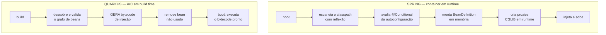
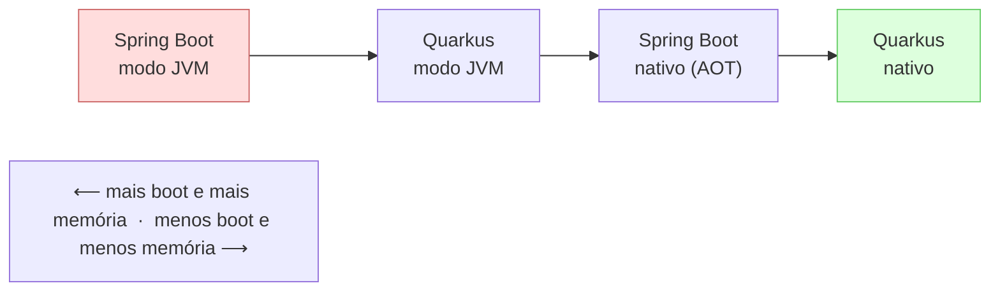
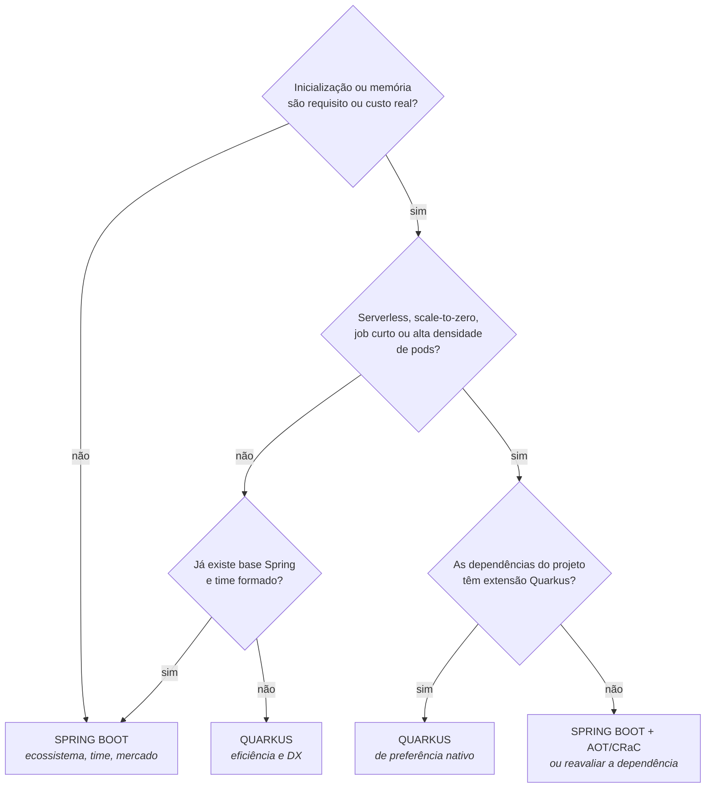

# III - QUARKUS × SPRING

> [← Voltar para QUARKUS](README.md) · Anterior: [II - QUARKUS NA PRÁTICA](ii-quarkus-na-pratica.md)

## 1. A diferença de origem explica todas as outras

Comparar os dois frameworks sem olhar **para qual problema cada um nasceu** leva a conclusões erradas. A linha do tempo é o argumento:

| | **Spring** (1.0 em 2004) | **Spring Boot** (1.0 em 2014) | **Quarkus** (2019) |
|---|---|---|---|
| Problema da época | EJB e XML: Java corporativo pesado e difícil de testar | configurar Spring dava trabalho; cada projeto reinventava a montagem | JVM num mundo de container, Kubernetes e serverless |
| Resposta | **POJO + injeção de dependência** em um container flexível e dinâmico | **convenção sobre configuração**: autoconfiguração, *starters*, servidor embutido | **antecipar o trabalho para o build**: *augmentation*, nativo, baixo footprint |
| Virtude central | flexibilidade e desacoplamento | produtividade | eficiência de inicialização e memória |
| Unidade de deploy pensada | WAR num servidor de aplicação | JAR executável numa VM | **container efêmero num pod** |

Os três são respostas corretas — para perguntas diferentes. O Spring é dinâmico **porque** flexibilidade em runtime era o valor a entregar em 2004; o Quarkus é estático **porque** custo de boot e de memória é o que dói em 2019. Nenhum dos dois está "errado": eles otimizam grandezas diferentes.

> **A consequência que atravessa este capítulo inteiro:** Spring resolve em **runtime** o que Quarkus resolve em **build time**. Toda outra diferença — velocidade, memória, nativo, testes, limites — é derivada dessa.

---

## 2. Injeção de dependência: runtime × build time

Esta é **a** diferença técnica. O resto é consequência.

| | **Spring** | **Quarkus** |
|---|---|---|
| Container | monta-se **no boot** | monta-se **no build** |
| Descoberta de beans | escaneamento de classpath com reflexão | processamento de anotações na augmentação |
| Erro de dependência | falha no **start** da aplicação | falha na **compilação** |
| Proxies | gerados em runtime (CGLIB / JDK) | gerados como bytecode no build |
| Decisão condicional | `@ConditionalOnProperty`, `@ConditionalOnMissingBean` — avaliadas **no boot**, com o ambiente real | `@IfBuildProfile` e configuração de build — avaliadas **no build** |
| Bean declarado e não usado | existe no container | **removido** do artefato |
| Reconfigurar sem recompilar | sempre possível | só para as propriedades de **runtime** |
| Extensibilidade de terceiros | qualquer JAR com autoconfiguração funciona | o ideal é haver **extensão**; sem ela, fora do modelo |

O *trade-off* é simétrico e honesto:

- **Spring ganha em flexibilidade.** A mesma imagem pode se comportar de formas diferentes conforme as propriedades do ambiente. Bean condicional, *plugin* descoberto no classpath, decisão por variável de ambiente: tudo natural.
- **Quarkus ganha em custo e previsibilidade.** O que foi decidido no build não precisa ser decidido de novo em cada um dos 200 pods — e o que está errado aparece no CI, não em produção.

> **Autoconfiguração × extensão** é o mesmo *trade-off* visto de outro ângulo. O `spring-boot-starter-data-jpa` decide no boot o que ligar, lendo o classpath e as propriedades. A extensão `quarkus-hibernate-orm` decide no **build** — por isso valida o mapeamento na compilação, e por isso trocar o *db-kind* exige rebuild.

---

## 3. Inicialização e memória: os números e o que eles não dizem

| Configuração | Inicialização | Memória residente (RSS) |
|---|---|---|
| Spring Boot, modo JVM | **segundos** (ordem de 1 a 5 s) | ordem de **200–300 MB** |
| Quarkus, modo JVM | **menos de 1 s** em aplicação típica | ordem de **100–150 MB** |
| Spring Boot nativo (AOT) | ordem de **dezenas a ~100 ms** | ordem de **100 MB** |
| Quarkus nativo | ordem de **dezenas de ms** | ordem de **30–60 MB** |

> ⚠️ **Leia esta tabela como ordem de grandeza, não como número.** São faixas típicas de aplicações REST+CRUD pequenas, reunidas de medições públicas que variam com versão, JDK, GC, `-Xmx`, número de dependências e o que a aplicação faz no start. A comparação relativa se sustenta; o número exato só vale se **você medir a sua aplicação**. Benchmark de fornecedor mede o caso que favorece o fornecedor.

**O que os números não dizem**, e que importa tanto quanto eles:

| Ponto cego | Por quê |
|---|---|
| **Boot do framework ≠ pronto para atender** | ainda falta aquecer pool de conexão, cache e (no modo JVM) o JIT. O tempo até a primeira resposta rápida é maior que o do log de start |
| **Memória depende de como você limita** | boa parte da diferença no modo JVM se dilui ao ajustar `-Xmx` e GC. RSS sem heap configurado compara pouco |
| **Throughput de pico pode inverter o ranking** | sem JIT, o nativo tende a ter teto menor em carga longa → [JIT × AOT](i-como-funciona.md#5-jit--aot--por-que-o-nativo-pode-ser-mais-lento) |
| **O gargalo real raramente é o framework** | numa aplicação típica, o banco e as chamadas de rede dominam a latência. Trocar de framework não corrige um N+1 → [N+1](../spring-data-jpa/ii-consultas-e-performance.md#6-o-problema-n1--o-mais-importante-da-matéria) |
| **Custo de pessoa × custo de pod** | 150 MB economizados por pod podem valer menos do que a produtividade de um time que já domina Spring |

**Onde a diferença realmente aparece:** alta densidade (centenas de instâncias pequenas), *scale-to-zero*, autoescala reativa a pico, função serverless cobrada por tempo de execução, e *jobs* curtos — ali, segundos de boot e centenas de MB **são** a conta.

---

## 4. Tabela de-para

Para quem já sabe Spring, aprender Quarkus é em boa medida traduzir vocabulário. O conceito quase sempre é o mesmo:

| Conceito | Spring / Spring Boot | Quarkus (Jakarta + MicroProfile) |
|---|---|---|
| Classe principal | `@SpringBootApplication` | *nada* — gerada no build |
| Bean de serviço | `@Service`, `@Component` | `@ApplicationScoped`, `@Singleton` |
| Injeção | `@Autowired` | `@Inject` |
| Bean de fábrica | `@Bean` em `@Configuration` | `@Produces` |
| Desambiguação | `@Qualifier`, `@Primary` | `@Named`, qualificador próprio |
| Escopo de requisição | `@RequestScope` | `@RequestScoped` |
| Controller | `@RestController` | classe com `@Path` |
| Rota | `@RequestMapping`, `@GetMapping` | `@Path` + `@GET` |
| Variável de caminho | `@PathVariable` | `@PathParam` |
| Parâmetro de query | `@RequestParam` | `@QueryParam` |
| Corpo | `@RequestBody` | parâmetro sem anotação |
| Resposta com status | `ResponseEntity` | `Response`, `RestResponse` |
| Erro global | `@RestControllerAdvice` | `ExceptionMapper` (`@Provider`) |
| Propriedade | `@Value` | `@ConfigProperty` |
| Grupo de propriedades | `@ConfigurationProperties` | `@ConfigMapping` |
| Perfis | `application-dev.properties`, `@Profile` | `%dev.` no mesmo arquivo, `@IfBuildProfile` |
| Repositório | `JpaRepository` | `PanacheRepository` / `PanacheEntity` |
| Transação | `@Transactional` (Spring) | `@Transactional` (Jakarta) |
| Cliente HTTP declarativo | Feign, `@HttpExchange` | `@RegisterRestClient` |
| Agendamento | `@Scheduled` | `@Scheduled` (`quarkus-scheduler`) |
| Cache | `@Cacheable` | `@CacheResult` |
| Evento interno | `ApplicationEventPublisher` + `@EventListener` | `Event<T>` + `@Observes` |
| No start | `ApplicationRunner`, `@PostConstruct` | `@Observes StartupEvent` |
| Resiliência | Resilience4j, Spring Retry | `@Retry`, `@CircuitBreaker`, `@Timeout`, `@Fallback` |
| Mensageria | `@KafkaListener`, `@RabbitListener` | `@Incoming` / `@Outgoing` |
| Teste de aplicação | `@SpringBootTest` | `@QuarkusTest` |
| Mock de bean | `@MockitoBean` (antes `@MockBean`) | `@InjectMock` |
| Teste HTTP | `MockMvc`, `WebTestClient` | RestAssured |
| Health / métricas | Actuator (`/actuator/**`) | SmallRye Health + Micrometer (`/q/**`) |
| Validação | Bean Validation | **a mesma** Bean Validation |
| Reativo | Reactor: `Mono`, `Flux` | Mutiny: `Uni`, `Multi` |

O que **não** muda e é bom lembrar: JPA, Hibernate, Bean Validation, JTA, Jackson, Micrometer, OpenTelemetry, Flyway, Testcontainers, JUnit 5, Mockito e os conceitos todos de REST, transação e concorrência. A matéria de [SPRING DATA JPA](../spring-data-jpa/README.md) vale inteira do lado do Quarkus.

---

## 5. Modelo de execução e programação reativa

| | Spring | Quarkus |
|---|---|---|
| Pilhas | **duas separadas**: MVC (servlet, *thread* por requisição) e WebFlux (Netty, reativo) | **uma só**: Vert.x embaixo de tudo, com modo bloqueante e não bloqueante lado a lado |
| Escolher reativo | decisão de **projeto**: muda a pilha, as dependências e o estilo de todo o código | decisão **por método**: retorno `Uni`/`Multi` ou anotação `@Blocking` |
| API reativa | Project Reactor (`Mono`, `Flux`) | Mutiny (`Uni`, `Multi`) |
| Estilo da API reativa | muitos operadores, nomes curtos | navegação explícita: `.onItem()`, `.onFailure()`, voltada a legibilidade |
| Misturar bloqueante e reativo | tecnicamente possível, operacionalmente perigoso | previsto por construção: o build decide a thread → [modelo de threads](i-como-funciona.md#7-o-modelo-de-threads-vertx-event-loop-e-mutiny) |
| Threads virtuais | `spring.threads.virtual.enabled` (Boot 3.2+) | `@RunOnVirtualThread` por método |

Na prática: **o Quarkus deixa o custo de ser reativo mais barato**, porque não exige comprometer a aplicação inteira com um estilo. No Spring, trocar MVC por WebFlux é uma decisão arquitetural com efeito em todo o código; no Quarkus, é a assinatura de um método.

---

## 6. Imagem nativa: o Quarkus não é mais o único

Era o diferencial mais citado em 2019, e é onde a comparação mais envelheceu. Hoje:

| | Quarkus | Spring Boot 3.x |
|---|---|---|
| Nativo | objetivo de projeto desde o início | suportado via **Spring AOT** + GraalVM Native Build Tools |
| Como funciona | augmentação já resolve tudo no build | a fase AOT gera definições de bean e *hints* para o GraalVM |
| Cobertura do ecossistema | as extensões são, por definição, compatíveis | boa nos projetos Spring; **variável** em bibliotecas de terceiros |
| Restrição herdada | o modelo já era estático | o modelo era dinâmico: no AOT, **perfis e condicionais são fixados no build** |
| Alternativa a nativo | — | **Project CRaC** (Boot 3.2+): *checkpoint/restore* do processo aquecido, reduzindo o start sem abandonar a JVM |

A leitura honesta: **a diferença encolheu, mas não desapareceu.** O Spring consegue nativo; o Quarkus foi desenhado em torno disso, e isso aparece na fluidez — menos *hints* manuais, menos surpresas de reflexão, *dev mode* e *dev services* no mesmo modelo. Além disso, o Spring AOT transporta para o build as mesmas restrições que o Quarkus assumiu desde o começo: quem usa nativo no Spring perde parte do dinamismo que era a vantagem do Spring.

> E há um terceiro na conversa: o **Micronaut** (2018) também faz DI em tempo de compilação, por processador de anotações. A ideia "resolva no build" não é exclusividade do Quarkus — é a resposta de uma geração inteira de frameworks ao mesmo problema.

---

## 7. As extensões de compatibilidade com Spring

O Quarkus oferece extensões que **aceitam um subconjunto das anotações do Spring**:

| Extensão | Traduz |
|---|---|
| `quarkus-spring-di` | `@Autowired`, `@Component`, `@Service`, `@Value`, `@Configuration`, `@Bean` |
| `quarkus-spring-web` | `@RestController`, `@RequestMapping`, `@GetMapping`, `@PathVariable` |
| `quarkus-spring-data-jpa` | interfaces no estilo `CrudRepository`, incluindo *derived queries* |
| `quarkus-spring-security` | `@Secured`, `@PreAuthorize` |
| `quarkus-spring-cache`, `quarkus-spring-scheduled` | `@Cacheable`, `@Scheduled` |

**O que elas são:** uma **ponte de migração**. As anotações do Spring são lidas na augmentação e traduzidas para o modelo do Quarkus, para você aproveitar código existente e reduzir o atrito do time.

**O que elas não são:** o Spring rodando dentro do Quarkus. Não há `ApplicationContext`, não há ciclo de vida do Spring, não há autoconfiguração, e o suporte é **parcial** — o que está fora do subconjunto simplesmente não funciona. Projeto novo em Quarkus deve usar CDI e Jakarta REST; as extensões `spring-*` existem para **sair** do Spring, não para ficar.

---

## 8. Ecossistema, maturidade e mercado

Aqui o Spring ganha, e não é perto:

| Critério | Spring | Quarkus |
|---|---|---|
| Idade e maturidade | **duas décadas** em produção | desde 2019 |
| Tamanho do ecossistema | enorme: Data, Security, Batch, Integration, Cloud, AI… | extensões cobrem o essencial e crescem rápido |
| Bibliotecas de terceiros | praticamente tudo tem integração | o que não tem extensão fica fora do modelo |
| Material, livros, cursos, respostas | **vastíssimo** | bom e oficialmente bem escrito, porém menor |
| Mercado de trabalho (Brasil) | **padrão de fato** em vaga Java | nichado: Red Hat/OpenShift, telecom, serviços financeiros |
| Risco de contratação e de rotatividade | baixo | maior: menos gente com experiência |
| Suporte comercial | Broadcom/VMware Tanzu | Red Hat (build suportado, com LTS) |
| Microsserviços distribuídos | **Spring Cloud**: Config Server, Gateway, service discovery | delega ao **Kubernetes**: ConfigMap, Service, Ingress, *service mesh* |

Essa última linha é uma diferença de filosofia, não de capacidade. O Spring Cloud resolve o problema **na biblioteca** (padrão que nasceu antes do Kubernetes dominar); o Quarkus assume que a **plataforma** resolve, e só se integra a ela. Em cluster Kubernetes, a abordagem do Quarkus é mais enxuta; fora dele, é o Spring Cloud que tem resposta pronta.

> **Ao defender a escolha num projeto real, o argumento de ecossistema e de time costuma pesar mais que o de milissegundos** — e isso não é conservadorismo: é avaliar custo total, que inclui pessoas.

---

## 9. Experiência de desenvolvimento

| Recurso | Spring Boot | Quarkus |
|---|---|---|
| Recarga ao salvar | DevTools: **reinicia** o contexto | **live reload** no próximo request, sem reiniciar o processo |
| Infra local (banco, Kafka) | `docker-compose`, ou Testcontainers com `@ServiceConnection` (3.1+) | **Dev Services**: container automático, zero configuração |
| Console de inspeção | Actuator (endpoints) | **Dev UI** em `/q/dev-ui`: beans, rotas, config, entidades |
| Teste contínuo | via IDE ou plugin | nativo: tecle `r` no dev mode |
| Geração de projeto | start.spring.io | code.quarkus.io, CLI `quarkus create` |
| Curva para quem vem do outro | — | CDI, Jakarta REST e Mutiny são vocabulário novo |

O *dev mode* é, na opinião de muita gente que usou os dois, o ponto em que o Quarkus está mais claramente à frente. É também o único argumento desta comparação que você sente **no primeiro dia**, em vez de na fatura do cluster.

---

## 10. Quando escolher cada um

**Escolha Spring Boot quando:** o time já é de Spring; o projeto depende do ecossistema (Spring Cloud, Batch, Integration); é monólito ou serviço de vida longa sob carga constante; contratar rápido importa; ou simplesmente **custo de boot não é um problema do seu projeto** — o que é o caso mais comum.

**Escolha Quarkus quando:** o alvo é serverless ou *scale-to-zero*; há **muitas** instâncias pequenas e a memória por pod é dinheiro; *cold start* é requisito de produto; são *jobs*, CLIs ou consumidores de evento de vida curta; já se roda OpenShift/Red Hat; o legado é Java EE (CDI + JPA + JAX-RS) e migrar para Jakarta é mais curto que reescrever; ou a DX do *dev mode* e dos Dev Services é vista como ganho de produtividade real.

**Não escolha por:** ser mais novo, ser mais rápido num *benchmark* de "Hello World", ou estar no topo de alguma lista de tendências. Nenhum desses três é um requisito.

---

## 11. Roteiro de migração (se for migrar)

1. **Inventarie as dependências.** A pergunta decisiva é "existe extensão?". Spring Cloud, Spring Batch, Spring Integration e bibliotecas muito reflexivas são os pontos de parada típicos.
2. **Comece por um serviço novo, de borda.** Nunca pelo núcleo do monólito. Um consumidor de fila ou uma API pequena mede o custo real da mudança com risco baixo.
3. **Use `quarkus-spring-di` e `quarkus-spring-web` como ponte**, se ajudar a trazer código existente — e com plano explícito de sair delas.
4. **Converta por camada:** primeiro configuração (`@Value` → `@ConfigProperty`), depois web (`@RestController` → `@Path`), depois persistência (`JpaRepository` → Panache). A camada de domínio, se estiver limpa, **não muda** — e é aqui que um projeto que seguiu [CLEAN ARCHITECTURE](../clean-architecture/README.md) cobra o investimento de volta.
5. **Reescreva os testes cedo** (`@QuarkusTest` + RestAssured) e habilite Dev Services: é o que dá confiança no resto da migração.
6. **Só então considere o nativo**, e com `@QuarkusIntegrationTest` no pipeline — erro de reflexão só aparece no binário.
7. **Meça antes e depois** (boot, RSS, p95, custo de cluster). Migração sem número antes é migração sem conclusão.

---

## 12. As pegadinhas que mais aparecem

| Afirmação | Correção |
|---|---|
| "Quarkus é rápido porque é nativo" | É rápido porque resolve tudo no **build**; nativo é um segundo ganho, opcional |
| "Nativo é sempre mais rápido que JVM" | Em **boot e memória**, sim. Em **throughput sustentado**, a JVM com JIT tende a ganhar |
| "Só o Quarkus faz imagem nativa" | Spring Boot 3 faz, via Spring AOT; Micronaut também. A diferença é fluidez e cobertura |
| "Quarkus é um Spring mais leve" | As APIs são Jakarta EE + MicroProfile; o modelo de DI é outro |
| "As extensões `spring-*` rodam Spring no Quarkus" | Traduzem um **subconjunto** de anotações. São ponte de migração |
| "No Quarkus toda propriedade é configurável em produção" | Há propriedades de **build time**: mudar exige rebuild |
| "Quarkus é só para aplicação reativa" | O modo imperativo é de primeira classe; o reativo é opcional, por método |
| "Spring é lento" | É mais pesado **para subir**. Em regime, com JIT aquecido, é rápido — e o gargalo costuma ser o banco |
| "Migrar é só trocar as anotações" | Perfis, condicionais, dependências sem extensão, reflexão e testes são o trabalho real |
| "Quarkus substituiu o Spring no mercado" | Ecossistema, comunidade e vagas do Spring são ordens de grandeza maiores |

---

## Perguntas para autoavaliação

1. Que problema cada um dos três (Spring, Spring Boot, Quarkus) nasceu para resolver?
2. Qual é a diferença técnica da qual todas as outras derivam?
3. Compare a montagem do container no Spring e no Quarkus em cinco critérios.
4. Por que o Spring ganha em flexibilidade e o Quarkus em previsibilidade?
5. Qual a diferença entre `@ConditionalOnProperty` e `@IfBuildProfile`?
6. Compare autoconfiguração e extensão.
7. Ordene as quatro combinações (Spring/Quarkus × JVM/nativo) por boot e por memória.
8. Cite três coisas que os números de boot e memória **não** dizem.
9. Em que cenários a diferença de footprint é realmente dinheiro?
10. Faça o de-para: `@Service`, `@Autowired`, `@Bean`, `@Value`, `@RestController`, `@GetMapping`, `@RequestBody`, `@RestControllerAdvice`, `@SpringBootTest`, `@MockBean`.
11. O que **não** muda ao trocar de framework?
12. Qual a diferença entre ter duas pilhas (MVC e WebFlux) e ter uma só com Vert.x?
13. Por que "ser reativo" é mais barato no Quarkus?
14. Spring Boot 3 faz imagem nativa. O que ainda diferencia o Quarkus nesse ponto?
15. O que o Spring AOT fixa no build, e por que isso é irônico?
16. O que é o Project CRaC e que problema ele ataca?
17. O que as extensões `quarkus-spring-*` fazem e o que elas **não** fazem?
18. Qual a diferença de filosofia entre Spring Cloud e a abordagem Kubernetes-native do Quarkus?
19. Cite quatro vantagens de DX do Quarkus e uma do Spring.
20. Liste quatro condições que justificam Quarkus e quatro que justificam Spring Boot.
21. Por que "é mais novo" e "ganhou o benchmark de Hello World" não são critérios?
22. Descreva os passos de uma migração de Spring para Quarkus, e por onde **não** começar.
23. Corrija: "nativo é sempre mais rápido", "Quarkus é rápido porque é nativo" e "migrar é só trocar as anotações".

---

> [← Voltar para QUARKUS](README.md) · Anterior: [II - QUARKUS NA PRÁTICA](ii-quarkus-na-pratica.md)
