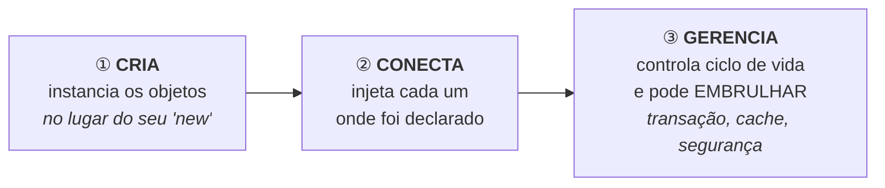
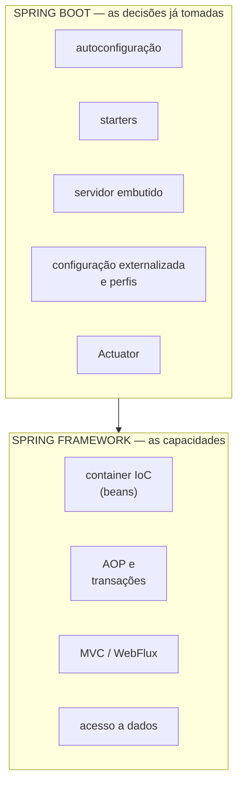
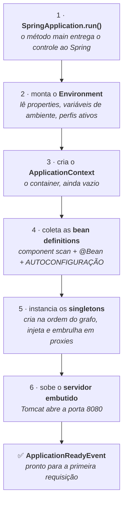

# SPRING E SPRING BOOT

> **Capítulos:** [I - IoC e beans](i-ioc-e-beans.md) · [II - AOP e proxies](ii-aop-e-proxies.md) · [III - Spring Boot](iii-spring-boot.md)

Esta é a matéria que fica **embaixo** das outras três de Spring: [MVC](../spring-mvc-apis-restful/README.md), [Data JPA](../spring-data-jpa/README.md) e [Security](../spring-security/README.md) todas supõem que você já sabe o que é um *bean*, quem o cria e por que uma anotação como `@Transactional` às vezes simplesmente não funciona. É isso que está aqui.

O Spring é, antes de qualquer coisa, **um container de objetos**. Tudo o que ele faz de mais famoso — transação declarativa, segurança por anotação, repositórios que você não implementa, autoconfiguração — é construído em cima de duas ideias apenas: **ele cria os seus objetos** e **ele pode embrulhá-los**. Quem entende essas duas, entende o framework; quem não entende, decora anotações.

---

## 1. O problema: quem cria os objetos?

Comece pelo código que todo mundo escreve antes de conhecer o Spring:

```java
public class PedidoService {

    private final PedidoRepository repository = new PedidoRepositoryPostgres();   // ❌
    private final EmailSender email = new EmailSenderSmtp("smtp.empresa.com");    // ❌

    public void criar(Pedido p) { repository.salvar(p); email.enviar(p); }
}
```

Funciona — e cria quatro problemas de uma vez:

| Problema | Por quê |
|---|---|
| **Acoplamento à implementação** | `PedidoService` conhece `PedidoRepositoryPostgres`. Trocar por outro banco significa **editar** o `PedidoService` |
| **Impossível de testar isoladamente** | não há como colocar um *mock* no lugar: o `new` está dentro da classe → [TEST DOUBLES](../testes-em-software/ii-test-doubles-e-mockito.md) |
| **Configuração espalhada** | o endereço do SMTP está no meio da regra de negócio |
| **Ciclo de vida descontrolado** | cada classe que precisar do repositório vai criar **a sua própria instância**, com seu próprio pool de conexões |

A solução é inverter a responsabilidade: a classe **declara o que precisa** e recebe pronto.

```java
public class PedidoService {

    private final PedidoRepository repository;     // ✅ depende da ABSTRAÇÃO
    private final EmailSender email;

    public PedidoService(PedidoRepository repository, EmailSender email) {   // recebe pronto
        this.repository = repository;
        this.email = email;
    }
}
```

Agora a classe é honesta (o construtor **declara** suas dependências), testável (passe *mocks*) e desacoplada. Mas alguém precisa fazer o trabalho que ela deixou de fazer: **decidir qual implementação usar, criar na ordem certa e entregar**. Esse alguém é o **container do Spring**.

> Isso é o **D** do [SOLID](../solid/README.md#d--dependency-inversion) aplicado: dependa de abstrações, não de implementações. O Spring não inventou o princípio — ele oferece a máquina que o torna prático.

---

## 2. Inversão de controle e injeção de dependência

| Termo | O que é |
|---|---|
| **IoC** — *Inversão de Controle* | o princípio geral: **quem chama quem se inverte**. Em vez de o seu código conduzir o fluxo e criar o que precisa, o framework conduz e chama o seu código nos pontos certos. É o *"Hollywood principle"*: **não nos ligue, nós ligamos para você** |
| **DI** — *Injeção de Dependência* | a forma mais comum de IoC: o objeto **não busca** suas dependências; elas lhe são **entregues** (pelo construtor, por um setter ou num campo) |
| **DIP** — *Dependency Inversion Principle* | o princípio de projeto (o "D" do SOLID) que diz para depender de abstrações. **DI é a técnica que o concretiza** |

Os três termos são frequentemente usados como sinônimos, e não são: **DIP** é o princípio, **DI** é a técnica, **IoC** é o conceito guarda-chuva — e **o container** é a implementação concreta que o Spring entrega.

O container faz três coisas, e só elas:



O item ③ é o que as pessoas chamam de "mágica do Spring" — e é o assunto do [capítulo II](ii-aop-e-proxies.md). Não há mágica: há um objeto a mais, gerado em volta do seu.

---

## 3. O vocabulário mínimo

| Termo | O que é, em uma linha |
|---|---|
| **Bean** | qualquer objeto **criado e gerenciado pelo container** — você não dá `new` nele |
| ***Bean definition*** | a "receita" do bean: qual classe, qual escopo, de quem depende, como inicializar. O container primeiro coleta receitas, depois cozinha |
| **Container** | o componente que cria, conecta e gerencia os beans |
| **`ApplicationContext`** | **o** container do Spring, na prática: a interface que representa a aplicação montada e que guarda todos os beans |
| ***Component scan*** | a varredura que o Spring faz nos pacotes procurando classes anotadas, para transformá-las em beans |
| ***Stereotype*** | as anotações que marcam uma classe como bean com um "papel": `@Component`, `@Service`, `@Repository`, `@Controller`, `@Configuration` |
| ***Autowiring*** | o ato de o container escolher e injetar automaticamente a dependência de um ponto de injeção |
| **Ponto de injeção** | o lugar onde a dependência é pedida: um parâmetro de construtor, um setter, um campo `@Autowired` |
| **Escopo** | quantas instâncias de um bean existem e por quanto tempo (`singleton`, `prototype`, `request`…) |
| **Proxy** | uma classe "embrulho", gerada em tempo de execução, que fica **no lugar** do seu bean para executar algo antes/depois do seu método → [padrão Proxy](../design-patterns-em-oo/ii-padroes-estruturais.md#7-proxy) |
| **AOP** | *Aspect-Oriented Programming*: separar o que é **transversal** (transação, log, segurança) da regra de negócio. No Spring, implementado com proxies |
| ***Starter*** | uma dependência do Spring Boot que **não tem código**: é um pacote de outras dependências coerentes entre si (`spring-boot-starter-web`) |
| **Autoconfiguração** | o mecanismo do Boot que, olhando o que está no classpath, **configura sozinho** o que você não configurou |
| ***Fat jar*** | o JAR do Boot, que carrega dentro de si as dependências **e** um servidor web embutido — basta `java -jar` |

> Se os termos **build**, **boot**, **runtime**, *classpath* e **reflexão** também estiverem nebulosos, eles estão abertos em [JVM E PLATAFORMA JAVA](../jvm-e-plataforma-java/README.md) — a matéria que fica abaixo desta, e que vale para qualquer aplicação Java.

---

## 4. De onde o Spring veio: o problema dos EJBs

A seção 1 mostrou o problema **técnico** que o Spring resolve. Vale conhecer também o problema **histórico**, porque ele explica a personalidade do framework.

Em **2002**, **Rod Johnson** publicou um livro com uma tese incômoda: o jeito oficial de construir aplicações corporativas em Java — o **J2EE** com **EJB** (*Enterprise JavaBeans*) — era mais complicado do que o problema que resolvia. O código que acompanhava o livro virou o **Spring**, cuja versão 1.0 saiu em **2004**.

Os quatro problemas dos EJBs que ele atacou:

| Problema | Por que doía |
|---|---|
| **Não rodava fora de um servidor de aplicação** | para executar ou depurar qualquer coisa era preciso subir um servidor pesado. **Testar ficava inviável** — e esse foi o argumento decisivo |
| **Cerimônia desproporcional** | várias interfaces e descritores XML por componente, para pouca regra de negócio |
| **Especificação ditada por comitê** | evoluía por consenso de fornecedores, não pela prática de quem escrevia aplicação |
| **Generalidade que ninguém usava** | foi desenhado para suportar muitos tipos de cliente e cenários distribuídos; a maioria dos projetos precisava de muito menos |

**A resposta do Spring** foi justamente a ausência de cerimônia: você escreve **POJOs** — *Plain Old Java Objects*, classes Java comuns, sem herdar nem implementar nada do framework — e um **container leve** cuida de criá-las, conectá-las e decorá-las. Como as suas classes não dependem do framework, elas rodam (e são testadas) **sem servidor nenhum**.

### Os quatro pilares do Spring Framework

A divisão que o framework tem até hoje, e que organiza esta matéria e as seguintes:

| Pilar | O que faz | Onde está no repositório |
|---|---|---|
| **Container (IoC)** | gerencia o **ciclo de vida** e a configuração dos objetos da aplicação | [capítulo I](i-ioc-e-beans.md) |
| **AOP e *aspects*** | separa as **preocupações transversais** — transação, segurança, log — da regra de negócio | [capítulo II](ii-aop-e-proxies.md) |
| **Acesso a dados e integração** | abstrai JDBC, ORM, transações e mensageria | [SPRING DATA JPA](../spring-data-jpa/README.md) |
| **Web MVC** | resolve URL, injeta parâmetros, valida entrada e serializa a saída | [Spring MVC - APIs RESTful](../spring-mvc-apis-restful/README.md) |

> **A ironia que fecha o círculo:** o Spring venceu os EJBs por ser **leve e testável fora do servidor**. Vinte anos depois, ele é a plataforma estabelecida — e é acusado, por sua vez, de peso e de cerimônia por frameworks mais novos. É literalmente o argumento de abertura do [QUARKUS](../quarkus/README.md#2-o-problema-que-o-quarkus-resolve). Arquitetura é cíclica, e vale desconfiar de quem apresenta o incumbente como escolha óbvia — inclusive quando o incumbente é o Spring.

---

## 5. Spring × Spring Boot — a confusão mais comum

**Spring Boot não é um framework diferente do Spring.** É o Spring com as decisões já tomadas.



| | **Spring Framework** | **Spring Boot** |
|---|---|---|
| O que é | o **framework**: container, AOP, MVC, transações, acesso a dados | uma **camada de conveniência** por cima dele |
| O que entrega | as capacidades | as **decisões**: o que ligar, com quais valores, em que versão |
| Como se configurava/configura | XML, depois classes `@Configuration` escritas por você | **autoconfiguração** — você só sobrescreve o que discorda |
| Servidor web | você instalava a aplicação num Tomcat externo (WAR) | Tomcat **embutido** no próprio JAR |
| Versões de dependência | você resolvia na mão | um **BOM** cuida da compatibilidade |
| Ponto de partida | escrever a montagem | `main()` + `@SpringBootApplication` |

Em uma frase: **o Framework dá os motores; o Boot já os ligou com o ajuste padrão.** Todo bean, todo proxy, toda transação do capítulo I e II é Spring Framework — o Boot só evitou que você escrevesse a configuração.

---

## 6. O ecossistema

| Projeto | Para que serve |
|---|---|
| **Spring Framework** | o núcleo: container IoC, AOP, transações, MVC, WebFlux → capítulos [I](i-ioc-e-beans.md) e [II](ii-aop-e-proxies.md) |
| **Spring Boot** | autoconfiguração, starters, servidor embutido, Actuator → [capítulo III](iii-spring-boot.md) |
| **Spring MVC** | a camada web: HTTP → método → JSON → [Spring MVC - APIs RESTful](../spring-mvc-apis-restful/README.md) |
| **Spring Data** | repositórios de persistência sem implementação → [SPRING DATA JPA](../spring-data-jpa/README.md) |
| **Spring Security** | autenticação e autorização → [SPRING SECURITY](../spring-security/README.md) |
| **Spring Test** | suporte a testes, *slices*, mocks de contexto → [TESTES NO SPRING](../testes-em-software/iii-testes-no-spring.md) |
| **Spring Cloud** | microsserviços: configuração central, *gateway*, *service discovery* → [ESTILOS ARQUITETURAIS](../arquitetura-distribuida/i-estilos-arquiteturais.md#5-monólito--microsserviços--quando-usar-cada-um) |
| **Spring Batch** | processamento em lote (*jobs*, *chunks*, *readers* e *writers*) |
| **Spring Integration** | integração por mensagens dentro da aplicação |
| **Spring for Kafka / AMQP** | mensageria com broker → [MENSAGERIA](../mensageria/README.md) |
| **Spring WebFlux** | o irmão reativo do MVC, sobre Netty → [QUARKUS × SPRING](../quarkus/iii-quarkus-x-spring.md#5-modelo-de-execução-e-programação-reativa) |

---

## 7. Como uma aplicação Spring Boot sobe

Vale ver o boot desta vez em termos do Spring — é o mesmo [passo a passo genérico de uma aplicação Java](../quarkus/README.md#o-que-a-aplicação-faz-no-boot--o-passo-a-passo), agora com os nomes reais:



| Passo | O que acontece de fato |
|---|---|
| **1** | o seu `main()` chama `SpringApplication.run(App.class, args)` e **entrega o controle** — é a inversão de controle, literalmente |
| **2** | o Spring reúne todas as fontes de configuração numa visão única (o `Environment`) e descobre os **perfis ativos** → [III](iii-spring-boot.md#4-configuração-externalizada) |
| **3** | nasce o `ApplicationContext`: o container vazio |
| **4** | o Spring **coleta receitas**, sem criar nada ainda: varre os seus pacotes, lê os métodos `@Bean` e processa a **autoconfiguração** do Boot → [III](iii-spring-boot.md#3-autoconfiguração-o-mecanismo) |
| **5** | com o grafo montado, instancia os beans *singleton*, injeta as dependências e aplica os **proxies** de transação, cache e segurança → [I](i-ioc-e-beans.md#5-o-ciclo-de-vida-de-um-bean) · [II](ii-aop-e-proxies.md) |
| **6–7** | o Tomcat embutido abre a porta e o evento `ApplicationReadyEvent` é publicado |

É nos passos **4 e 5** que mora todo o tempo de inicialização de uma aplicação Spring — e é exatamente deles que o [Quarkus](../quarkus/README.md) discorda, movendo-os para o build.

---

## Capítulos

- [I - IoC E BEANS](i-ioc-e-beans.md) — o container por dentro: o que é um bean, as três formas de declarar, as três de injetar (e por que construtor), `@Qualifier` e `@Primary`, escopos, o ciclo de vida completo, `@Lazy`, dependência circular, `@Conditional` e como inspecionar o container
- [II - AOP E PROXIES](ii-aop-e-proxies.md) — a resposta para "por que minha anotação não funcionou": preocupações transversais, o vocabulário do AOP, JDK proxy × CGLIB, as limitações estruturais do proxy, escrever um `@Aspect`, as anotações que dependem dele, eventos e `@Scheduled`
- [III - SPRING BOOT](iii-spring-boot.md) — `@SpringBootApplication` decomposto, starters, o mecanismo da autoconfiguração, configuração externalizada e precedência, `@ConfigurationProperties`, perfis, Actuator, DevTools, empacotamento e o que mudou no Boot 3

---

## Perguntas para autoavaliação

1. Quais quatro problemas o `new` dentro de uma classe produz?
2. O que a classe passa a declarar quando a dependência vai para o construtor?
3. Diferencie IoC, DI e DIP — qual é princípio, qual é técnica, qual é conceito guarda-chuva?
4. O que é o *Hollywood principle* e onde ele aparece numa aplicação Spring?
5. Quais são as três coisas que o container faz?
6. O que é um bean? E uma *bean definition*? Por que a distinção importa?
7. O que é o `ApplicationContext`?
8. Explique: *component scan*, *stereotype*, *autowiring*, ponto de injeção, escopo.
9. O que é um proxy e por que ele é a base da "mágica" do Spring?
10. Que tese Rod Johnson defendeu em 2002, e o que nasceu dela?
11. Cite os quatro problemas dos EJBs e diga qual foi o decisivo.
12. O que é um POJO e por que ele foi a resposta do Spring aos EJBs?
13. Quais são os quatro pilares do Spring Framework?
14. Qual é a ironia histórica entre Spring e Quarkus?
15. Spring Boot é um framework diferente do Spring? O que exatamente ele acrescenta?
16. O que é um *starter* e por que se diz que ele não tem código?
17. Para que serve a autoconfiguração e como você sobrescreve uma decisão dela?
18. Cite seis projetos do ecossistema Spring e para que servem.
19. Descreva os sete passos entre `SpringApplication.run()` e a primeira requisição atendida.
20. Em quais desses passos está concentrado o tempo de inicialização? Por que o Quarkus discorda deles?
---

**Relacionados:** [Spring MVC - APIs RESTful](../spring-mvc-apis-restful/README.md) · [SPRING DATA JPA](../spring-data-jpa/README.md) · [SPRING SECURITY](../spring-security/README.md) · [QUARKUS](../quarkus/README.md) · [SOLID](../solid/README.md) · [DESIGN PATTERNS EM OO](../design-patterns-em-oo/README.md) · [JVM E PLATAFORMA JAVA](../jvm-e-plataforma-java/README.md)
