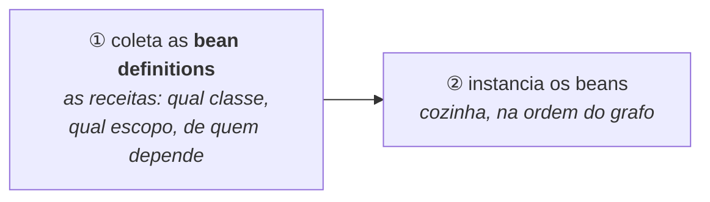
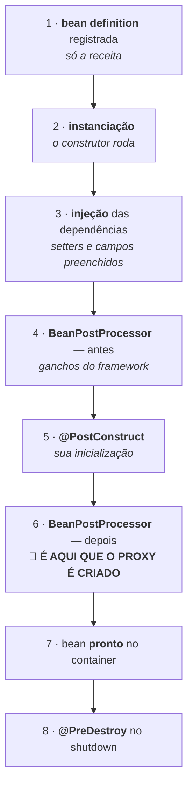
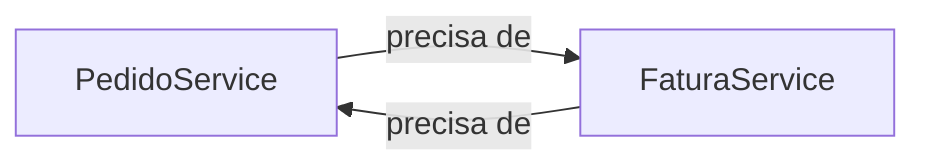

# I - IoC E BEANS

> [← Voltar para SPRING E SPRING BOOT](README.md) · Próximo: [II - AOP E PROXIES](ii-aop-e-proxies.md)

## 1. O container: `ApplicationContext`

Um **bean** é um objeto que **o container cria e gerencia**. Você nunca dá `new` nele; você declara que ele existe e declara onde ele é necessário.

O container tem duas interfaces, e a distinção aparece em entrevista:

| | `BeanFactory` | `ApplicationContext` |
|---|---|---|
| O que é | o container **mínimo**: cria e injeta beans | **estende** o `BeanFactory` e acrescenta o resto |
| Acrescenta | — | eventos, internacionalização, carregamento de recursos, integração com AOP, *post-processors* |
| Criação dos *singletons* | sob demanda (*lazy*) | **antecipada**, no start da aplicação |
| Na prática | raramente usado direto | **é este que você usa** — toda aplicação Spring Boot tem um |

Então, quando se diz "o container do Spring", leia **`ApplicationContext`**: o objeto que representa a sua aplicação montada e que guarda todos os beans.

Um detalhe com consequência prática: o container trabalha **em duas etapas**.



Primeiro ele reúne **todas** as receitas (de anotações, de métodos `@Bean`, da autoconfiguração do Boot) e só então começa a criar objetos. É por isso que ele consegue detectar, **antes** de criar qualquer coisa, que falta uma dependência ou que existem dois candidatos para o mesmo lugar.

---

## 2. As três formas de declarar um bean

### a) `@Component` e os *stereotypes* — para as suas classes

Você anota a classe e o Spring a encontra no ***component scan***: a varredura dos pacotes em busca de classes anotadas.

```java
@Service                                  // é um @Component com um papel declarado
public class PedidoService { }
```

| Anotação | Papel | Diferença técnica real |
|---|---|---|
| `@Component` | bean genérico | é a base — todas as outras são `@Component` por dentro |
| `@Service` | regra de negócio | **nenhuma**: é semântica, para quem lê o código |
| `@Repository` | acesso a dados | **tem efeito**: ativa a *tradução de exceções* — converte erro específico do banco (`SQLException`, exceções do Hibernate) na hierarquia `DataAccessException` do Spring |
| `@Controller` / `@RestController` | camada web | o MVC os procura para mapear rotas → [Spring MVC](../spring-mvc-apis-restful/iii-spring-mvc-na-pratica.md) |
| `@Configuration` | classe de montagem | também é um bean, e é onde vivem os métodos `@Bean` |

> **A pegadinha do *component scan*:** ele varre **o pacote da classe anotada com `@SpringBootApplication` e os subpacotes** — e nada mais. Uma classe `@Service` em `br.com.outro.pacote`, fora dessa árvore, simplesmente **não vira bean**, sem erro nenhum: ela só não existe para o Spring. É a causa nº 1 de `NoSuchBeanDefinitionException`.

### b) `@Bean` dentro de `@Configuration` — para classes que não são suas

Não dá para anotar uma classe de biblioteca de terceiros. Então você escreve um **método que a fabrica**:

```java
@Configuration
public class ClientesConfig {

    @Bean                                              // o OBJETO RETORNADO é o bean
    public RestClient pagamentosClient(
            @Value("${pagamentos.url}") String url) {  // injeta uma propriedade
        return RestClient.builder().baseUrl(url).build();
    }

    @Bean
    public ObjectMapper objectMapper() {
        return JsonMapper.builder().addModule(new JavaTimeModule()).build();
    }
}
```

| | `@Component` | `@Bean` |
|---|---|---|
| Onde vai | **na classe** | **num método** de uma `@Configuration` |
| Quem instancia | o Spring, chamando o construtor | **o seu código**, dentro do método |
| Serve para | as suas classes | classes de terceiros, ou quando a criação exige lógica |
| Nome do bean | o nome da classe em *camelCase* | **o nome do método** |

> **Por que `@Configuration` é especial:** a classe é embrulhada num proxy (ver [capítulo II](ii-aop-e-proxies.md)) para que, se um método `@Bean` chamar outro, o Spring devolva **o mesmo singleton** em vez de criar um objeto novo. Quem não precisa desse comportamento pode usar `@Configuration(proxyBeanMethods = false)` e economizar um pouco do boot.

### c) Registro programático — o caso raro

`BeanDefinitionRegistry`, `ImportBeanDefinitionRegistrar`, `@Import`: é assim que o **próprio Spring** e as bibliotecas registram beans dinamicamente. Você raramente escreve isso à mão, mas é bom saber que o caminho existe — é o mecanismo por trás da autoconfiguração e dos repositórios do Spring Data.

---

## 3. As três formas de injetar — e por que construtor

```java
@Service
public class PedidoService {

    // ✅ 1. CONSTRUTOR — a forma recomendada
    private final PedidoRepository repository;

    public PedidoService(PedidoRepository repository) {    // @Autowired é dispensável
        this.repository = repository;                      // desde o Spring 4.3,
    }                                                      // se houver um só construtor

    // ⚠️ 2. SETTER — para dependência genuinamente opcional
    private MetricsClient metrics;

    @Autowired(required = false)
    public void setMetrics(MetricsClient metrics) { this.metrics = metrics; }

    // ❌ 3. CAMPO — evite
    @Autowired
    private EmailSender email;
}
```

| | Construtor | Setter | Campo |
|---|---|---|---|
| Permite `final` | **sim** → objeto imutável | não | não |
| Dependência obrigatória fica explícita | **sim**: está na assinatura | não | **não** — fica escondida no meio da classe |
| Testar sem Spring | **trivial**: `new PedidoService(mock)` | possível | **só com reflexão** ou framework |
| Detecta dependência circular | **no start**, com erro claro | tarde | tarde |
| Risco de `NullPointerException` | nenhum: sem dependência o objeto não nasce | existe | existe |
| Esconde classe grande demais | não: um construtor com 9 parâmetros **grita** que a classe faz coisa demais → [SRP](../solid/README.md#s--single-responsibility) | sim | **sim** |

**A regra:** construtor para o que é obrigatório, setter para o que é realmente opcional, campo para nada. O último item da tabela é o argumento mais subestimado: injeção por campo **esconde** o acoplamento, e um construtor incômodo é um bom alarme de projeto.

> **A pegadinha clássica:** se você der `new PedidoService()` na mão, **nada é injetado e nenhum proxy existe** — os campos ficam `null` e `@Transactional` não tem efeito. Objeto criado por você não é bean. → [II](ii-aop-e-proxies.md#4-as-limitações-estruturais-do-proxy)

---

## 4. Quando há mais de um candidato

Se existem duas implementações de `PagamentoGateway`, o Spring não tem como escolher e falha no start com `NoUniqueBeanDefinitionException`. Há quatro saídas:

```java
public interface PagamentoGateway { }

@Service @Primary                                  // ① o escolhido quando ninguém especifica
public class GatewayPix implements PagamentoGateway { }

@Service("gatewayBoleto")                          // ② nome explícito do bean
public class GatewayBoleto implements PagamentoGateway { }
```
```java
@Service
public class Cobranca {
    public Cobranca(@Qualifier("gatewayBoleto") PagamentoGateway gateway) { }   // ③ pede pelo nome
}
```

| Estratégia | Como funciona |
|---|---|
| **`@Primary`** | marca o candidato padrão — usado quando o ponto de injeção não especifica nada |
| **`@Qualifier("nome")`** | o ponto de injeção **pede** um bean específico |
| **Nome do parâmetro** | se o parâmetro se chamar `gatewayBoleto`, o Spring casa pelo nome. Funciona, mas é frágil: depende de o nome sobreviver à compilação |
| **Qualificador próprio** | uma anotação sua (`@Pix`) anotada com `@Qualifier` — mais legível e verificada pelo compilador |

**E a quarta saída, que é a mais elegante:** se você quer **todos**, peça uma coleção. O Spring injeta todos os beans daquele tipo.

```java
@Service
public class ValidacaoDePedido {

    private final List<RegraDeValidacao> regras;     // TODAS as implementações, injetadas

    public ValidacaoDePedido(List<RegraDeValidacao> regras) { this.regras = regras; }

    public void validar(Pedido p) { regras.forEach(r -> r.validar(p)); }
}
```

Esse é o padrão [Strategy](../design-patterns-em-oo/iii-padroes-comportamentais.md#1-strategy) montado pelo container: adicionar uma regra nova é **criar uma classe** — nenhum código existente muda, que é exatamente o [Open/Closed](../solid/README.md#o--openclosed). Use `Map<String, RegraDeValidacao>` para receber nome → bean, e `@Order` para controlar a ordem da lista.

---

## 5. O ciclo de vida de um bean

Esta é a seção que explica mais comportamento estranho do Spring por linha escrita.



<!--animacao: ciclo-de-vida-do-bean-->

| Etapa | O que acontece | O que isso te explica |
|---|---|---|
| **2. Instanciação** | o construtor é chamado | no construtor, **as dependências de campo/setter ainda são `null`** — não as use lá |
| **3. Injeção** | o Spring preenche o que falta | |
| **4 e 6. `BeanPostProcessor`** | ganchos que o framework executa em **todo** bean, antes e depois da inicialização | é o mecanismo de extensão do container |
| **5. `@PostConstruct`** | o seu método de inicialização, **com as dependências já injetadas** | é aqui que vai "aquecer cache", "validar configuração" — não no construtor |
| **6. Criação do proxy** | se o bean precisa de transação, cache ou segurança, um `BeanPostProcessor` **devolve um proxy no lugar dele** | 🔑 **o que fica no container é o proxy, não o seu objeto** — a origem de todas as pegadinhas do [capítulo II](ii-aop-e-proxies.md) |
| **8. `@PreDestroy`** | chamado no desligamento ordenado | não é chamado em `kill -9`, nem em beans `prototype` |

> `@PostConstruct` e `@PreDestroy` vêm do pacote `jakarta.annotation` (no Spring Boot 3; era `javax.annotation` no Boot 2). As alternativas são implementar `InitializingBean`/`DisposableBean` — mais acopladas ao Spring — ou declarar `@Bean(initMethod=..., destroyMethod=...)`.

---

## 6. Escopos

O **escopo** responde: **quantas instâncias existem e por quanto tempo?**

| Escopo | Quantas instâncias | Observação |
|---|---|---|
| **`singleton`** | **uma por container** | é o **padrão**. Criada no start da aplicação. Como é compartilhada por todas as requisições, **precisa ser sem estado** (*stateless*) — campo mutável aqui é bug de concorrência |
| **`prototype`** | **uma a cada vez que é pedida** | o container cria, injeta e **esquece**: não chama `@PreDestroy` |
| **`request`** | uma por requisição HTTP | morre com a resposta (só em aplicação web) |
| **`session`** | uma por sessão de usuário | cuidado: vira estado no servidor → [Stateful × Stateless](../spring-security/README.md#15-estado-da-sessão-stateful-vs-stateless) |
| **`application`** | uma por `ServletContext` | |

> **A pegadinha nº 1 de escopo:** injetar um `prototype` dentro de um `singleton` **não funciona como você espera**. A injeção acontece **uma única vez**, quando o singleton é criado — então ele fica para sempre com a **mesma** instância do prototype. Se você precisa de uma nova a cada uso, injete `ObjectProvider<T>` e chame `getObject()`, ou use `@Lookup`.

> **A pegadinha nº 2:** injetar um bean `request` dentro de um `singleton` falharia (no start não existe requisição alguma). A solução é o **scoped proxy** — `@Scope(value = "request", proxyMode = ScopedProxyMode.TARGET_CLASS)` —, que injeta um proxy capaz de descobrir, **a cada chamada**, qual é a instância da requisição atual.

**O singleton do Spring não é o [Singleton do GoF](../design-patterns-em-oo/i-padroes-criacionais.md#1-singleton):** no padrão, a própria classe impede que exista outra instância (construtor privado, estado global). Aqui, a classe é comum — é **o container** que decide manter uma só, por container. Nada impede você de dar `new` nela num teste, e é isso que a torna testável.

---

## 7. `@Lazy` e a inicialização antecipada

Por padrão, os *singletons* são criados **no start**, todos, antes de a aplicação aceitar requisições. Isso é deliberado: **falhar rápido**. Se há um erro de configuração, você descobre no deploy e não na primeira requisição do usuário.

`@Lazy` adia a criação para o primeiro uso. Serve para o bean caro e raramente usado — mas tem um preço:

| | Antecipado (padrão) | `@Lazy` |
|---|---|---|
| Quando é criado | no start | no primeiro uso |
| Erro de configuração aparece | **no start** ✅ | na primeira chamada, em produção ⚠️ |
| Tempo de boot | maior | menor |
| Uso típico | tudo | bean pesado e pouco usado; romper ciclo |

---

## 8. Dependência circular

`A` precisa de `B`, que precisa de `A`. Com injeção por construtor é um **impasse real**: não há ordem possível de construção.



A partir do **Spring Boot 2.6**, isso é **proibido por padrão**: a aplicação não sobe. Existe a chave `spring.main.allow-circular-references=true` para restabelecer o comportamento antigo (que resolvia o ciclo com injeção por campo/setter e uma referência "pela metade") — e usá-la é tratar o sintoma.

**A correção certa é de projeto**, e o ciclo é um sintoma útil: ele quase sempre significa que existe uma **terceira responsabilidade** disfarçada. Extraia-a para uma classe nova da qual as duas dependem, ou inverta uma das direções com um **evento** → [II - eventos](ii-aop-e-proxies.md#7-eventos-async-e-scheduled). Paliativos: `@Lazy` num dos lados, ou injeção por setter.

---

## 9. Beans condicionais

Um bean pode existir **ou não**, conforme o ambiente:

```java
@Bean
@Profile("!prod")                                        // em qualquer perfil que não seja prod
public EmailSender emailFalso() { return new EmailLog(); }

@Bean
@ConditionalOnProperty(name = "feature.novo-calculo", havingValue = "true")
public Calculadora novaCalculadora() { return new CalculadoraV2(); }
```

| Anotação | Condição |
|---|---|
| `@Profile("dev")` | o perfil está ativo → [III - perfis](iii-spring-boot.md#5-perfis) |
| `@ConditionalOnProperty` | uma propriedade tem certo valor |
| `@ConditionalOnMissingBean` | **ninguém mais** declarou um bean daquele tipo — é o coração da autoconfiguração → [III](iii-spring-boot.md#3-autoconfiguração-o-mecanismo) |
| `@ConditionalOnClass` | certa classe está no classpath |
| `@Conditional(MinhaCondicao.class)` | a sua própria regra |

O ponto a reter: essas condições são avaliadas **em runtime, no boot**, com o ambiente real disponível. É a flexibilidade que o Spring oferece — e exatamente o que o [Quarkus troca por previsibilidade](../quarkus/iii-quarkus-x-spring.md#2-injeção-de-dependência-runtime--build-time) ao decidir no build.

---

## 10. Como inspecionar o container

Quando a pergunta é "esse bean existe?", "qual implementação está lá?" ou "por que esse objeto apareceu?", não adivinhe:

| Ferramenta | Para que serve |
|---|---|
| `ctx.getBeanDefinitionNames()` | lista, em código, todos os beans registrados |
| `ctx.getBean(Tipo.class)` | pega um bean para inspecionar (em teste, não em produção) |
| **`/actuator/beans`** | a lista completa em JSON, com escopo, tipo e dependências de cada um |
| **`/actuator/conditions`** | **o relatório de condições**: o que a autoconfiguração ligou, o que não ligou e **por quê** |
| `--debug` ou `debug=true` | imprime esse mesmo relatório no log do start |
| `@SpringBootTest` + `@Autowired` | verificar em teste que o contexto sobe e que o bean certo foi escolhido → [TESTES NO SPRING](../testes-em-software/iii-testes-no-spring.md) |

```java
@SpringBootApplication
public class App {
    public static void main(String[] args) {
        var ctx = SpringApplication.run(App.class, args);
        Arrays.stream(ctx.getBeanDefinitionNames()).sorted().forEach(System.out::println);
    }
}
```

---

## Perguntas para autoavaliação

1. O que é um bean e o que o diferencia de um objeto comum?
2. Diferencie `BeanFactory` e `ApplicationContext`.
3. Por que o container trabalha em duas etapas (receitas e depois instâncias)? O que isso permite detectar?
4. Quais são as três formas de declarar um bean e quando usar cada uma?
5. `@Service`, `@Repository` e `@Component`: qual delas tem efeito técnico real, e qual?
6. Qual é a pegadinha do *component scan* e que erro ela produz?
7. Diferencie `@Component` e `@Bean` em quatro critérios.
8. Por que uma classe `@Configuration` é embrulhada num proxy?
9. Compare as três formas de injeção. Por que construtor é a recomendada?
10. Por que um construtor com nove parâmetros é um bom alarme?
11. O que acontece se você der `new` numa classe anotada com `@Service`?
12. Quatro formas de resolver ambiguidade entre dois candidatos.
13. O que acontece ao injetar `List<RegraDeValidacao>`? Que padrão e que princípio isso realiza?
14. Descreva as oito etapas do ciclo de vida de um bean.
15. Em que etapa o proxy é criado, e por que essa informação explica tanta coisa?
16. Por que inicializações pesadas vão em `@PostConstruct` e não no construtor?
17. O que um escopo decide? Diferencie os cinco.
18. Por que um bean *singleton* precisa ser *stateless*?
19. Explique a pegadinha de injetar um `prototype` num `singleton` e as duas soluções.
20. Por que injetar um bean `request` num `singleton` exige um *scoped proxy*?
21. Por que o *singleton* do Spring não é o Singleton do GoF?
22. Por que a criação antecipada dos singletons é deliberada? O que `@Lazy` custa?
23. O que o Spring Boot faz com dependência circular desde a versão 2.6, e qual é a correção certa?
24. Cite cinco anotações condicionais e o que cada uma avalia.
25. Quando essas condições são avaliadas, e qual a diferença em relação ao Quarkus?
26. Cite três formas de descobrir quais beans existem no container.

---

> [← Voltar para SPRING E SPRING BOOT](README.md) · Próximo: [II - AOP E PROXIES](ii-aop-e-proxies.md)
