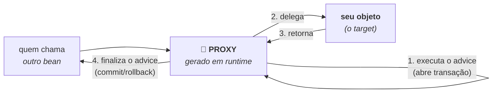

# II - AOP E PROXIES

> [← Voltar para SPRING E SPRING BOOT](README.md) · Anterior: [I - IoC E BEANS](i-ioc-e-beans.md) · Próximo: [III - SPRING BOOT](iii-spring-boot.md)

Este capítulo responde a uma pergunta que todo mundo faz em algum momento: **"por que a minha anotação não funcionou?"** `@Transactional` que não abre transação, `@Cacheable` que não cacheia, `@Async` que roda na mesma thread. A resposta é sempre a mesma, e está no final da seção 3.

## 1. O problema: preocupações transversais

Olhe o que acontece quando as responsabilidades de infraestrutura entram no método de negócio:

```java
public Comprovante transferir(Transferencia t) {
    log.info("iniciando transferência {}", t.id());          // log
    if (!seguranca.podeTransferir(usuario)) throw ...;       // segurança
    long inicio = System.currentTimeMillis();                // métrica
    tx.begin();                                              // transação
    try {
        Comprovante c = executar(t);                         // 👈 o negócio é ISTO
        tx.commit();
        return c;
    } catch (Exception e) {
        tx.rollback();
        throw e;
    } finally {
        metricas.registrar(System.currentTimeMillis() - inicio);
        log.info("fim da transferência {}", t.id());
    }
}
```

Uma linha de regra de negócio, treze de infraestrutura — e esse mesmo bloco se repete, copiado, em todos os métodos da aplicação. Log, segurança, métrica e transação são **preocupações transversais** (*cross-cutting concerns*): assuntos que **atravessam** todas as camadas e não pertencem a nenhuma.

**AOP** — *Aspect-Oriented Programming* — é a resposta: tirar esses assuntos do método e declará-los **por fora**.

```java
@Transactional                                        // a transação virou declaração
public Comprovante transferir(Transferencia t) {
    return executar(t);                               // sobrou só o negócio
}
```

O código não ficou menor por mágica: o que era repetido **foi para outro lugar**. O resto do capítulo é sobre qual lugar.

> AOP **complementa** a orientação a objetos, não a substitui: OO organiza bem o que é vertical (uma hierarquia de domínio), mas não tem resposta boa para o que é horizontal. Tentar resolver transação com herança produz exatamente o acoplamento que [POO](../poo/conceitos-de-poo.md#herança--composição--o-mesmo-problema-dos-dois-jeitos) adverte.

---

## 2. O vocabulário do AOP

São cinco palavras, e todas aparecem na documentação como se fossem óbvias:

| Termo | O que é | No exemplo acima |
|---|---|---|
| ***Aspect*** (aspecto) | o módulo que concentra uma preocupação transversal | "gerenciamento de transação" |
| ***Join point*** (ponto de junção) | um ponto do programa onde o aspecto **poderia** agir. **No Spring AOP, é sempre a execução de um método** — nada de campo ou construtor | a chamada de `transferir(...)` |
| ***Pointcut*** | a **expressão** que seleciona quais *join points* interessam | "todo método anotado com `@Transactional`" |
| ***Advice*** (conselho) | o **código** que roda no ponto selecionado | "abra a transação; no fim, *commit* ou *rollback*" |
| ***Weaving*** (tecelagem) | o ato de **juntar** o aspecto ao código. No Spring, acontece **em runtime**, via proxy; no AspectJ, em tempo de compilação | ver seção 3 |
| ***Target*** (alvo) | o seu objeto original, o que está sendo embrulhado | a sua instância de `ContaService` |

Os tipos de *advice* disponíveis:

| Advice | Quando roda |
|---|---|
| `@Before` | antes do método |
| `@AfterReturning` | depois, **se retornou** normalmente |
| `@AfterThrowing` | depois, **se lançou** exceção |
| `@After` | depois, **em qualquer caso** (como um `finally`) |
| `@Around` | **em volta**: recebe o controle, decide se chama o método, pode alterar argumentos e retorno. É o mais poderoso — e o que a transação usa |

---

## 3. Como o Spring implementa: o proxy

O Spring não reescreve o seu bytecode. Ele faz algo mais simples: **coloca outro objeto na frente do seu**.



Lembre do [ciclo de vida](i-ioc-e-beans.md#5-o-ciclo-de-vida-de-um-bean): na etapa 6, um `BeanPostProcessor` percebe que o bean tem métodos anotados e **devolve um proxy no lugar dele**. A consequência é toda a chave do capítulo:

> 🔑 **O que está registrado no container não é o seu objeto — é o proxy.** Quando outro bean injeta `ContaService`, ele recebe o **embrulho**. E o advice só roda quando a chamada **passa pelo embrulho**.

O Spring tem duas técnicas para fabricar esse embrulho:

| | **JDK dynamic proxy** | **CGLIB** |
|---|---|---|
| Como funciona | cria uma classe que **implementa a mesma interface** do seu bean | cria uma **subclasse** do seu bean, sobrescrevendo os métodos |
| Exige | que o bean implemente uma **interface** | que a **classe e os métodos não sejam `final`** |
| Vem de | da própria JDK (`java.lang.reflect.Proxy`) | biblioteca de geração de bytecode (embutida no Spring) |
| Tipo do objeto resultante | **não** é da sua classe — só da interface | **é** uma subclasse da sua classe |
| Quando o Spring usa | historicamente, quando havia interface | **o padrão no Spring Boot** (`spring.aop.proxy-target-class=true`), com ou sem interface |

Isso explica dois erros de start que parecem esotéricos: se o proxy for JDK e você injetar **a classe concreta** em vez da interface, a injeção falha (o proxy não é daquele tipo); e se a classe for `final`, o CGLIB não consegue herdá-la.

---

## 4. As limitações estruturais do proxy

Como o advice só roda quando a chamada **atravessa** o proxy, tudo o que não atravessa fica sem efeito. **Não é bug: é consequência direta do mecanismo.**

```java
@Service
public class RelatorioService {

    public void gerarTodos(List<Long> ids) {
        ids.forEach(this::gerar);          // ❌ this = o SEU objeto, não o proxy
    }

    @Cacheable("relatorios")
    public Relatorio gerar(Long id) { ... }   // o cache NÃO é consultado aqui
}
```

A chamada veio de dentro: saiu do objeto real e voltou para ele mesmo, **sem passar pelo embrulho**. O cache simplesmente não existe nesse caminho.

| Situação | Por que o advice não roda |
|---|---|
| **Chamada interna** (`this.metodo()`) | não passa pelo proxy |
| Método **`private`** | o proxy não consegue interceptá-lo |
| Método ou classe **`final`** | o CGLIB precisa **sobrescrever**; `final` impede |
| Método **`static`** | não pertence à instância, logo não ao proxy |
| Objeto criado com **`new`** | não é bean: não existe proxy nenhum |
| Chamada vinda de **outra thread** | o advice roda, mas o contexto preso à thread (como o da transação) **não atravessa** |

**As saídas, em ordem de preferência:**

1. **Mover o método para outra bean** — a chamada passa a ser externa e o advice volta a funcionar. É a solução correta na maioria dos casos, e o incômodo costuma ser um bom sinal: `gerarTodos` (orquestração) e `gerar` (unidade de trabalho) eram duas responsabilidades.
2. **Injetar a si mesmo** (`@Lazy RelatorioService self`) e chamar `self.gerar(id)` — funciona, mas declara que o desenho está torto.
3. `AopContext.currentProxy()` — gambiarra, exige `exposeProxy = true`.
4. **AspectJ de verdade** (seção 8), que não usa proxy e portanto não tem essa limitação.

> Essa mesma mesa de limitações, aplicada especificamente a transações — com `@Transactional` em chamada interna, `private` e `@Async` —, está em [TRANSAÇÕES E CONCORRÊNCIA](../spring-data-jpa/iii-transacoes-e-concorrencia.md#4-as-pegadinhas-do-proxy). Vale ler as duas: aqui está **o mecanismo**, lá está **o efeito no caso mais importante**.

---

## 5. Escrevendo um aspecto próprio

Com a dependência `spring-boot-starter-aop`, um aspecto é uma classe anotada:

```java
@Aspect                                      // declara que a classe contém advices
@Component                                   // e que ela é um bean
public class TempoDeExecucaoAspect {

    private static final Logger log = LoggerFactory.getLogger(TempoDeExecucaoAspect.class);

    @Around("@annotation(Cronometrado)")     // pointcut: métodos anotados com @Cronometrado
    public Object medir(ProceedingJoinPoint jp) throws Throwable {
        long inicio = System.nanoTime();
        try {
            return jp.proceed();             // 👈 chama o método original
        } finally {
            long ms = (System.nanoTime() - inicio) / 1_000_000;
            log.info("{} levou {} ms", jp.getSignature().toShortString(), ms);
        }
    }
}
```

```java
@Retention(RetentionPolicy.RUNTIME)
@Target(ElementType.METHOD)
public @interface Cronometrado { }           // a sua anotação, sem nenhuma lógica
```

O `jp.proceed()` é o ponto central do `@Around`: **enquanto você não o chamar, o método original não executou**. Isso te dá o poder de não chamá-lo (bloquear a execução), chamá-lo com outros argumentos, ou chamá-lo mais de uma vez (é assim que `@Retryable` funciona).

**As expressões de *pointcut* mais usadas:**

| Expressão | Seleciona |
|---|---|
| `@annotation(Cronometrado)` | métodos anotados com `@Cronometrado` |
| `execution(* br.com.app.service.*.*(..))` | qualquer método de qualquer classe daquele pacote |
| `execution(public * *..*Service.salvar*(..))` | métodos públicos que começam com `salvar` em classes terminadas em `Service` |
| `within(br.com.app.api..*)` | qualquer *join point* dentro daquele pacote e subpacotes |
| `bean(*Repository)` | beans cujo nome termina em `Repository` |

Quando há vários aspectos no mesmo método, a ordem é indefinida — a menos que você a declare com `@Order` (menor número roda mais "por fora").

---

## 6. As anotações que dependem de proxy

Boa parte do que parece "recurso da linguagem" numa aplicação Spring é, na verdade, um aspecto. Todas as anotações abaixo **herdam as limitações da seção 4**:

| Anotação | O que faz | Precisa de | Onde está detalhada |
|---|---|---|---|
| `@Transactional` | abre e fecha transação | — (autoconfigurado) | [SPRING DATA JPA](../spring-data-jpa/iii-transacoes-e-concorrencia.md#1-como-transactional-funciona) |
| `@Cacheable`, `@CacheEvict` | consulta/invalida cache | `@EnableCaching` | — |
| `@Async` | executa em outra thread | `@EnableAsync` | seção 7 |
| `@Scheduled` | executa periodicamente | `@EnableScheduling` | seção 7 |
| `@PreAuthorize`, `@Secured` | autoriza antes de executar | `@EnableMethodSecurity` | [SPRING SECURITY](../spring-security/README.md#29-method-security) |
| `@Retryable` | repete em caso de falha | Spring Retry | [RESILIÊNCIA](../arquitetura-distribuida/iv-resiliencia.md#3-retry--repetir-mas-com-juízo) |
| `@Validated` | valida os argumentos | — | [Bean Validation](../spring-mvc-apis-restful/iii-spring-mvc-na-pratica.md#4-bean-validation) |

> **O diagnóstico universal:** quando uma dessas não surte efeito, a pergunta não é "o que há de errado com a anotação" — é **"essa chamada passou pelo proxy?"**. Na prática: a classe é bean? o método é público? a chamada veio de fora da classe? É quase sempre uma dessas três.

---

## 7. Eventos, `@Async` e `@Scheduled`

O container também serve como **barramento interno** de mensagens, sem broker nenhum. É um recurso subestimado para desacoplar código dentro do mesmo processo:

```java
// quem publica não conhece quem reage
@Service
public class PedidoService {
    private final ApplicationEventPublisher publisher;

    public PedidoService(ApplicationEventPublisher publisher) { this.publisher = publisher; }

    @Transactional
    public void criar(Pedido p) {
        repository.save(p);
        publisher.publishEvent(new PedidoCriado(p.getId()));   // qualquer objeto serve de evento
    }
}
```
```java
@Component
public class NotificaCliente {

    @TransactionalEventListener(phase = TransactionPhase.AFTER_COMMIT)
    public void ao(PedidoCriado evento) { email.enviar(evento.pedidoId()); }
}
```

| Detalhe | Comportamento |
|---|---|
| `@EventListener` | **síncrono** por padrão: roda na **mesma thread** e dentro da **mesma transação** de quem publicou |
| `@TransactionalEventListener` | amarra o listener a uma **fase da transação**. `AFTER_COMMIT` é o que você quase sempre quer: não envie e-mail de um pedido que ainda pode sofrer *rollback* |
| `@EventListener` + `@Async` | roda em outra thread — e aí **sai** da transação do publicador |
| Eventos do ciclo de vida | o próprio Spring publica `ApplicationStartedEvent`, `ApplicationReadyEvent`, `ContextClosedEvent` |

É o padrão [Observer](../design-patterns-em-oo/iii-padroes-comportamentais.md#4-observer) dentro do processo. Mas atenção ao limite: **evento do Spring não é mensageria**. Não há persistência, retentativa nem garantia de entrega — se o processo morrer, o evento se perde. Quando isso importa, o assunto é [MENSAGERIA](../mensageria/README.md) e o padrão é [Outbox](../arquitetura-distribuida/iii-consistencia-e-dados.md#5-outbox--o-problema-da-escrita-dupla).

**Os dois recursos "fora da requisição"** e suas pegadinhas:

| Recurso | Pegadinha |
|---|---|
| `@Async` | o método deve retornar `void` ou `CompletableFuture`. Em `void`, **exceções são silenciosamente perdidas** se você não registrar um `AsyncUncaughtExceptionHandler`. E o contexto de transação e de segurança **não** atravessa a troca de thread |
| `@Scheduled` | o agendador tem **uma única thread** por padrão: uma tarefa lenta atrasa todas as outras. E, com **várias instâncias** da aplicação no ar, **todas** executam a tarefa — se ela não puder rodar em duplicidade, é preciso bloqueio distribuído |

---

## 8. Spring AOP × AspectJ

| | **Spring AOP** | **AspectJ** |
|---|---|---|
| Mecanismo | **proxy** criado em runtime | **modifica o bytecode** (em tempo de compilação ou de carga) |
| Alcance | só execução de **método público**, só em **beans**, só chamada **externa** | qualquer método (inclusive `private`), construtor, acesso a campo, chamada interna |
| Configuração | nenhuma: já vem pronto | exige compilador próprio ou agente Java |
| Desempenho | custo de uma indireção por chamada | praticamente nenhum em runtime |
| Quando usar | **quase sempre** — é o suficiente | quando as limitações do proxy inviabilizam o requisito |

A regra prática: **fique no Spring AOP.** Se você se vê precisando de AspectJ para interceptar uma chamada interna, o sinal mais provável é de que o desenho das classes está pedindo refatoração, não que o framework está no caminho.

---

## Perguntas para autoavaliação

1. O que são preocupações transversais? Dê quatro exemplos.
2. Por que herança não resolve bem esse tipo de preocupação?
3. Defina: *aspect*, *join point*, *pointcut*, *advice*, *weaving*, *target*.
4. O que é um *join point* no Spring AOP — e o que **não** é?
5. Cite os cinco tipos de *advice* e quando cada um roda.
6. Como o Spring implementa AOP, em uma frase?
7. O que exatamente está registrado no container: o seu objeto ou o proxy? Qual a consequência?
8. Em que etapa do ciclo de vida de um bean o proxy é criado?
9. Compare JDK dynamic proxy e CGLIB em quatro critérios.
10. Qual é o padrão no Spring Boot, e que erro de start uma classe `final` produz?
11. Por que uma chamada interna (`this.metodo()`) não ativa o advice?
12. Liste seis situações em que o advice não roda.
13. Quais são as quatro saídas para o problema da chamada interna, em ordem de preferência?
14. Por que a primeira saída é a melhor, e o que o incômodo costuma indicar?
15. Escreva (ou descreva) um `@Around` que meça o tempo de execução. Qual o papel do `proceed()`?
16. O que acontece se você não chamar `proceed()`? E se chamar duas vezes?
17. Cite quatro expressões de *pointcut* e o que selecionam.
18. Cite cinco anotações que dependem de proxy e o que cada uma exige para funcionar.
19. Qual é o diagnóstico universal de "minha anotação não funcionou"?
20. Qual a diferença entre `@EventListener` e `@TransactionalEventListener`?
21. Por que `AFTER_COMMIT` é quase sempre o que se quer?
22. Por que evento do Spring não é mensageria? O que fazer quando a entrega precisa ser garantida?
23. Quais as duas pegadinhas de `@Async` e as duas de `@Scheduled`?
24. Compare Spring AOP e AspectJ. Quando o segundo se justifica?

---

> [← Voltar para SPRING E SPRING BOOT](README.md) · Anterior: [I - IoC E BEANS](i-ioc-e-beans.md) · Próximo: [III - SPRING BOOT](iii-spring-boot.md)
