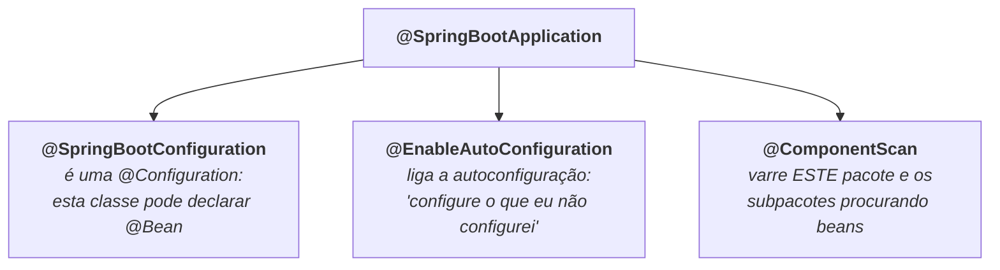
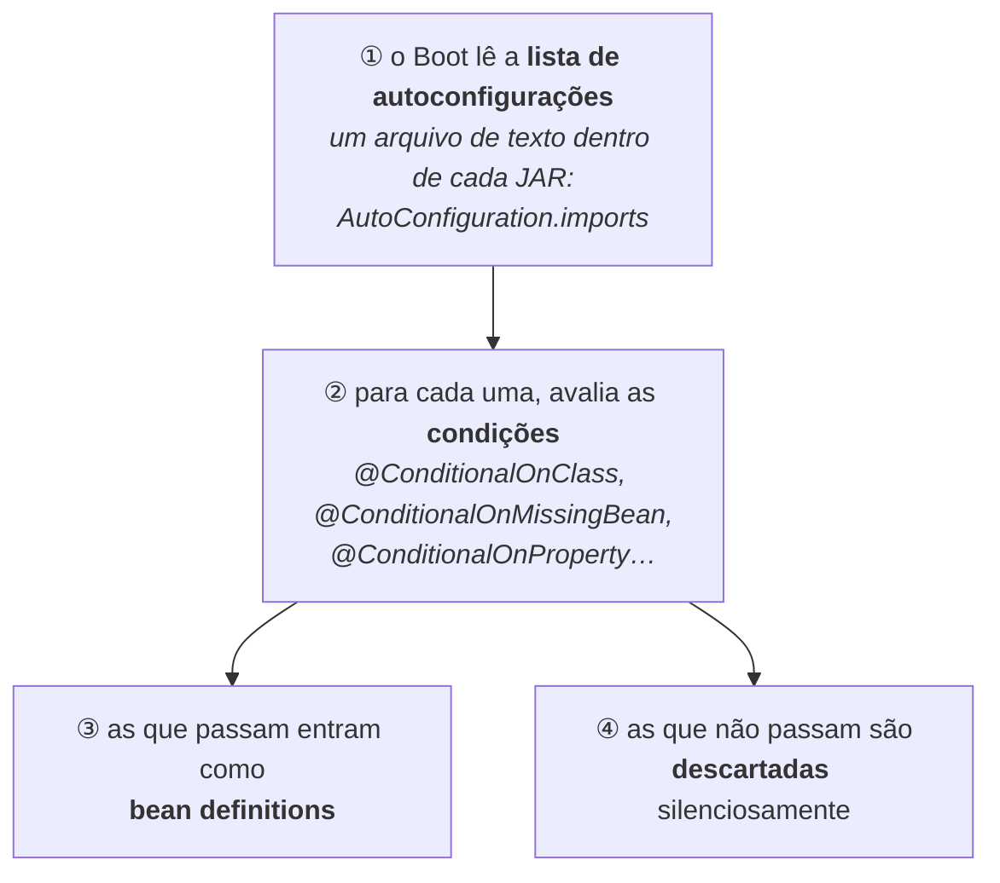

# III - SPRING BOOT

> [← Voltar para SPRING E SPRING BOOT](README.md) · Anterior: [II - AOP E PROXIES](ii-aop-e-proxies.md)

## 1. O que o Boot acrescenta

Antes do Spring Boot (2014), começar um projeto Spring significava: escolher cada dependência e descobrir quais versões eram compatíveis entre si; escrever a configuração do `DispatcherServlet`, do `DataSource`, do `EntityManagerFactory`, do gerenciador de transações; instalar um Tomcat e nele implantar um WAR. Semanas de montagem antes da primeira linha de negócio.

O Boot ataca isso com **cinco** coisas — e nenhuma delas é um framework novo:

| O que ele traz | O que resolve |
|---|---|
| **Starters** | "quais dependências, em quais versões" |
| **Autoconfiguração** | "qual a configuração padrão razoável" |
| **Servidor embutido** | "onde isso roda" — o Tomcat vem dentro do JAR |
| **Configuração externalizada** | "como mudo valores por ambiente, sem recompilar" |
| **Actuator** | "como vejo a aplicação por dentro em produção" |

O princípio é **convenção sobre configuração**, com uma regra que vale memorizar: **o Boot configura apenas o que você não configurou.** Declare o seu próprio `DataSource` e o dele desaparece. Não é um sistema fechado de "faça do meu jeito" — é um conjunto de padrões que você sobrescreve pontualmente.

---

## 2. `@SpringBootApplication` decomposto

Toda aplicação começa com três linhas:

```java
@SpringBootApplication
public class PedidosApplication {
    public static void main(String[] args) {
        SpringApplication.run(PedidosApplication.class, args);
    }
}
```

Essa anotação é só um atalho para três outras:



Duas consequências práticas dessa decomposição:

- A classe principal define **a raiz do *component scan***. É por isso que a convenção é colocá-la no **pacote mais alto** do projeto: tudo abaixo dela é varrido, e o que está fora não existe para o Spring. → [a pegadinha do scan](i-ioc-e-beans.md#2-as-três-formas-de-declarar-um-bean)
- Dá para excluir uma autoconfiguração específica quando ela incomoda:

```java
@SpringBootApplication(exclude = DataSourceAutoConfiguration.class)
```

---

## 3. Autoconfiguração: o mecanismo

Não é mágica nem convenção secreta: é **um monte de classes `@Configuration` já escritas**, que vêm dentro das dependências e são ativadas sob condições. O fluxo:



Um exemplo simplificado do que vem dentro do `spring-boot-autoconfigure`:

```java
@AutoConfiguration
@ConditionalOnClass(DataSource.class)                  // só se JDBC estiver no classpath
@ConditionalOnProperty("spring.datasource.url")        // e se a URL foi informada
public class DataSourceAutoConfiguration {

    @Bean
    @ConditionalOnMissingBean                          // 🔑 só se VOCÊ não declarou um
    public DataSource dataSource(DataSourceProperties props) {
        return props.initializeDataSourceBuilder().build();
    }
}
```

| Condição | Significado |
|---|---|
| `@ConditionalOnClass` | **a classe está no classpath** → ou seja, "a dependência foi adicionada". É assim que adicionar o *starter* de JPA liga a configuração de JPA |
| `@ConditionalOnMissingBean` | **você não declarou o seu** — a chave de toda a filosofia: *o seu bean sempre ganha* |
| `@ConditionalOnProperty` | uma propriedade está presente/com certo valor |
| `@ConditionalOnWebApplication` | é uma aplicação web (ou não é) |
| `@ConditionalOnMissingClass` | a classe **não** está no classpath |

### Starters

Um ***starter*** é uma dependência **sem código**: um `pom.xml` que arrasta um conjunto coerente de outras.

| Starter | Traz |
|---|---|
| `spring-boot-starter-web` | Spring MVC + Jackson + **Tomcat embutido** + validação |
| `spring-boot-starter-data-jpa` | Spring Data JPA + Hibernate + pool de conexões |
| `spring-boot-starter-security` | Spring Security e sua filter chain |
| `spring-boot-starter-validation` | Bean Validation (Hibernate Validator) |
| `spring-boot-starter-actuator` | os endpoints de observabilidade |
| `spring-boot-starter-test` | JUnit 5, AssertJ, Mockito, Spring Test → [TESTES](../testes-em-software/iii-testes-no-spring.md#1-o-que-vem-no-spring-boot-starter-test) |

E a compatibilidade de versões vem do **BOM** (`spring-boot-starter-parent` como *parent*, ou o `spring-boot-dependencies` importado): você declara dependências **sem versão** e o Boot garante um conjunto testado em conjunto.

> **Como descobrir o que foi ligado e por quê:** `/actuator/conditions` ou subir com `--debug`. O relatório lista, de um lado, as autoconfigurações que entraram e **qual condição as aprovou**; de outro, as que não entraram e **qual condição as reprovou**. É a ferramenta certa para "por que esse bean existe?" e "por que o meu não foi usado?". → [inspecionar o container](i-ioc-e-beans.md#10-como-inspecionar-o-container)

---

## 4. Configuração externalizada

**Externalizada** significa: o mesmo artefato roda em qualquer ambiente, mudando só valores de fora. É o [terceiro fator](../docker/capitulo-v-orquestracao-de-containeres.md#5-boas-práticas-de-container-em-produção) dos 12 fatores.

```properties
# application.properties
server.port=8080
spring.datasource.url=jdbc:postgresql://localhost:5432/pedidos
pedido.limite-itens=50
```

O Spring reúne **todas** as fontes num só lugar (o `Environment`) e resolve conflitos por **precedência** — quem está mais perto do ambiente de execução ganha:

| Precedência | Fonte |
|---|---|
| 🔝 mais forte | argumentos de linha de comando (`--server.port=9090`) |
| | propriedades de sistema (`-Dserver.port=9090`) |
| | **variáveis de ambiente** (`SERVER_PORT=9090`) ← o caminho em container |
| | `application-{perfil}.properties` **fora** do JAR |
| | `application-{perfil}.properties` **dentro** do JAR |
| | `application.properties` **fora** do JAR |
| ⬇️ mais fraca | `application.properties` **dentro** do JAR |

*(lista simplificada — a ordem completa na documentação tem mais degraus, como `SPRING_APPLICATION_JSON` e configuração de testes)*

**Relaxed binding** é o recurso que faz isso funcionar bem em container: a propriedade `pedido.limite-itens` pode chegar como `PEDIDO_LIMITEITENS` por variável de ambiente, ou `pedido.limiteItens`, e tudo é reconhecido como a mesma chave. Atenção: esse recurso vale para `@ConfigurationProperties` — **`@Value` exige a chave exata.**

### `@Value` × `@ConfigurationProperties`

```java
// @Value — um valor isolado
@Value("${pedido.limite-itens:50}")      // o ":50" é o valor padrão
private int limiteItens;
```

```java
// @ConfigurationProperties — um grupo tipado (com record, no Boot 3)
@ConfigurationProperties(prefix = "pedido")
@Validated
public record PedidoProperties(
        @Positive int limiteItens,
        Optional<String> webhook,
        Retentativa retentativa) {

    public record Retentativa(int maximo, Duration espera) { }
}
```

| | `@Value` | `@ConfigurationProperties` |
|---|---|---|
| Granularidade | um valor | **um grupo inteiro** |
| Tipagem | *String* convertida | tipos ricos: `Duration`, `DataSize`, listas, aninhados |
| Validação | nenhuma | `@Validated` + Bean Validation, **falha no start** |
| *Relaxed binding* | **não** | **sim** |
| Testabilidade | injeta valor solto | é um objeto que se passa no construtor |
| Recomendação | valor pontual | **o padrão para qualquer configuração da sua aplicação** |

---

## 5. Perfis

Um **perfil** (*profile*) é um rótulo de ambiente que liga e desliga configuração e beans.

```properties
# application.properties — comum a todos
spring.application.name=pedidos

# application-dev.properties
spring.jpa.show-sql=true
logging.level.br.com.app=DEBUG

# application-prod.properties
spring.datasource.url=${DB_URL}
spring.jpa.hibernate.ddl-auto=validate
```

```bash
java -jar app.jar --spring.profiles.active=prod
# ou
SPRING_PROFILES_ACTIVE=prod java -jar app.jar
```

| Recurso | Como se usa |
|---|---|
| Arquivo por perfil | `application-{perfil}.properties` (ou `.yaml`) |
| Ativar | `spring.profiles.active`, por variável de ambiente, argumento ou propriedade |
| Bean por perfil | `@Profile("dev")`, `@Profile("!prod")` na classe ou no método `@Bean` |
| Agrupar | `spring.profiles.group.local=dev,mock-pagamentos` liga vários de uma vez |
| Nenhum ativo | vale o perfil `default` |

> **O erro clássico:** usar perfil para guardar **segredo** (`application-prod.properties` com a senha do banco, versionada no Git). Perfil serve para **comportamento**; segredo vem de variável de ambiente, *secret manager* ou ConfigMap/Secret do Kubernetes. → [SPRING SECURITY](../spring-security/README.md)

---

## 6. Actuator

O Actuator expõe a aplicação por dentro, por HTTP. **Por padrão, só o `health` é exposto** — os outros endpoints precisam ser habilitados explicitamente, e isso é proposital: `/env` e `/beans` contam muito sobre a aplicação.

```properties
management.endpoints.web.exposure.include=health,info,metrics,prometheus
management.endpoint.health.show-details=when-authorized
management.endpoint.health.probes.enabled=true
```

| Endpoint | Para que serve |
|---|---|
| `/actuator/health` | a aplicação está viva e pronta? |
| `/actuator/health/liveness` e `/readiness` | as duas sondas separadas, para o Kubernetes |
| `/actuator/info` | versão, *commit*, dados de build |
| `/actuator/metrics` e `/actuator/prometheus` | métricas via Micrometer → [OBSERVABILIDADE](../arquitetura-distribuida/v-observabilidade.md#4-métricas) |
| `/actuator/beans` | **todos os beans** do container, com tipo, escopo e dependências |
| `/actuator/conditions` | o relatório de autoconfiguração (seção 3) |
| `/actuator/mappings` | todas as rotas HTTP mapeadas |
| `/actuator/loggers` | **lê e muda o nível de log em runtime**, sem reiniciar |
| `/actuator/env` | todas as propriedades e de qual fonte cada uma veio |
| `/actuator/threaddump`, `/heapdump` | diagnóstico de travamento e de memória |

A distinção **liveness × readiness** é a que mais importa em produção: *liveness* reprovado significa "me reinicie"; *readiness* reprovado significa "não me mande tráfego agora" (ainda estou subindo, ou o banco caiu). Confundi-las produz pods reiniciando em cascata durante uma instabilidade do banco. → [OBSERVABILIDADE](../arquitetura-distribuida/v-observabilidade.md)

> **Segurança do Actuator:** esses endpoints não são públicos. Em produção, exponha-os numa **porta separada** (`management.server.port`) acessível só pela rede interna, ou proteja-os com autenticação. `/actuator/env` e `/heapdump` na internet são incidente de segurança.

---

## 7. DevTools e produtividade

A dependência `spring-boot-devtools` (que o Boot **não** embarca no artefato de produção) dá:

| Recurso | O que faz |
|---|---|
| ***Restart* automático** | ao recompilar, o Boot reinicia **só o seu código**, mantendo as bibliotecas carregadas (dois *classloaders*). É mais rápido que reiniciar, mas **é um reinício** — diferente do *live reload* do [Quarkus](../quarkus/i-como-funciona.md#6-dev-mode--o-que-mais-impressiona-na-prática), que troca as classes no processo em pé |
| **LiveReload** | recarrega o navegador sozinho |
| **Padrões de desenvolvimento** | desliga cache de template, ajusta log |
| **Infra em container** | desde o Boot 3.1: `spring-boot-docker-compose` sobe o `docker-compose.yml` do projeto, e o suporte a **Testcontainers** com `@ServiceConnection` conecta a aplicação ao container automaticamente |

---

## 8. Empacotamento

```bash
./mvnw package                    # gera o fat jar em target/
java -jar target/pedidos-1.0.0.jar
```

O ***fat jar*** (ou *uber jar*) do Boot não é um JAR comum: ele guarda as dependências **como JARs aninhados** e um carregador próprio que sabe lê-los.

```
pedidos-1.0.0.jar
├── META-INF/MANIFEST.MF          → Main-Class: o launcher do Boot
│                                   Start-Class: a SUA classe main
├── BOOT-INF/classes/             → o seu código
├── BOOT-INF/lib/                 → as dependências, como .jar
└── org/springframework/boot/loader/  → o launcher
```

Para container, o detalhe que importa é o ***layered jar***: o Boot grava um índice de camadas (dependências, dependências de *snapshot*, recursos, o seu código) que permite extrair cada grupo numa **camada de imagem diferente**. Como o seu código muda a cada build e as dependências não, o cache de camadas do Docker é reaproveitado e a imagem nova pesa pouco. → [imagem em camadas](../docker/capitulo-i-introducao-ao-docker.md#4-imagem-em-camadas-e-copy-on-write)

```dockerfile
# multi-stage com extração de camadas
FROM eclipse-temurin:21-jre AS builder
WORKDIR /app
COPY target/*.jar app.jar
RUN java -Djarmode=tools -jar app.jar extract --layers --destination extracted
# (em versões anteriores do Boot, o modo se chama "layertools")

FROM eclipse-temurin:21-jre
WORKDIR /app
COPY --from=builder /app/extracted/dependencies/ ./
COPY --from=builder /app/extracted/spring-boot-loader/ ./
COPY --from=builder /app/extracted/application/ ./
RUN useradd -r app && chown -R app /app
USER app
ENTRYPOINT ["java", "org.springframework.boot.loader.launch.JarLauncher"]
```

| Alternativa | Como |
|---|---|
| **Buildpacks** | `./mvnw spring-boot:build-image` — monta a imagem sem você escrever `Dockerfile` |
| **WAR** | ainda suportado, para quem precisa de servidor de aplicação externo |
| **Desligamento ordenado** | `server.shutdown=graceful`: para de aceitar requisições novas e espera as em andamento terminarem. **Obrigatório** em Kubernetes, para que o *rolling update* não derrube requisições |

---

## 9. O que mudou no Spring Boot 3

| Mudança | O que significa |
|---|---|
| **Java 17 como mínimo** | records, `sealed`, *pattern matching* disponíveis → [Java moderno](../poo/conceitos-de-poo.md#java-moderno-records-sealed-e-pattern-matching) |
| **`javax` → `jakarta`** | a migração mais trabalhosa do Boot 2 para o 3: todo `import javax.persistence` virou `jakarta.persistence` |
| **Observabilidade unificada** | Micrometer com API de *Observation* e tracing integrado, substituindo o Spring Cloud Sleuth |
| **AOT e imagem nativa** | o Boot processa a aplicação em tempo de build e suporta GraalVM → [QUARKUS × SPRING](../quarkus/iii-quarkus-x-spring.md#6-imagem-nativa-o-quarkus-não-é-mais-o-único) |
| **CRaC** (3.2+) | *checkpoint/restore*: salva o processo já aquecido e o restaura em milissegundos |
| **Threads virtuais** (3.2+) | `spring.threads.virtual.enabled=true` — uma thread por requisição deixa de ser caro |
| **`@MockitoBean`** (3.4+) | substitui o `@MockBean`, depreciado no 3.4 e **removido no 4.0** → [TESTES NO SPRING](../testes-em-software/iii-testes-no-spring.md) |

---

## 10. E o Spring Boot 4

A linha **4.x** já é a corrente (sobre o **Spring Framework 7**). Os exemplos deste material são de Boot 3, e continuam válidos: **container, bean, escopo, proxy, autoconfiguração e configuração externalizada não mudaram** — é tudo o que os capítulos [I](i-ioc-e-beans.md) e [II](ii-aop-e-proxies.md) descrevem. O que muda é a plataforma embaixo e alguns nomes.

| Item | Boot 3 | **Boot 4** |
|---|---|---|
| Spring Framework | 6.x | **7.x** |
| Java | 17+ | **17+** (suportado até o 27) |
| Servlet | 6.0 (Tomcat 10) | **6.1** (Tomcat 11, Jetty 12.1) |
| Jakarta Persistence | 3.1 | **3.2** (Hibernate 7.2) |
| Jackson | 2.x | **3.0** — o suporte ao Jackson 2 vem depreciado |
| `@MockBean` / `@SpyBean` | depreciados no 3.4 | **removidos** |

**O que o 4 acrescenta e vale conhecer:**

| Novidade | O que é |
|---|---|
| **HTTP Service Clients** | autoconfiguração para interfaces anotadas com `@HttpExchange` — o cliente HTTP declarativo deixa de exigir montagem manual, aproximando-se do [`@RegisterRestClient` do Quarkus](../quarkus/ii-quarkus-na-pratica.md#2-endpoint-rest) |
| **Versionamento de API** | suporte de primeira classe no MVC e no WebFlux, para o problema discutido em [EVOLUÇÃO DA API](../spring-mvc-apis-restful/iv-evolucao-da-api.md#2-versionamento) |
| **`RestTestClient`** | um cliente de teste único para MockMvc e para servidor no ar → [TESTES NO SPRING](../testes-em-software/iii-testes-no-spring.md) |
| **`spring-boot-starter-opentelemetry`** | starter dedicado para métricas e traces via OTLP → [OBSERVABILIDADE](../arquitetura-distribuida/v-observabilidade.md) |
| Renomes de propriedade | `management.tracing.enabled` → `management.tracing.export.enabled`, entre outros |

> **O que isso significa para quem está estudando:** aprender Boot 3 **não** é aprender errado — a mudança de 3 para 4 é de plataforma (Jakarta, Jackson, Tomcat) e de limpeza de API, não de modelo mental. A migração realmente trabalhosa foi a de **2 para 3** (`javax` → `jakarta`).

---

## Perguntas para autoavaliação

1. Quais são as cinco coisas que o Spring Boot acrescenta ao Spring Framework?
2. Enuncie a regra central da autoconfiguração em uma frase.
3. Em quais três anotações `@SpringBootApplication` se decompõe, e o que cada uma faz?
4. Por que a classe principal deve ficar no pacote mais alto do projeto?
5. Descreva os quatro passos do mecanismo de autoconfiguração.
6. O que `@ConditionalOnClass` e `@ConditionalOnMissingBean` avaliam, e por que a segunda é a chave da filosofia?
7. O que é um *starter* e por que se diz que ele não tem código?
8. Para que serve o BOM do Boot?
9. Como descobrir por que uma autoconfiguração entrou — ou não entrou?
10. O que significa configuração "externalizada" e qual problema resolve?
11. Ordene as fontes de configuração por precedência. Qual delas é o caminho natural em container?
12. O que é *relaxed binding* e por que `@Value` não participa dele?
13. Compare `@Value` e `@ConfigurationProperties` em cinco critérios.
14. Como se ativa um perfil? Cite três formas.
15. Por que perfil não é lugar para segredo? Onde segredo deve ficar?
16. Por que o Actuator expõe só o `health` por padrão?
17. Qual a diferença entre *liveness* e *readiness*, e o que acontece se forem confundidas?
18. Por que o Actuator deve ir para outra porta ou ser autenticado?
19. Qual a diferença entre o *restart* do DevTools e o *live reload* do Quarkus?
20. O que o `fat jar` tem dentro, e por que ele não é um JAR comum?
21. O que é um *layered jar* e por que ele importa para a imagem de container?
22. Para que serve `server.shutdown=graceful` e por que é obrigatório em Kubernetes?
23. Cite quatro mudanças do Spring Boot 3 e o impacto de cada uma.
24. O que muda do Boot 3 para o Boot 4 — e o que **não** muda?
25. Por que a migração de 2 para 3 foi mais trabalhosa que a de 3 para 4?
26. Cite três novidades do Boot 4 e o problema que cada uma ataca.

---

> [← Voltar para SPRING E SPRING BOOT](README.md) · Anterior: [II - AOP E PROXIES](ii-aop-e-proxies.md)
