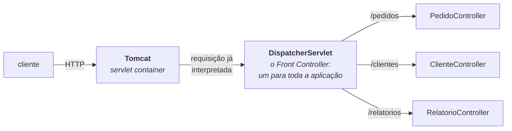
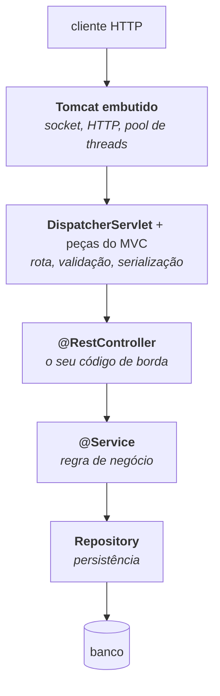

# I - INTRODUÇÃO SOBRE O SPRING MVC

> [← Voltar para Spring MVC - APIs RESTful](README.md) · Próximo: [II - Fundamentos REST](ii-fundamentos-rest.md)

**Spring MVC** é a camada web do Spring: o pedaço do framework que transforma uma **requisição HTTP** em uma **chamada de método Java**, e o valor retornado de volta em uma **resposta HTTP**. É só isso que ele faz — e é por isso que ele é a porta de entrada de toda aplicação Spring que atende a internet.

> A origem do Spring, o problema dos EJBs e os pilares do framework estão em [SPRING E SPRING BOOT](../spring-e-spring-boot/README.md#4-de-onde-o-spring-veio-o-problema-dos-ejbs). Aqui o assunto é **a camada web**, e esta matéria supõe que o container, o *bean* e o proxy já estejam entendidos — se não estiverem, comece por [IoC e beans](../spring-e-spring-boot/i-ioc-e-beans.md).

---

## 1. O que é um servlet

Antes do Spring existir, a especificação Java já tinha uma resposta para "como atender HTTP em Java": o **servlet**.

> **Servlet:** um objeto Java que **recebe uma requisição HTTP e escreve uma resposta**, executado por um **servlet container** (Tomcat, Jetty, Undertow).

A divisão de trabalho entre os dois é o que importa:

| Quem | Cuida de |
|---|---|
| **O servlet container** (Tomcat) | abrir a porta TCP, aceitar conexões, **interpretar o protocolo HTTP** (linha de requisição, cabeçalhos, corpo), gerenciar o **pool de threads** e devolver os bytes da resposta |
| **O servlet** (o seu código, ou o do framework) | olhar a requisição **já interpretada** e decidir o que responder |

Duas consequências que atravessam todas as matérias de Spring:

- **O modelo é uma thread por requisição.** O container tira uma thread do pool, entrega a requisição a ela e só a devolve quando a resposta sai. Se o seu código bloqueia esperando o banco, aquela thread fica parada e indisponível — a origem do argumento das [threads virtuais](../jvm-e-plataforma-java/iii-subir-e-operar-em-producao.md#3-threads-plataforma--virtuais) e da programação reativa.
- **Você não escreve servlets.** O Spring MVC fornece **um** servlet que recebe absolutamente tudo e distribui internamente para os seus métodos. Esse servlet é o `DispatcherServlet`.

---

## 2. O padrão Front Controller

Em vez de um servlet por tela ou por rota — como se fazia nos anos 2000, declarando cada um no `web.xml` —, o Spring MVC implementa o padrão **Front Controller**: **um** ponto de entrada único recebe todas as requisições e as despacha.

O ganho é concentrar num só lugar tudo o que vale para **todas** as requisições: resolução de rota, conversão de parâmetros, validação, tratamento de erro, serialização, interceptadores. É o mesmo princípio do padrão [Facade](../design-patterns-em-oo/ii-padroes-estruturais.md#5-facade) aplicado à borda HTTP. O ciclo completo desse despacho, passo a passo, está em [III - Spring MVC na prática](iii-spring-mvc-na-pratica.md#1-o-ciclo-do-dispatcherservlet).

---

## 3. O que "MVC" significa — e por que o nome confunde

**MVC** é um padrão de interface com o usuário: **Model** (os dados), **View** (a apresentação) e **Controller** (quem recebe a interação e coordena os dois). O nome do framework vem da época em que a aplicação Java **gerava a tela**: o controller buscava os dados e escolhia um template JSP ou Thymeleaf para renderizar HTML.

Numa **API REST** — que é o caso desta matéria — **não existe View**:

| Peça do MVC | Aplicação web clássica | API REST |
|---|---|---|
| **Model** | os objetos que vão para a tela | o **DTO** de resposta → [DTOs](iii-spring-mvc-na-pratica.md#3-dtos--e-por-que-nunca-expor-a-entidade-jpa) |
| **View** | um template (JSP, Thymeleaf) que produz **HTML** | **não há**: o lugar dela é ocupado pela **serialização em JSON**, feita por um `HttpMessageConverter` (o Jackson) |
| **Controller** | `@Controller`, que devolve o **nome de uma view** | `@RestController`, que devolve **o próprio objeto** — e o framework o converte |

É exatamente essa a diferença entre `@Controller` e `@RestController`: o segundo é o primeiro **mais** `@ResponseBody`, que significa "o retorno **é** o corpo da resposta, não o nome de uma view".

> Então o nome "Spring MVC" é, numa API REST, um resquício histórico: você usa o **C** e o **M** do padrão, e troca o **V** por serialização. Vale saber disso para não procurar uma camada de *view* que não existe no seu projeto.

---

## 4. As peças do Spring MVC

| Componente | Papel |
|---|---|
| **`DispatcherServlet`** | o Front Controller: recebe tudo e orquestra as peças abaixo |
| **`HandlerMapping`** | descobre **qual método** atende aquela URL e aquele verbo |
| **`HandlerAdapter`** | invoca o método, resolvendo os parâmetros (`@PathVariable`, `@RequestBody`…) |
| **`HttpMessageConverter`** | converte **corpo ↔ objeto** nos dois sentidos (JSON ⇄ Java, via Jackson) |
| **`HandlerExceptionResolver`** | transforma exceção em resposta HTTP → [tratamento de erros](iii-spring-mvc-na-pratica.md#5-tratamento-de-erros) |
| **`ViewResolver`** | escolhe o template, **só** em aplicação que renderiza HTML |
| **Interceptadores e filtros** | código que roda antes/depois, para toda requisição → [filtro × interceptor × AOP](iii-spring-mvc-na-pratica.md#8-filtro--interceptor--aop) |

Todas essas peças são **beans** no container, com implementações padrão fornecidas pela autoconfiguração do Spring Boot — e todas podem ser substituídas. → [autoconfiguração](../spring-e-spring-boot/iii-spring-boot.md#3-autoconfiguração-o-mecanismo)

---

## 5. Onde o Spring MVC se encaixa

| Camada | Matéria |
|---|---|
| Tomcat, threads, memória | [JVM E PLATAFORMA JAVA](../jvm-e-plataforma-java/README.md) |
| Container, beans, proxies, autoconfiguração | [SPRING E SPRING BOOT](../spring-e-spring-boot/README.md) |
| **DispatcherServlet, rotas, DTOs, erros, evolução da API** | **esta matéria** |
| Persistência e transação | [SPRING DATA JPA](../spring-data-jpa/README.md) |
| Autenticação e autorização | [SPRING SECURITY](../spring-security/README.md) |
| Organização em camadas | [CLEAN ARCHITECTURE](../clean-architecture/README.md) |

---

## 6. MVC × WebFlux, em uma linha

O Spring tem **duas** pilhas web: o **MVC**, sobre servlet, com thread por requisição; e o **WebFlux**, sobre Netty, não bloqueante e reativo. Escolher entre elas é decisão de projeto, não de método — a comparação está em [III - Spring MVC × WebFlux](iii-spring-mvc-na-pratica.md#9-spring-mvc--webflux) e, no contraste com outro framework, em [QUARKUS × SPRING](../quarkus/iii-quarkus-x-spring.md#5-modelo-de-execução-e-programação-reativa).

---

## Perguntas para autoavaliação

1. O que o Spring MVC faz, em uma frase?
2. O que é um servlet, e como o trabalho se divide entre ele e o servlet container?
3. O que o container faz com o protocolo HTTP antes de o seu código ver a requisição?
4. O que é o modelo "uma thread por requisição", e que problema ele cria?
5. Quantos servlets uma aplicação Spring MVC tem, e qual é?
6. O que é o padrão Front Controller e o que se ganha com ele?
7. O que significam as três letras de MVC?
8. Numa API REST, quem ocupa o lugar da View?
9. Qual a diferença entre `@Controller` e `@RestController`?
10. Por que o nome "Spring MVC" é um resquício histórico numa API REST?
11. Para que servem `HandlerMapping`, `HandlerAdapter` e `HttpMessageConverter`?
12. De onde vêm as implementações padrão dessas peças?
13. Em que camada cada matéria de Spring atua?
14. Qual a diferença entre MVC e WebFlux?

---

> [← Voltar para Spring MVC - APIs RESTful](README.md) · Próximo: [II - Fundamentos REST](ii-fundamentos-rest.md)
