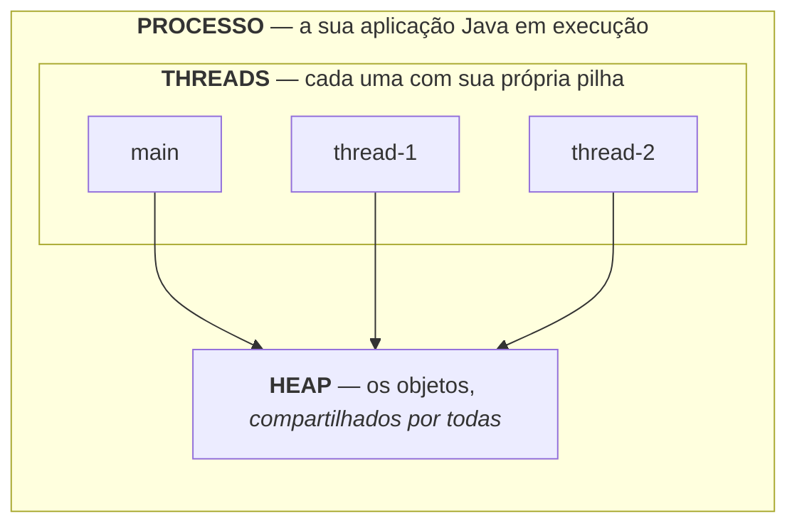
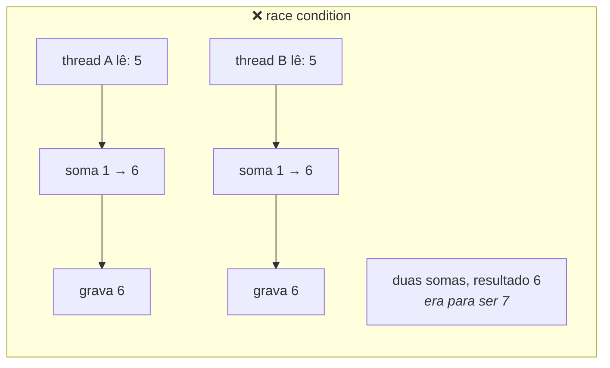

# THREADS E CONCORRÊNCIA

> **Capítulos:** [I - Criando e controlando threads](i-criando-e-controlando-threads.md) · [II - Compartilhando memória](ii-compartilhando-memoria.md) · [III - java.util.concurrent](iii-java-util-concurrent.md)

Esta matéria começa do zero: o que é uma thread, por que elas existem e por que elas quebram tudo quando você não toma cuidado. Se você nunca escreveu uma linha de código concorrente, **comece por aqui e leia na ordem**.

---

## 1. O problema: um programa faz uma coisa de cada vez

Um programa comum executa **uma instrução depois da outra**. Se uma delas demora, tudo para e espera:

```java
public static void main(String[] args) {
    baixarArquivo();      // 3 segundos — o programa fica parado aqui
    baixarOutro();        // mais 3 segundos
    System.out.println("pronto");   // só aparece depois de 6 segundos
}
```

Os 6 segundos **não** são de trabalho: são de **espera**. O processador está ocioso, esperando a rede responder. Se os dois downloads acontecessem ao mesmo tempo, o total seria 3 segundos em vez de 6.

É isso que uma thread resolve.

> **Thread** (em português, *linha de execução*): uma sequência de instruções que o processador executa. Um programa pode ter **várias ao mesmo tempo**, cada uma andando pelo seu próprio caminho pelo código.

---

## 2. Processo × thread

Antes de tudo, a distinção que cai em prova:

| | **Processo** | **Thread** |
|---|---|---|
| O que é | um programa **em execução** | uma linha de execução **dentro** de um processo |
| Memória | tem a **sua própria**, isolada dos outros processos | **compartilha** a memória do processo com as outras threads |
| Criar custa | caro | barato (mas não de graça) |
| Comunicação | difícil: precisa de arquivo, socket, pipe | fácil: as duas enxergam os **mesmos objetos** |
| Se uma quebra | o processo morre sozinho | pode derrubar o processo inteiro |



> 🔑 **A frase que explica toda a matéria:** *threads compartilham memória.* É daí que vem o poder (comunicação instantânea) **e** todo o perigo (duas threads mexendo no mesmo objeto ao mesmo tempo). O capítulo [II](ii-compartilhando-memoria.md) é inteiro sobre isso.

→ Os conceitos de processo, pilha e heap estão abertos com mais calma em [JVM E PLATAFORMA JAVA](../jvm-e-plataforma-java/README.md#2-o-mínimo-do-mínimo-processo-thread-stack-heap-e-gc).

---

## 3. Concorrência × paralelismo

Duas palavras que parecem sinônimos e não são:

| | **Concorrência** | **Paralelismo** |
|---|---|---|
| O que é | várias tarefas **em andamento** no mesmo período | várias tarefas **executando no mesmo instante** |
| Precisa de | um processador basta | **vários núcleos** |
| Como funciona | o sistema **reveza** as threads num mesmo núcleo, trocando muito rápido | cada thread roda num núcleo diferente, de verdade |
| Analogia | um cozinheiro alternando entre três panelas | três cozinheiros, uma panela cada |

> **Concorrência é sobre estrutura** (lidar com muitas coisas ao mesmo tempo); **paralelismo é sobre execução** (fazer muitas coisas ao mesmo tempo). Todo paralelismo é concorrência, mas nem toda concorrência é paralela.

Na prática isso importa porque **o seu código não controla qual é qual**: quem decide quando cada thread roda é o **escalonador** do sistema operacional. É por isso que um programa concorrente pode dar resultado diferente a cada execução.

---

## 4. Sua primeira thread

Em Java, a forma mais direta:

```java
public class Primeira {
    public static void main(String[] args) {
        Thread t = new Thread(() -> {
            System.out.println("olá da thread " + Thread.currentThread().getName());
        });

        t.start();                 // ← pede ao sistema para CRIAR a thread e executar
        System.out.println("olá da main");
    }
}
```

Saída possível:

```
olá da main
olá da thread Thread-0
```

…ou o contrário. **A ordem não é garantida** — e essa é a primeira lição da matéria.

> ⚠️ **A pegadinha mais cobrada de todas:** `t.start()` cria uma thread nova. `t.run()` **não cria nada** — executa o código na thread atual, como se fosse uma chamada de método comum. Trocar um pelo outro é o erro clássico de prova. → [I](i-criando-e-controlando-threads.md#3-start--run--a-pegadinha-número-um)

---

## 5. Os métodos que você precisa saber de cor

Todos vêm da classe `Thread`:

| Método | O que faz |
|---|---|
| `start()` | **cria** a thread e executa o `run()` nela. Só pode ser chamado **uma vez** |
| `run()` | o corpo da tarefa. Você **implementa**, mas não chama |
| `Thread.sleep(ms)` | faz a thread **atual** dormir. **Não solta nenhum lock** |
| `join()` | faz quem chamou **esperar** aquela thread terminar |
| `interrupt()` | **pede** para a thread parar (ela não é morta à força) |
| `isAlive()` | a thread já começou e ainda não terminou? |
| `setDaemon(true)` | marca como **daemon**: não impede a JVM de encerrar |
| `Thread.currentThread()` | devolve a thread que está executando agora |
| `setName()` / `getName()` | nome, para aparecer no log e no *thread dump* |
| `setPriority(n)` | **dica** de prioridade (1 a 10). O sistema pode ignorar |
| `Thread.yield()` | **dica** de "posso ceder a vez". Raramente usado |

O detalhe de cada um, com código e armadilhas, está no [capítulo I](i-criando-e-controlando-threads.md#4-os-métodos-essenciais).

---

## 6. Os três problemas que a concorrência cria

Threads compartilham memória — e é aí que mora o perigo. Os três nomes que caem em prova:

| Problema | O que é | Exemplo em uma linha |
|---|---|---|
| **Race condition** (condição de corrida) | o resultado depende de **quem chega primeiro**; duas threads mexem no mesmo dado e uma sobrescreve a outra | dois `contador++` simultâneos resultam em **+1**, não +2 |
| **Visibilidade** | uma thread altera um valor e a outra **continua vendo o antigo**, porque cada núcleo tem seu cache | um laço `while (!parar)` que nunca termina |
| **Deadlock** (impasse) | duas threads travam esperando uma pela outra, **para sempre** | A segura o lock 1 e quer o 2; B segura o 2 e quer o 1 |



As soluções — `synchronized`, `volatile`, classes atômicas e os utilitários do `java.util.concurrent` — são o assunto dos capítulos [II](ii-compartilhando-memoria.md) e [III](iii-java-util-concurrent.md).

---

## 7. Quando usar thread (e quando não)

| Use quando | Não use quando |
|---|---|
| A tarefa **espera** por algo: rede, disco, banco | A tarefa é curta e simples — o custo de criar a thread passa do ganho |
| Há trabalho de CPU que dá para dividir entre núcleos | Você precisa que as coisas aconteçam **em ordem garantida** |
| A aplicação precisa continuar respondendo enquanto processa | Dá para resolver com uma fila ou com processamento assíncrono já pronto |
| O servidor atende **muitos clientes ao mesmo tempo** | Você não tem como testar: concorrência errada falha raramente e em produção |

> **O conselho mais honesto da matéria:** a melhor forma de lidar com concorrência é **não compartilhar estado mutável**. Se cada thread trabalha com dados próprios, nenhum dos três problemas acima existe. Quando o compartilhamento é inevitável, prefira as ferramentas prontas do [capítulo III](iii-java-util-concurrent.md) a sincronizar na mão.

---

## Capítulos

- [I - CRIANDO E CONTROLANDO THREADS](i-criando-e-controlando-threads.md) — as três formas de criar, `start()` × `run()`, os métodos essenciais com código, os seis estados do ciclo de vida, interrupção, daemon e prioridade
- [II - COMPARTILHANDO MEMÓRIA](ii-compartilhando-memoria.md) — race condition passo a passo, atomicidade × visibilidade, `synchronized` (método, bloco e estático), `volatile`, `wait`/`notify`, deadlock e como evitá-lo
- [III - JAVA.UTIL.CONCURRENT](iii-java-util-concurrent.md) — `ExecutorService`, `Callable` e `Future`, `CompletableFuture`, classes atômicas, coleções concorrentes, `ReentrantLock`, `CountDownLatch`, `Semaphore` e as threads virtuais do Java 21

---

## Perguntas para autoavaliação

1. O que é uma thread, em uma frase?
2. Diferencie processo e thread em quatro critérios.
3. O que as threads de um mesmo processo compartilham, e o que cada uma tem de próprio?
4. Qual a diferença entre concorrência e paralelismo?
5. Por que um programa concorrente pode dar resultados diferentes a cada execução?
6. Qual a diferença entre `start()` e `run()`? O que acontece se você chamar o errado?
7. Para que servem `join()`, `sleep()` e `interrupt()`?
8. O que é uma thread daemon?
9. Explique race condition, problema de visibilidade e deadlock.
10. Por que dois `contador++` simultâneos podem resultar em +1?
11. Em que situações vale usar threads? Em quais não vale?
12. Qual é a forma mais segura de lidar com concorrência?

---

**Relacionados:** [JVM E PLATAFORMA JAVA](../jvm-e-plataforma-java/README.md) · [POO](../poo/README.md) · [SPRING E SPRING BOOT](../spring-e-spring-boot/ii-aop-e-proxies.md) · [ARQUITETURA DISTRIBUÍDA](../arquitetura-distribuida/iv-resiliencia.md) · [TESTES EM SOFTWARE](../testes-em-software/README.md)
