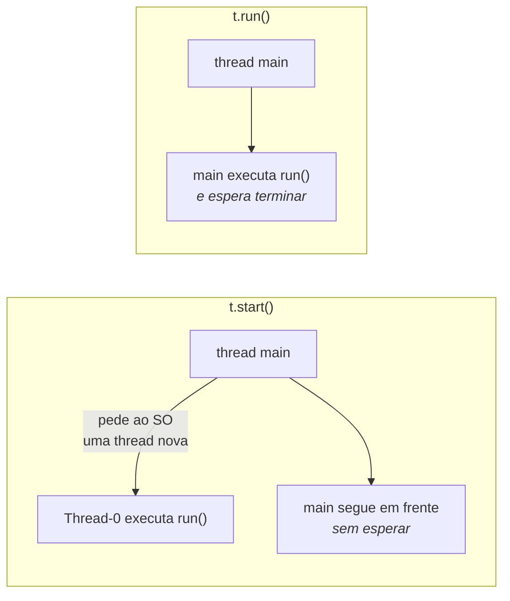
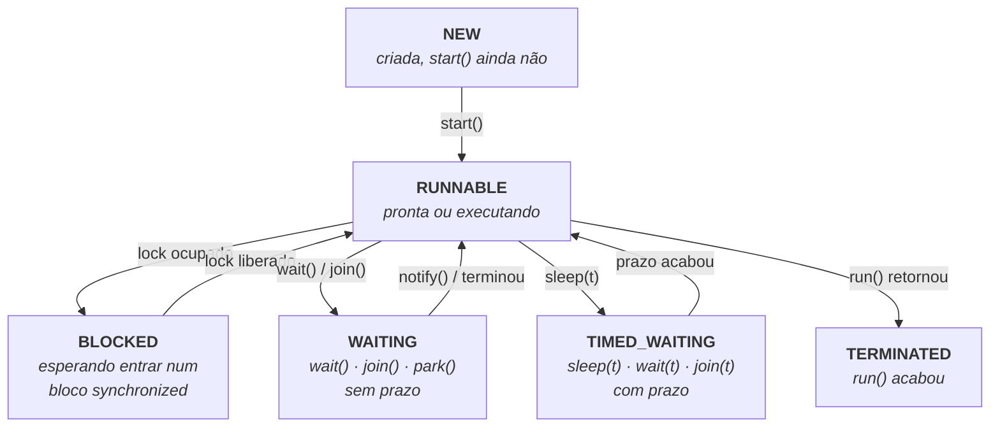

# I - CRIANDO E CONTROLANDO THREADS

> [← Voltar para THREADS E CONCORRÊNCIA](README.md) · Próximo: [II - COMPARTILHANDO MEMÓRIA](ii-compartilhando-memoria.md)

## 1. As três formas de criar uma thread

### a) Implementando `Runnable` — a forma recomendada

```java
public class Tarefa implements Runnable {
    @Override
    public void run() {                       // o corpo da tarefa
        System.out.println("rodando em " + Thread.currentThread().getName());
    }
}

// em algum lugar:
Thread t = new Thread(new Tarefa());
t.start();
```

### b) Com lambda — o mesmo, mais curto

`Runnable` é uma interface funcional (um método só), então cabe em lambda:

```java
Thread t = new Thread(() -> System.out.println("rodando"));
t.start();
```

### c) Estendendo `Thread` — evite

```java
public class MinhaThread extends Thread {
    @Override
    public void run() { System.out.println("rodando"); }
}

new MinhaThread().start();
```

**Por que evitar:** Java não tem herança múltipla. Ao estender `Thread`, a sua classe **gasta a única herança** que tinha e fica presa a ser uma thread — em vez de ser uma tarefa que *pode* rodar em uma. Com `Runnable`, você separa **o que fazer** (a tarefa) de **como executar** (a thread, ou um pool). → [herança × composição](../poo/conceitos-de-poo.md#herança--composição--o-mesmo-problema-dos-dois-jeitos)

| | `implements Runnable` | `extends Thread` |
|---|---|---|
| Herança | fica livre para outra classe | **gasta** a herança |
| Separa tarefa de execução | **sim** | não |
| Serve para `ExecutorService` | **sim** | não diretamente |
| Recomendação | ✅ use esta | ❌ só em exemplo de livro |

---

## 2. `Runnable` × `Callable`

| | `Runnable` | `Callable<T>` |
|---|---|---|
| Método | `void run()` | `T call()` |
| Devolve valor | **não** | **sim** |
| Lança checked exception | **não pode** | **pode** |
| Usado com | `new Thread(...)`, executores | **só** executores → [III](iii-java-util-concurrent.md#2-callable-e-future-quando-a-tarefa-devolve-algo) |

```java
Callable<Integer> soma = () -> 2 + 2;    // devolve 4 — mas precisa de um executor
```

---

## 3. `start()` × `run()` — a pegadinha número um

```java
Thread t = new Thread(() -> System.out.println(Thread.currentThread().getName()));

t.start();   // imprime "Thread-0"  → criou uma thread nova
t.run();     // imprime "main"      → NÃO criou nada: é chamada de método comum
```



| | `start()` | `run()` |
|---|---|---|
| Cria thread nova | **sim** | **não** |
| Quem executa o corpo | a thread nova | **quem chamou** |
| Bloqueia quem chamou | não | **sim** |
| Pode chamar duas vezes | ❌ `IllegalThreadStateException` | sim, é método comum |

> ⚠️ **Chamar `start()` duas vezes na mesma instância lança `IllegalThreadStateException`.** Uma thread não é reutilizável: depois de terminar, acabou. Para reaproveitar, use um **pool** → [III](iii-java-util-concurrent.md#1-executorservice-pare-de-criar-thread-na-mão).

---

## 4. Os métodos essenciais

### `sleep(ms)` — dormir

```java
try {
    Thread.sleep(2000);                      // 2 segundos
} catch (InterruptedException e) {
    Thread.currentThread().interrupt();      // restaura o sinal! (ver seção 6)
}
```

- É **estático**: sempre dorme a thread **atual**, mesmo que você escreva `outraThread.sleep(100)` (erro comum).
- **Não solta lock nenhum.** Se a thread está dentro de um `synchronized`, ela continua segurando o monitor enquanto dorme — diferente de `wait()`. → [II](ii-compartilhando-memoria.md#7-waitnotify--conversa-entre-threads)
- O tempo é **mínimo garantido**, não exato: a thread acorda *pelo menos* depois daquilo.

### `join()` — esperar terminar

```java
Thread t1 = new Thread(() -> processar("A"));
Thread t2 = new Thread(() -> processar("B"));

t1.start();
t2.start();

t1.join();                      // main espera t1 acabar
t2.join();                      // e depois t2
System.out.println("os dois terminaram");
```

Sem os `join()`, a última linha imprimiria **antes** do trabalho terminar. Variações: `join(1000)` espera no máximo 1 segundo.

### `isAlive()` — ainda está viva?

```java
t.start();
System.out.println(t.isAlive());   // true (provavelmente)
t.join();
System.out.println(t.isAlive());   // false
```

### `setDaemon(true)` — thread de serviço

```java
Thread relogio = new Thread(() -> { while (true) { atualizar(); } });
relogio.setDaemon(true);     // precisa ser ANTES do start()
relogio.start();
```

| | Thread normal (*user*) | Thread **daemon** |
|---|---|---|
| Impede a JVM de encerrar | **sim** | **não** |
| Quando a main acaba | a JVM espera | a JVM **mata** a daemon no meio |
| Serve para | o trabalho principal | tarefas de fundo: limpeza, monitor, *heartbeat* |

> A JVM encerra quando **não resta nenhuma thread não-daemon**. Por isso um programa pode "travar" sem acabar: alguma thread não-daemon continua viva — o caso clássico é um `ExecutorService` sem `shutdown()`.

### `setPriority(n)` e `yield()` — dicas, não ordens

```java
t.setPriority(Thread.MAX_PRIORITY);    // 10; MIN = 1, NORM = 5
Thread.yield();                        // "posso ceder a vez"
```

Ambos são **sugestões ao escalonador**, que pode ignorá-las. O comportamento muda entre sistemas operacionais. **Nunca** escreva lógica que dependa de prioridade para estar correta.

---

## 5. O ciclo de vida: os seis estados

`Thread.State` tem exatamente seis valores — e eles caem em prova:



| Estado | Quando acontece |
|---|---|
| `NEW` | objeto criado, `start()` ainda não chamado |
| `RUNNABLE` | está executando **ou** pronta esperando o processador — o Java não distingue os dois |
| `BLOCKED` | parada na porta de um `synchronized` que outra thread segura |
| `WAITING` | parada **sem prazo**: `wait()`, `join()` sem tempo |
| `TIMED_WAITING` | parada **com prazo**: `sleep(t)`, `wait(t)`, `join(t)` |
| `TERMINATED` | o `run()` retornou (normalmente ou por exceção) |

> **A distinção que pega:** `BLOCKED` é só para o **lock intrínseco** (`synchronized`). Esperar por um `ReentrantLock` aparece como `WAITING`, porque é implementado com `LockSupport.park()`. E `RUNNABLE` **não** significa "executando agora" — significa "apta a executar".

---

## 6. Interrupção: como se pede para uma thread parar

Java **não tem** como matar uma thread à força. `Thread.stop()` existe mas é **depreciado e perigoso** (deixa objetos pela metade). O mecanismo correto é **cooperativo**: você pede, a thread decide.

```java
Thread trabalhador = new Thread(() -> {
    while (!Thread.currentThread().isInterrupted()) {   // 1. verifica o sinal
        processarUmItem();
        try {
            Thread.sleep(100);
        } catch (InterruptedException e) {
            Thread.currentThread().interrupt();          // 2. RESTAURA o sinal
            break;                                       // 3. e sai
        }
    }
    System.out.println("encerrando com calma");
});

trabalhador.start();
Thread.sleep(1000);
trabalhador.interrupt();     // pede para parar
```

Como funciona: cada thread tem uma **flag de interrupção**.

| Método | O que faz |
|---|---|
| `t.interrupt()` | **liga** a flag de `t`. Se `t` estiver em `sleep`/`wait`/`join`, ela acorda com `InterruptedException` |
| `t.isInterrupted()` | lê a flag, **sem limpar** |
| `Thread.interrupted()` | lê a flag da thread atual **e limpa** (estático — cuidado) |

> ⚠️ **A armadilha clássica:** quando `sleep()`, `wait()` ou `join()` lançam `InterruptedException`, elas **limpam a flag**. Se você só escrever `catch (InterruptedException e) { }`, o pedido de parada **desaparece** e ninguém mais acima fica sabendo. Por isso a regra: **ou propague a exceção, ou chame `Thread.currentThread().interrupt()` para restaurar o sinal.** Engolir a `InterruptedException` em silêncio é um dos erros mais comuns em código Java concorrente.

---

## 7. Exceções em threads

Uma exceção não tratada **não** sobe para a thread que criou — ela morre ali:

```java
Thread t = new Thread(() -> { throw new RuntimeException("estourei"); });
t.start();
// a main NÃO vê essa exceção; a thread apenas termina
```

Para capturar:

```java
t.setUncaughtExceptionHandler((thread, erro) ->
    System.err.println("thread " + thread.getName() + " morreu: " + erro.getMessage()));
```

Com `ExecutorService`, o comportamento é outro: a exceção fica **guardada no `Future`** e só aparece quando você chama `get()`. → [III](iii-java-util-concurrent.md#2-callable-e-future-quando-a-tarefa-devolve-algo)

---

## 8. Exemplo completo

```java
public class Exemplo {
    public static void main(String[] args) throws InterruptedException {
        Runnable tarefa = () -> {
            String nome = Thread.currentThread().getName();
            for (int i = 1; i <= 3; i++) {
                System.out.println(nome + " — passo " + i);
                try {
                    Thread.sleep(100);
                } catch (InterruptedException e) {
                    Thread.currentThread().interrupt();
                    return;
                }
            }
        };

        Thread a = new Thread(tarefa, "alfa");
        Thread b = new Thread(tarefa, "beta");

        System.out.println(a.getState());    // NEW

        a.start();
        b.start();
        System.out.println(a.getState());    // RUNNABLE (ou TIMED_WAITING)

        a.join();
        b.join();

        System.out.println(a.getState());    // TERMINATED
        System.out.println("fim");
    }
}
```

A saída **intercala** alfa e beta em ordem imprevisível — mas `"fim"` vem sempre por último, porque os `join()` garantem isso.

---

## Perguntas para autoavaliação

1. Quais são as três formas de criar uma thread? Qual é a recomendada e por quê?
2. Por que estender `Thread` é pior que implementar `Runnable`?
3. Diferencie `Runnable` e `Callable` em três critérios.
4. O que `t.start()` faz que `t.run()` não faz?
5. O que acontece ao chamar `start()` duas vezes na mesma thread?
6. `Thread.sleep()` solta o lock? E `wait()`?
7. Por que `sleep()` ser estático confunde as pessoas?
8. Para que serve `join()`? O que muda no programa sem ele?
9. O que é uma thread daemon, e quando a JVM encerra?
10. Por que `setPriority()` e `yield()` não servem para garantir correção?
11. Cite os seis estados de `Thread.State` e quando cada um acontece.
12. Qual a diferença entre `BLOCKED` e `WAITING`?
13. `RUNNABLE` significa "executando agora"? Explique.
14. Por que `Thread.stop()` foi depreciado? Qual é o mecanismo correto?
15. O que `interrupt()` faz de fato?
16. Diferencie `isInterrupted()` e `Thread.interrupted()`.
17. Por que engolir uma `InterruptedException` é um erro grave? O que fazer no lugar?
18. O que acontece com uma exceção não tratada dentro de uma thread?

---

> [← Voltar para THREADS E CONCORRÊNCIA](README.md) · Próximo: [II - COMPARTILHANDO MEMÓRIA](ii-compartilhando-memoria.md)
