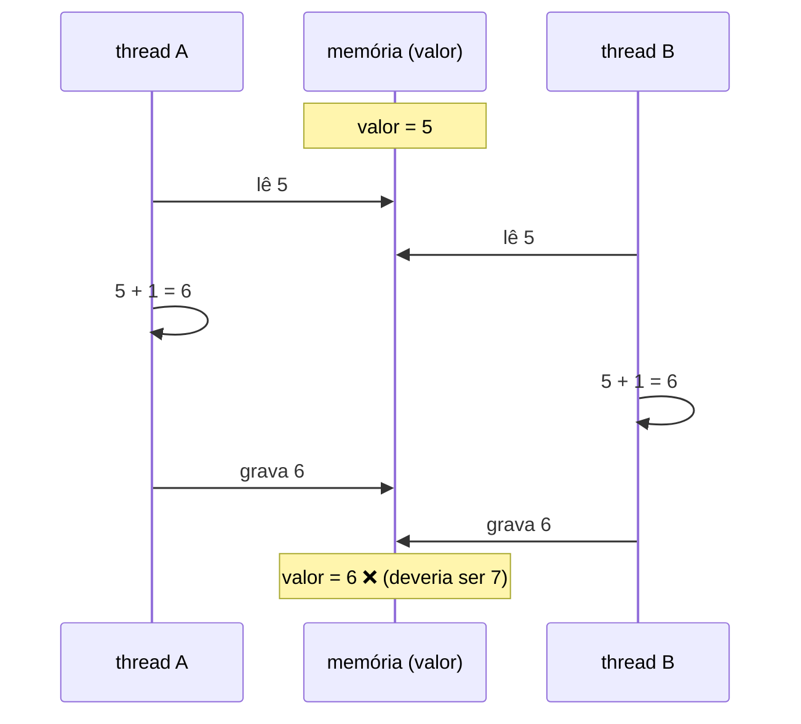
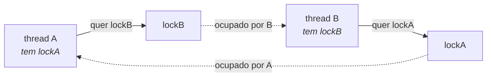
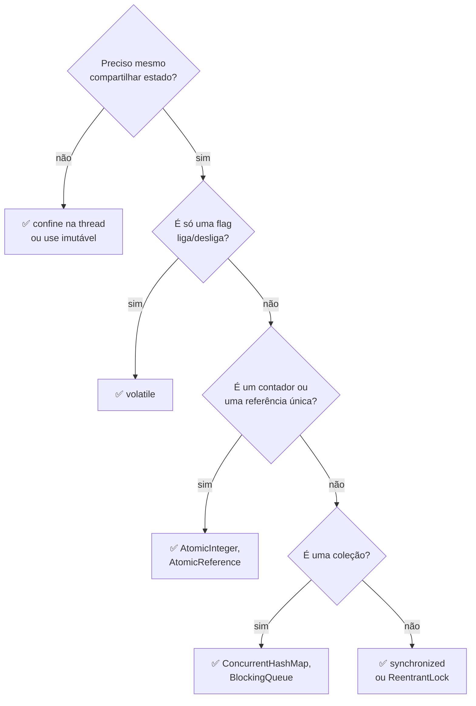

# II - COMPARTILHANDO MEMÓRIA

> [← Voltar para THREADS E CONCORRÊNCIA](README.md) · Anterior: [I - CRIANDO E CONTROLANDO THREADS](i-criando-e-controlando-threads.md) · Próximo: [III - JAVA.UTIL.CONCURRENT](iii-java-util-concurrent.md)

Este é o capítulo que importa. Criar thread é fácil; o difícil é duas threads mexerem no mesmo dado sem corromper tudo.

## 1. A race condition, passo a passo

```java
public class Contador {
    private int valor = 0;
    public void incrementar() { valor++; }      // ← parece uma operação. São três.
    public int getValor() { return valor; }
}
```

```java
Contador c = new Contador();
Runnable tarefa = () -> { for (int i = 0; i < 10_000; i++) c.incrementar(); };

Thread t1 = new Thread(tarefa), t2 = new Thread(tarefa);
t1.start(); t2.start();
t1.join();  t2.join();

System.out.println(c.getValor());    // esperado 20000 — sai 13847, 17236, 19998…
```

**Por que dá errado:** `valor++` não é uma instrução. São três:

```
1. LER   o valor da memória
2. SOMAR 1
3. GRAVAR de volta
```

Se as duas threads se intercalam entre o passo 1 e o 3:



<!--animacao: race-condition-->

> **Race condition:** o resultado depende da **ordem** em que as threads chegam — e essa ordem muda a cada execução. É o bug que passa em mil testes e quebra uma vez em produção.

---

## 2. Os dois problemas por trás: atomicidade e visibilidade

| Problema | O que falta | Sintoma |
|---|---|---|
| **Atomicidade** | a operação pode ser **interrompida no meio** | o `valor++` acima: somas se perdem |
| **Visibilidade** | cada núcleo tem **cache próprio**; o que A escreveu pode não chegar a B | um `while (!parar)` que roda para sempre |

O caso de visibilidade, que surpreende quem vê pela primeira vez:

```java
public class Servico {
    private boolean parar = false;        // sem volatile

    public void rodar() {
        while (!parar) { /* trabalha */ }     // pode NUNCA terminar
    }
    public void pedirParada() { parar = true; }
}
```

A thread que roda o laço pode ter copiado `parar` para o cache do seu núcleo e **nunca reler da memória principal**. Do ponto de vista dela, `parar` continua `false` para sempre. O compilador ainda pode otimizar o laço assumindo que `parar` não muda.

> 🔑 Guardar isso: **atomicidade** é sobre a operação não ser partida ao meio. **Visibilidade** é sobre a alteração de uma thread **chegar** às outras. São problemas diferentes e exigem ferramentas diferentes.

---

## 3. `synchronized` — a solução mais direta

`synchronized` resolve **os dois** problemas de uma vez: garante que só uma thread entra por vez (atomicidade) **e** que o que foi escrito dentro fica visível para quem entrar depois (visibilidade).

```java
public class Contador {
    private int valor = 0;

    public synchronized void incrementar() { valor++; }     // agora é seguro
    public synchronized int getValor() { return valor; }    // o getter TAMBÉM precisa
}
```

> ⚠️ Sincronizar só a escrita e esquecer a leitura é erro comum: sem `synchronized` no `getValor()`, a leitura pode enxergar um valor velho.

### Como funciona: o monitor

Todo objeto em Java tem um **lock intrínseco** (ou *monitor*). Entrar num `synchronized` é **pegar** esse lock; sair é soltá-lo. Quem chega e encontra o lock ocupado fica em `BLOCKED` até liberar.

### As três formas

```java
// 1. método de instância → o lock é o OBJETO (this)
public synchronized void a() { }

// 2. bloco → você escolhe em qual objeto travar
public void b() {
    synchronized (this) { }           // mesmo lock do caso 1
    synchronized (meuLock) { }        // um lock dedicado
}

// 3. método estático → o lock é a CLASSE (Contador.class)
public static synchronized void c() { }
```

| Forma | Lock usado | Protege |
|---|---|---|
| `synchronized` em método de instância | **o objeto** (`this`) | os outros métodos sincronizados **da mesma instância** |
| `synchronized (obj) { }` | **o objeto `obj`** | quem sincronizar no mesmo `obj` |
| `synchronized` em método estático | **o objeto `Classe.class`** | os outros estáticos sincronizados da classe |

> ⚠️ **A pegadinha:** um método de instância sincronizado e um método estático sincronizado da mesma classe usam **locks diferentes** e, portanto, **não excluem um ao outro**. Da mesma forma, dois objetos distintos têm locks distintos: sincronizar não protege nada se as threads mexem em instâncias diferentes.

### Bloco em vez de método: segure o lock pelo menor tempo possível

```java
public void processar(Pedido p) {
    var resultado = calcularCaro(p);          // fora do lock — não toca estado compartilhado
    synchronized (this) {
        total += resultado;                    // só a parte crítica dentro
    }
}
```

### O lock é reentrante

A mesma thread pode pegar o lock que já tem, sem travar a si mesma:

```java
public synchronized void a() { b(); }      // ok: a thread já tem o lock
public synchronized void b() { }
```

---

## 4. `volatile` — só visibilidade

```java
private volatile boolean parar = false;     // agora o laço da seção 2 termina
```

`volatile` garante que:
- toda **leitura** vem da memória principal, não do cache;
- toda **escrita** vai direto para a memória principal;
- o compilador não reordena instruções em volta dela.

E **não** garante atomicidade:

```java
private volatile int valor;
public void incrementar() { valor++; }      // ❌ CONTINUA quebrado
```

`valor++` segue sendo ler-somar-gravar. `volatile` só assegura que cada leitura e cada escrita isoladas são frescas — não que as três aconteçam sem interrupção.

| | `volatile` | `synchronized` |
|---|---|---|
| Visibilidade | ✅ | ✅ |
| Atomicidade | ❌ | ✅ |
| Bloqueia a thread | nunca | sim, pode esperar |
| Custo | baixo | maior |
| Use para | **flags** e valores lidos/escritos isoladamente | **blocos** de operações sobre estado compartilhado |

> **Regra prática:** `volatile` serve para um `boolean parar`. Para contador, use `AtomicInteger`; para um bloco de lógica, use `synchronized` ou um `Lock`. → [III](iii-java-util-concurrent.md#4-classes-atômicas-contador-sem-lock)

---

## 5. Por que `String` e os imutáveis são seguros

```java
record Pedido(long id, BigDecimal total) { }     // imutável: ninguém altera depois de criado
```

Um objeto **imutável** não tem como ser corrompido por concorrência: se ninguém escreve, não há race. É por isso que `String`, `Integer`, `LocalDate` e os `record` com campos finais podem ser compartilhados à vontade.

> **A melhor estratégia de concorrência é não precisar de sincronização.** Imutabilidade e dados confinados a uma thread resolvem antes de o problema existir. → [imutabilidade](../poo/conceitos-de-poo.md#imutabilidade-e-value-objects)

---

## 6. As coleções: `HashMap` é uma bomba

```java
Map<String, Integer> mapa = new HashMap<>();     // ❌ em ambiente concorrente
```

Dois `put()` simultâneos num `HashMap` podem corromper a estrutura interna — em versões antigas do Java, isso chegava a causar **laço infinito** com 100% de CPU. As alternativas:

| Opção | Comentário |
|---|---|
| `ConcurrentHashMap` | ✅ a escolha certa; trava só partes do mapa, não o todo |
| `Collections.synchronizedMap(m)` | trava o **mapa inteiro** a cada operação: correto, porém lento |
| `Hashtable` | legado; sincroniza tudo, não use em código novo |

→ Detalhes e as outras coleções concorrentes no [capítulo III](iii-java-util-concurrent.md#5-coleções-concorrentes).

---

## 7. `wait`/`notify` — conversa entre threads

Quando uma thread precisa **esperar uma condição** que outra vai produzir:

```java
public class Caixa {
    private final Queue<String> fila = new LinkedList<>();

    public synchronized void colocar(String item) {
        fila.add(item);
        notifyAll();                       // acorda quem espera
    }

    public synchronized String tirar() throws InterruptedException {
        while (fila.isEmpty()) {           // ⚠️ while, NUNCA if
            wait();                        // solta o lock e dorme
        }
        return fila.poll();
    }
}
```

| Método | O que faz |
|---|---|
| `wait()` | **solta o lock** e dorme até alguém notificar |
| `notify()` | acorda **uma** thread esperando (você não escolhe qual) |
| `notifyAll()` | acorda **todas** — mais seguro, prefira |

Três regras que caem em prova:

1. **Só dentro de `synchronized`** no mesmo objeto — senão é `IllegalMonitorStateException`.
2. **Sempre `while`, nunca `if`**: existe *spurious wakeup* (a thread pode acordar sem ninguém ter notificado), e entre o `notify` e a retomada do lock outra thread pode ter consumido o item. Reavaliar a condição é obrigatório.
3. **`wait()` solta o lock; `sleep()` não.** Essa é a comparação mais cobrada da matéria.

| | `sleep(t)` | `wait()` |
|---|---|---|
| De onde vem | `Thread` (estático) | `Object` |
| Solta o lock | ❌ **não** | ✅ **sim** |
| Acorda com | o tempo acabando | `notify()`/`notifyAll()` (ou tempo, em `wait(t)`) |
| Precisa de `synchronized` | não | **sim** |

> Na prática, hoje você raramente escreve `wait`/`notify`: usa `BlockingQueue`, que já resolve o padrão produtor-consumidor. Mas cai em prova porque é o mecanismo embaixo. → [III](iii-java-util-concurrent.md#5-coleções-concorrentes)

---

## 8. Deadlock — o impasse

```java
// thread A
synchronized (lockA) {
    synchronized (lockB) { }      // espera B
}

// thread B
synchronized (lockB) {
    synchronized (lockA) { }      // espera A
}
```



As **quatro condições de Coffman** — todas precisam valer ao mesmo tempo:

| Condição | O que significa |
|---|---|
| **Exclusão mútua** | o recurso só pode ser usado por um por vez |
| **Posse e espera** | quem já tem um recurso pede outro sem soltar o primeiro |
| **Não preempção** | ninguém toma o recurso à força |
| **Espera circular** | A espera B, que espera A (um ciclo) |

**Como evitar, em ordem de eficácia:**

1. **Ordem global de locks** — se todos pegarem sempre na mesma ordem (ex.: por `id` crescente), não há ciclo. É a solução mais usada.
2. **Não segure um lock enquanto chama código de fora** — nunca invoque um método desconhecido dentro de um `synchronized`.
3. **Use `tryLock(tempo)`** do `ReentrantLock`: desiste em vez de esperar para sempre → [III](iii-java-util-concurrent.md#6-reentrantlock-o-lock-explícito).
4. **Reduza o número de locks** — o melhor lock é o que não existe.

**Primos do deadlock:**

| Nome | O que é |
|---|---|
| **Livelock** | as threads não travam, mas ficam reagindo uma à outra sem progredir (dois se desviando no corredor, para sempre) |
| **Starvation** (inanição) | uma thread nunca consegue a vez porque outras sempre passam na frente |

> **Como diagnosticar na prática:** tire um *thread dump* (`jcmd <pid> Thread.print`). A JVM detecta e escreve literalmente `Found one Java-level deadlock`, nomeando as duas threads e os locks. → [JVM - diagnóstico](../jvm-e-plataforma-java/iii-subir-e-operar-em-producao.md#7-diagnóstico-os-quatro-incidentes-clássicos)

---

## 9. O resumo da decisão



---

## Perguntas para autoavaliação

1. Por que `valor++` não é atômico? Quais são as três operações?
2. Desenhe a intercalação de duas threads que faz duas somas virarem uma.
3. O que é uma race condition, e por que ela é difícil de testar?
4. Diferencie atomicidade e visibilidade. Dê um sintoma de cada.
5. Por que um `while (!parar)` pode nunca terminar sem `volatile`?
6. Quais dos dois problemas o `synchronized` resolve?
7. Por que o *getter* também precisa ser sincronizado?
8. O que é o lock intrínseco (monitor)?
9. Quais são as três formas de usar `synchronized` e qual lock cada uma usa?
10. Um método de instância sincronizado exclui um método estático sincronizado da mesma classe? Por quê?
11. O que significa o lock ser reentrante?
12. O que `volatile` garante e o que **não** garante?
13. Quando usar `volatile` e quando usar `synchronized`?
14. Por que objetos imutáveis são seguros em concorrência?
15. O que pode acontecer ao usar `HashMap` concorrentemente? Quais as alternativas?
16. Compare `sleep()` e `wait()` em quatro critérios.
17. Por que `wait()` deve estar sempre dentro de um `while`?
18. Qual a diferença entre `notify()` e `notifyAll()`, e qual preferir?
19. O que acontece ao chamar `wait()` fora de um `synchronized`?
20. O que é deadlock? Cite as quatro condições de Coffman.
21. Cite quatro formas de evitar deadlock, da mais eficaz à menos.
22. Diferencie deadlock, livelock e starvation.
23. Como descobrir um deadlock numa aplicação em produção?

---

> [← Voltar para THREADS E CONCORRÊNCIA](README.md) · Anterior: [I - CRIANDO E CONTROLANDO THREADS](i-criando-e-controlando-threads.md) · Próximo: [III - JAVA.UTIL.CONCURRENT](iii-java-util-concurrent.md)
